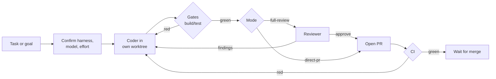

# Cuesura

**English** · [Tiếng Việt](README.vi.md)

> Every call has a cue. Every pause has a purpose.

Cuesura is a **deterministic, event-driven workflow engine for AI coding agents**. You give it a task or a
whole feature, and it drives Claude Code and Codex CLI from the request to a green pull request: code, gates,
review, fixes, PR, CI. A plain state machine decides every step. Models are called only for the work itself, or
when a decision needs judgment.

The name joins **Cue** (the signal to start) and **Caesura** (a deliberate pause in music or verse). When no
agent is running, the system still knows why it is waiting (CI, a person, a quota) and what lets it continue.

The CLI is `cusr` and the daemon is `cusrd`.

## Why

Coding agents are good at writing code and bad at being an orchestrator that runs overnight: a long session
grows its context, forgets earlier decisions, repeats side effects after a crash, and loops between a reviewer
and a fixer. Cuesura moves those concerns into code:

- **No primary AI running all the time.** Orchestration is a pure state machine, so routine transitions cost
  zero tokens.
- **One-shot agent calls per step.** Each step runs a headless Claude Code or Codex session in the task's own
  git worktree. Fixes for gates, review and CI resume the coder's session instead of starting over.
- **Durable state in SQLite.** An append-only event log, an outbox with idempotency keys, and crash recovery
  that never repeats a side effect: no duplicate PR, push or comment after a restart.
- **Guarantees owned by code, not by the model.** A PR is never opened before the gates pass, review loops have
  caps, every decision is recorded with its reason, and agents never merge.

## How a task flows



When a task gets stuck (every retry used, a reviewer and a fixer pushing the same finding back and forth, a
budget or deadline reached, a question about the spec), it goes to a wait. A **deputy** agent can then act for
the owner in a short, bounded turn, and code stops it from repeating an action without new evidence. Otherwise
the owner answers through `cusr inbox`, a Telegram bot or the terminal UI.

## Features

| Feature | Spec |
| --- | --- |
| 001 Deterministic core: engine, event log, outbox, crash recovery | [spec](specs/001-deterministic-core/spec.md) |
| 002 Task to green PR: worktrees, gates, review, PR, CI, manual or rule-based merge | [spec](specs/002-task-to-green-pr/spec.md) |
| 003 Telegram channel for questions and approvals | [spec](specs/003-telegram-channel/spec.md) |
| 004 Terminal UI: task board, details, logs, questions, task form | [spec](specs/004-terminal-tui/spec.md) |
| 006 Account pool: several subscriptions per harness, cooldown when a quota runs out | [spec](specs/006-account-pool/spec.md) |
| 007 Deputy and goals: an agent that decides for the owner at waits, multi-task goals on a goal branch | [spec](specs/007-deputy/spec.md) |

Other parts worth a look:

- **Projects in any language.** Gates, setup commands, log filters and resources are declared per repository in
  `cusr.yaml`, with toolchain presets for Node, Python, Go, Rust and the JVM.
- **Assistant integration.** `cusr --json` lets an external assistant (Claude Code, Codex) submit and drive
  tasks. A [skill](skills/cusr/SKILL.md) teaches it the commands, and a Claude Code hook wakes it when a task
  needs an answer.
- **Morning report.** `cusr report` summarizes, per project, what finished, what waits for you and what the
  deputy decided since a given time.

## Status

Built in about a month (from late October to late November 2026) through about 260 merged pull requests, most of
them written by coding agents under the rules in [AGENTS.md](AGENTS.md). The code base has about 84k lines of
TypeScript and 98k lines of tests (unit, contract, property-based, integration, reliability and smoke).

Feature 002 has run end to end on a sandbox repository with both Claude and Codex, including a daemon restart, red
gates and a manual merge ([acceptance report](specs/002-task-to-green-pr/acceptance-report.md)). The repository
is also developed with Cuesura itself ([dogfooding](docs/dogfooding.md)). Known limits: it runs on Linux only,
it has not had a long soak test, and backup/restore has not been accepted yet.

This is a personal project, not a supported product.

## Documentation

Most design documents (SPEC, feature specs, ADRs, commit messages and issues) are written in Vietnamese, the
working language of the project. Code and code comments are in English.

| Path | Content |
| --- | --- |
| [SPEC.md](SPEC.md) | Overall specification: v1 scope, domain model, workflow, operating contracts |
| [GLOSSARY.md](GLOSSARY.md) | Domain terms |
| [docs/architecture.md](docs/architecture.md) | Build-vs-buy review and survey of other orchestrators |
| [docs/adr/](docs/adr/) | Architecture decision records |
| [specs/](specs/) | Feature specs, plans, contracts and acceptance reports |
| [deploy/README.md](deploy/README.md) | Install and operating guide |
| `src/` | Engine, daemon, CLI, runner, adapters, terminal UI |
| `test/` | Unit, contract, property, integration, reliability, performance and smoke tests |

## Running it

Requirements:

- Linux (Ubuntu, or WSL2 with the repository on the Linux filesystem, not `/mnt/c`). Agents run under
  `systemd`; macOS is not supported.
- Node at the version pinned in `.nvmrc` (24.22.1) and pnpm through Corepack.
- `build-essential` and `python3` to build `better-sqlite3` when no prebuilt binary is available.

```bash
corepack enable
pnpm install --frozen-lockfile
pnpm build
```

Quality checks:

```bash
pnpm typecheck
pnpm lint
pnpm format:check
pnpm test
```

Longer suites run separately: `pnpm test:performance`, `pnpm test:reliability` (prints a seed on failure; pass it
back with `--seed <seed>`), and `pnpm report:invariants` for the invariant report built from the latest runs.

To install the daemon, set up projects and connect an assistant, follow [deploy/README.md](deploy/README.md) and
start from [deploy/config.example.yaml](deploy/config.example.yaml). A typical session:

```bash
cusr init                       # install cusr.yaml, PR template and assistant skill into a repository
cusr doctor --project my-app    # check the host, harnesses and project config
cusr task add ...               # submit a task
cusr inbox                      # answer what is waiting for you
cusr                            # open the terminal UI
```

Stack: Node 24, TypeScript (strict), SQLite (`better-sqlite3`), Zod, Commander, Vitest and fast-check.

## License

[Apache License 2.0](LICENSE).
