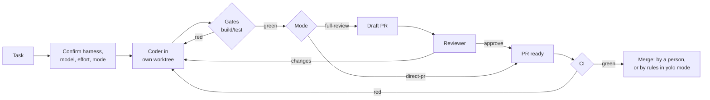

# Cuesura

**English** · [Tiếng Việt](README.vi.md)

> Every call has a cue. Every pause has a purpose.

Cuesura is a **deterministic, event-driven workflow engine for AI coding agents**. You give it a task or a
whole feature, and it drives Claude Code and Codex CLI from the request to a green pull request: code, gates,
review, fixes, PR, CI. A plain state machine decides every step. Models are called only for the work itself, or
when a decision needs judgment.

The name joins **Cue** (the signal to start) and **Caesura** (a deliberate pause in music or verse). When no
agent is running, the system still knows why it is waiting (CI, a person, a quota) and what lets it continue.

The CLI is `cusr` and the daemon is `cusrd`.

## Why

Coding agents are good at writing code and bad at being an orchestrator that runs overnight: a long session
grows its context, forgets earlier decisions, repeats side effects after a crash, and loops between a reviewer
and a fixer. Cuesura moves those concerns into code:

- **No primary AI running all the time.** Orchestration is a pure state machine, so routine transitions cost
  zero tokens.
- **Short agent runs per step.** Each step runs a headless Claude Code or Codex session in the task's own
  git worktree. A fix for gates, review or CI resumes the earlier session when a compatible one exists, so it
  does not start over.
- **Durable state in SQLite.** An append-only event log and an outbox with durable idempotency keys. After a
  crash, the daemon checks the real state of uncertain Git and GitHub writes before it retries them, so a
  restart does not open a second PR or push twice.
- **Guarantees owned by code, not by the model.** Work goes to review and CI only after the required gates pass
  (or a person waives them), review loops have caps, every decision is recorded with its reason, and agents
  never merge.

## How a task flows



In `full-review` mode each review is posted on the draft PR, and the PR turns ready only after an approval.
`direct-pr` skips the reviewer. When a task runs out of ways forward, it fails with its reason; if its work
is not published yet, Cuesura can open it as a draft PR for a person to look at. A goal (a feature split into
several tasks) has its own plan confirmation, and its task PRs merge into a goal branch.

When a task gets stuck (every retry used, a reviewer and a fixer pushing the same finding back and forth, a
budget or deadline reached, a question about the spec), it goes to a wait. A **deputy** agent can then act for
the owner in a bounded turn (headless, or interactive in an assistant session), and code stops it from repeating
an action without new evidence. Otherwise the owner sees what waits with `cusr inbox` and replies with
`cusr answer`, or in the terminal UI.

## Features

| Feature | State | Spec |
| --- | --- | --- |
| 001 Deterministic core: engine, event log, outbox, crash recovery | Built | [spec](specs/001-deterministic-core/spec.md) |
| 002 Task to green PR: worktrees, gates, review, PR, CI, manual or rule-based merge | Built, accepted | [spec](specs/002-task-to-green-pr/spec.md) |
| 004 Terminal UI: task board, details, logs, questions, task form | Built | [spec](specs/004-terminal-tui/spec.md) |
| 007 Deputy and goals: an agent that decides for the owner at waits, multi-task goals on a goal branch | Built | [spec](specs/007-deputy/spec.md) |
| 003 Telegram channel for questions and approvals | Spec only | [spec](specs/003-telegram-channel/spec.md) |
| 006 Account pool: several subscriptions per harness, switching when a quota runs out | Spec only | [spec](specs/006-account-pool/spec.md) |

When a harness reports a rate limit, the task waits for the reset time instead of failing.

Other parts worth a look:

- **Projects in any language.** Gates, setup commands, log filters and resources are declared per repository in
  `cusr.yaml`; nothing in the engine is tied to one toolchain.
- **Assistant integration.** `cusr --json` lets an external assistant (Claude Code, Codex) submit and drive
  tasks. A [skill](skills/cusr/SKILL.md) teaches it the commands, and a Claude Code hook wakes it when a task
  needs an answer.
- **Morning report.** `cusr report` summarizes, per project, what finished, what waits for you and what the
  deputy decided since a given time.

## Status

Built in about a month (from late October to late November 2026) through about 260 merged pull requests, most of
them written by coding agents under the rules in [AGENTS.md](AGENTS.md). The code base has about 90k lines of
TypeScript in `src/` and over 100k lines of tests in `test/` (unit, contract, property-based, integration,
reliability and smoke), counting blank lines and comments.

Feature 002 has run end to end on two sandbox repositories, one Node and one Python, with Claude and Codex
taking turns as coder and reviewer, including daemon kills, red gates and manual merges
([final acceptance](specs/002-task-to-green-pr/acceptance-report.md#nghiệm-thu-cuối-feature-002-t131t134)). The repository
is also developed with Cuesura itself ([dogfooding](docs/dogfooding.md)). Known limits: it runs on Linux only,
it has not had a long soak test, and backup/restore has not been accepted yet.

This is a personal project, not a supported product.

## Documentation

Most design documents (SPEC, feature specs, ADRs, commit messages and issues) are written in Vietnamese, the
working language of the project. Code and code comments are in English.

| Path | Content |
| --- | --- |
| [SPEC.md](SPEC.md) | Overall specification: v1 scope, domain model, workflow, operating contracts |
| [GLOSSARY.md](GLOSSARY.md) | Domain terms |
| [docs/architecture.md](docs/architecture.md) | Build-vs-buy review and survey of other orchestrators |
| [docs/adr/](docs/adr/) | Architecture decision records |
| [specs/](specs/) | Feature specs, plans, contracts and acceptance reports |
| [deploy/README.md](deploy/README.md) | Install and operating guide |
| `src/` | Engine, daemon, CLI, runner, adapters, terminal UI |
| `test/` | Unit, contract, property, integration, reliability, performance and smoke tests |

## Running it

Requirements:

- Linux (Ubuntu, or WSL2 with the repository on the Linux filesystem, not `/mnt/c`). Agents run under
  `systemd`; macOS is not supported.
- Node at the version pinned in `.nvmrc` (24.22.1) and pnpm through Corepack.
- `build-essential` and `python3` to build `better-sqlite3` when no prebuilt binary is available.
- To run real tasks: Git, an authenticated `gh`, a systemd user manager, and Claude Code or Codex CLI logged in.

```bash
corepack enable
pnpm install --frozen-lockfile
pnpm build
```

Quality checks:

```bash
pnpm typecheck
pnpm lint
pnpm format:check
pnpm test
```

Longer suites run separately: `pnpm test:performance`, `pnpm test:reliability` (prints a seed on failure; pass it
back with `--seed <seed>`), and `pnpm report:invariants` for the invariant report built from the latest runs.

`pnpm build` writes the `cusr`, `cusrd` and `cusr-runner` entry points to `dist/cli/`. Run them with
`node dist/cli/cusr.js` and so on, or put small wrapper scripts named `cusr`, `cusrd` and `cusr-runner` on your
`PATH`. To install the daemon, set up projects and connect an assistant, follow
[deploy/README.md](deploy/README.md) and start from [deploy/config.example.yaml](deploy/config.example.yaml).
A typical session:

```bash
cusrd --config ~/.cusr/config.yaml --data-dir ~/.cusr   # start the daemon (or run it as a systemd service)
cusr init                       # install cusr.yaml, PR template and assistant skill into a repository
cusr doctor --project my-app    # check the host, harnesses and project config
cusr task add ...               # submit a task
cusr inbox                      # see what is waiting for you
cusr answer ...                 # reply to a question
cusr                            # open the terminal UI
```

Stack: Node 24, TypeScript (strict), SQLite (`better-sqlite3`), Zod, Commander, Vitest and fast-check.

## License

[Apache License 2.0](LICENSE). Vendored third-party files keep their own licenses; see [NOTICE](NOTICE).
