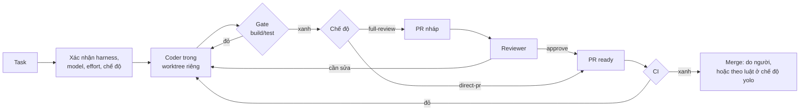

# Cuesura

[English](README.md) · **Tiếng Việt**

> Every call has a cue. Every pause has a purpose.
>
> Mỗi lần gọi đều có tín hiệu. Mỗi khoảng lặng đều có lý do.

Cuesura là một **workflow engine tất định, hướng sự kiện, dành cho AI coding agent**. Bạn giao một task hoặc cả
một feature, Cuesura điều khiển Claude Code và Codex CLI đi từ yêu cầu tới pull request xanh: code, gate, review,
sửa lỗi, PR, CI. Một state machine thuần quyết định mọi bước. Model chỉ được gọi để làm việc, hoặc khi cần phán
đoán.

Tên ghép từ **Cue** (tín hiệu bắt đầu) và **Caesura** (khoảng ngắt có chủ đích trong âm nhạc hoặc thơ). Khi không
có agent nào chạy, hệ thống vẫn biết vì sao nó đang chờ (CI, một người, hạn mức) và điều gì cho phép nó đi tiếp.

CLI là `cusr`, daemon là `cusrd`.

## Vì sao

Coding agent viết code giỏi nhưng làm người điều phối chạy qua đêm thì kém: phiên dài làm context phình to, quên
quyết định cũ, lặp lại side effect sau crash, và đẩy qua đẩy lại giữa reviewer với fixer. Cuesura chuyển những
việc đó vào code:

- **Không có AI chính chạy liên tục.** Việc điều phối là một state machine thuần, nên các bước chuyển thông
  thường tốn 0 token.
- **Mỗi bước là một lượt agent ngắn.** Mỗi bước chạy một phiên Claude Code hoặc Codex headless trong git worktree
  riêng của task. Lượt sửa gate, review hay CI resume phiên trước khi có phiên tương thích, nên không phải làm lại
  từ đầu.
- **Trạng thái bền vững trong SQLite.** Event log chỉ ghi thêm và outbox có idempotency key bền vững. Sau crash,
  daemon kiểm trạng thái thật của các thao tác Git và GitHub chưa chắc chắn trước khi thử lại, nên restart không
  mở PR thứ hai hay push hai lần.
- **Bảo đảm nằm trong code, không phụ thuộc model.** Việc chỉ đi tới review và CI khi gate bắt buộc đã xanh (hoặc
  được người miễn), vòng review có giới hạn, mọi quyết định được ghi kèm lý do, và agent không bao giờ merge.

## Luồng của một task



Ở chế độ `full-review`, mỗi lượt review được đăng lên PR nháp, và PR chỉ chuyển ready sau khi được approve.
`direct-pr` bỏ bước reviewer. Khi task hết đường đi tiếp, nó fail kèm lý do; nếu việc chưa được publish, Cuesura
có thể mở nó thành PR nháp để người xem. Một goal (feature chia thành nhiều task) có bước xác nhận kế hoạch riêng,
và PR của từng task merge vào nhánh goal.

Khi task bị kẹt (dùng hết lượt thử, reviewer và fixer đẩy qua lại cùng một finding, chạm ngân sách hoặc
deadline, có câu hỏi về spec), nó chuyển sang trạng thái chờ. Lúc đó agent **deputy** có thể quyết thay chủ dự
án trong một lượt có giới hạn (headless, hoặc tương tác trong phiên assistant), và code chặn nó lặp lại một hành
động khi không có bằng chứng mới. Nếu không, chủ dự án xem việc đang chờ bằng `cusr inbox` và trả lời bằng
`cusr answer`, hoặc trong giao diện terminal.

## Tính năng

| Feature | Trạng thái | Spec |
| --- | --- | --- |
| 001 Lõi tất định: engine, event log, outbox, khôi phục sau crash | Đã làm | [spec](specs/001-deterministic-core/spec.md) |
| 002 Task tới PR xanh: worktree, gate, review, PR, CI, merge thủ công hoặc theo luật | Đã làm, đã nghiệm thu | [spec](specs/002-task-to-green-pr/spec.md) |
| 004 Giao diện terminal: bảng task, chi tiết, log, câu hỏi, form tạo task | Đã làm | [spec](specs/004-terminal-tui/spec.md) |
| 007 Deputy và goal: agent quyết thay chủ dự án ở điểm chờ, goal nhiều task trên nhánh goal | Đã làm | [spec](specs/007-deputy/spec.md) |
| 003 Kênh Telegram cho câu hỏi và duyệt | Mới có spec | [spec](specs/003-telegram-channel/spec.md) |
| 006 Nhiều tài khoản cho mỗi harness, đổi tài khoản khi hết hạn mức | Mới có spec | [spec](specs/006-account-pool/spec.md) |

Khi harness báo chạm rate limit, task chờ tới giờ reset thay vì fail.

Những phần khác đáng xem:

- **Dùng cho project mọi ngôn ngữ.** Gate, lệnh setup, bộ lọc log và tài nguyên được khai báo theo từng repo trong
  `cusr.yaml`; engine không gắn với toolchain nào.
- **Tích hợp assistant.** `cusr --json` cho assistant bên ngoài (Claude Code, Codex) giao và điều khiển task. Một
  [skill](skills/cusr/SKILL.md) dạy nó các lệnh, và một hook của Claude Code đánh thức nó khi task cần câu trả lời.
- **Báo cáo buổi sáng.** `cusr report` tóm tắt theo từng project việc đã xong, việc đang chờ bạn và những gì
  deputy đã quyết từ một mốc thời gian.

## Trạng thái

Làm trong khoảng một tháng (từ cuối tháng 10 tới cuối tháng 11/2026) qua khoảng 260 pull request đã merge, phần
lớn do coding agent viết theo quy tắc trong [AGENTS.md](AGENTS.md). Code có khoảng 90k dòng TypeScript trong
`src/` và hơn 100k dòng test trong `test/` (unit, contract, property-based, integration, reliability và smoke),
tính cả dòng trống và comment.

Feature 002 đã chạy trọn vẹn trên hai repo sandbox, một Node và một Python, với Claude và Codex đổi vai coder và
reviewer, gồm cả kill daemon, gate đỏ và merge thủ công
([nghiệm thu cuối](specs/002-task-to-green-pr/acceptance-report.md#nghiệm-thu-cuối-feature-002-t131t134)). Chính
repo này cũng được phát triển bằng Cuesura ([dogfooding](docs/dogfooding.md)). Giới hạn đã biết: chỉ chạy trên
Linux, chưa có soak test dài, và backup/restore chưa được nghiệm thu.

Đây là dự án cá nhân, không phải sản phẩm có hỗ trợ.

## Tài liệu

Phần lớn tài liệu thiết kế (SPEC, spec của feature, ADR, commit message và issue cũ) viết bằng tiếng Việt, ngôn ngữ
làm việc của dự án. Code và comment trong code viết bằng tiếng Anh.

| Đường dẫn | Nội dung |
| --- | --- |
| [SPEC.md](SPEC.md) | Đặc tả tổng quan: phạm vi v1, mô hình miền, workflow, hợp đồng vận hành |
| [GLOSSARY.md](GLOSSARY.md) | Thuật ngữ miền |
| [docs/architecture.md](docs/architecture.md) | Đánh giá build-vs-buy và khảo sát các công cụ điều phối khác |
| [docs/adr/](docs/adr/) | Bản ghi quyết định kiến trúc (ADR) |
| [specs/](specs/) | Spec, kế hoạch, hợp đồng và báo cáo nghiệm thu của từng feature |
| [deploy/README.md](deploy/README.md) | Hướng dẫn cài đặt và vận hành |
| `src/` | Engine, daemon, CLI, runner, adapter, giao diện terminal |
| `test/` | Test unit, contract, property, integration, reliability, performance và smoke |

## Chạy thử

Yêu cầu:

- Linux (Ubuntu, hoặc WSL2 với repo nằm trên filesystem Linux, không phải `/mnt/c`). Agent chạy dưới `systemd`;
  không hỗ trợ macOS.
- Node đúng bản pin trong `.nvmrc` (24.22.1) và pnpm qua Corepack.
- `build-essential` và `python3` để build `better-sqlite3` khi không có bản prebuilt.
- Để chạy task thật: Git, `gh` đã đăng nhập, systemd user manager, và Claude Code hoặc Codex CLI đã đăng nhập.

```bash
corepack enable
pnpm install --frozen-lockfile
pnpm build
```

Kiểm tra chất lượng:

```bash
pnpm typecheck
pnpm lint
pnpm format:check
pnpm test
```

Các bộ test dài chạy riêng: `pnpm test:performance`, `pnpm test:reliability` (in seed khi fail; truyền lại bằng
`--seed <seed>` để tái hiện), và `pnpm report:invariants` cho báo cáo bất biến dựng từ các lần chạy gần nhất.

`pnpm build` ghi các entry point `cusr`, `cusrd` và `cusr-runner` vào `dist/cli/`. Chạy chúng bằng
`node dist/cli/cusr.js` và tương tự, hoặc đặt script wrapper nhỏ tên `cusr`, `cusrd` và `cusr-runner` vào
`PATH`. Để cài daemon, cấu hình project và nối assistant, xem [deploy/README.md](deploy/README.md) và bắt đầu từ
[deploy/config.example.yaml](deploy/config.example.yaml). Một phiên làm việc điển hình:

```bash
cusrd --config ~/.cusr/config.yaml --data-dir ~/.cusr   # chạy daemon (hoặc chạy như systemd service)
cusr init                       # cài cusr.yaml, PR template và skill assistant vào repo
cusr doctor --project my-app    # kiểm host, harness và cấu hình project
cusr task add ...               # giao một task
cusr inbox                      # xem việc đang chờ bạn
cusr answer ...                 # trả lời một câu hỏi
cusr                            # mở giao diện terminal
```

Stack: Node 24, TypeScript (strict), SQLite (`better-sqlite3`), Zod, Commander, Vitest và fast-check.

## Giấy phép

[Apache License 2.0](LICENSE). Các file bên thứ ba được đưa vào repo giữ giấy phép riêng; xem [NOTICE](NOTICE).
