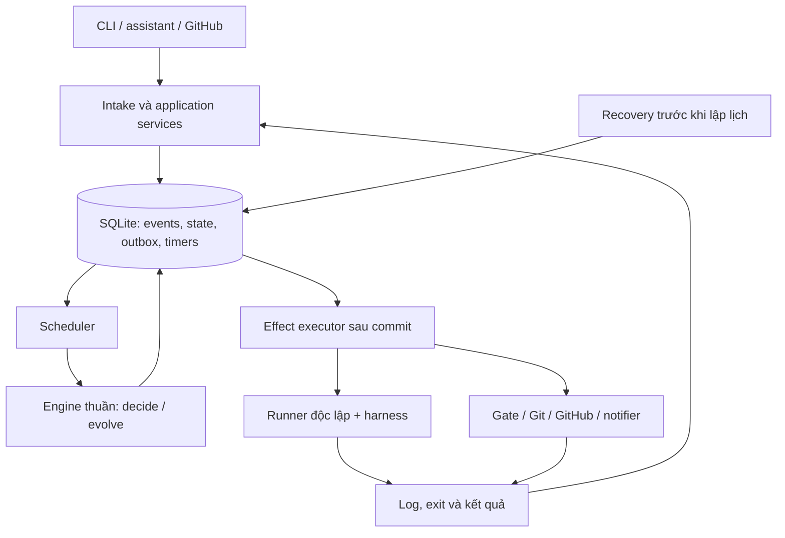

# Cuesura — Đặc tả tổng quan

**Phiên bản:** 0.2 · **Ngày:** 2026-10-29 · **Trạng thái:** Đặc tả thiết kế, chưa triển khai.

> Every call has a cue. Every pause has a purpose.
>
> Mỗi lần gọi đều có tín hiệu. Mỗi khoảng lặng đều có lý do.

Tài liệu này định nghĩa hành vi, ranh giới hệ thống và điều kiện nghiệm thu của toàn bộ Cuesura. Đây là nền để tách các đặc tả thành phần sau này; không phải danh sách task triển khai. [README](README.md) giới thiệu sản phẩm; [đánh giá kiến trúc](docs/architecture.md) lưu lập luận, khảo sát công cụ và các phương án đã cân nhắc. Khi hai tài liệu mô tả khác nhau về hợp đồng triển khai, dùng SPEC này làm chuẩn và cập nhật tài liệu liên quan.

**BẮT BUỘC / KHÔNG ĐƯỢC** là yêu cầu nghiệm thu. **NÊN** là mặc định có thể thay bằng quyết định được ghi lại. **Sau v1** là định hướng, không phải điều kiện phát hành v1. Các ví dụ CLI, JSON và đường dẫn dưới đây là hợp đồng dự kiến, chưa phải chức năng đã có.

Đọc nhanh: [Phạm vi](#2-phạm-vi) · [Bất biến](#4-bất-biến-hệ-thống) · [Workflow](#7-workflow-phát-triển-phần-mềm) · [Runner](#12-hợp-đồng-runner-và-kết-quả-agent) · [Stack](#17-baseline-kỹ-thuật) · [Nghiệm thu](#18-nghiệm-thu).

## 1. Mục tiêu sản phẩm

Cuesura là workflow engine tất định, hướng sự kiện, điều phối AI agent qua nhiều harness. Người dùng giao mục tiêu và giới hạn; code chọn bước tiếp theo, agent thực hiện công việc chuyên môn, người dùng tham gia tại những điểm cần quyết định.

Tên **Cuesura** kết hợp **Cue** (tín hiệu bắt đầu) và **Caesura** (khoảng ngắt có chủ đích trong âm nhạc hoặc thơ). Khoảng chờ là một phần có trạng thái và lý do của workflow: hệ thống tiếp tục theo dõi điều kiện cần thiết mà không giữ agent chạy chỉ để chờ. CLI dùng tên ngắn **`cusr`**.

Use case đầu tiên là phát triển phần mềm: nhận task → code → gate → review → PR → CI → merge. Lõi engine không chứa kiến thức về ngôn ngữ lập trình, build tool, nhà cung cấp model hay kênh nhận task. Mục tiêu dài hạn là hỗ trợ các workflow khác qua adapter có hợp đồng rõ ràng; mỗi workflow mới là một preset trong code, có test cho graph của nó, không phải graph do người dùng tự khai.

Giá trị cần đạt:

- Hoàn thành task với ít thao tác điều phối và ít lượt gọi agent lãng phí.
- Có thể giải thích từng quyết định: task đang ở đâu, vì sao dừng, đã dùng model nào, còn giới hạn gì.
- Khôi phục sau crash mà không làm mất trạng thái đã commit, chạy trùng agent hay lặp thao tác bên ngoài đã thành công.
- Giữ quyền kiểm soát policy, chi phí, quyền ghi và merge ở người dùng.
- Dùng được trên nhiều repo và hệ sinh thái mà không sửa engine.

Chuyển trạng thái thông thường không gọi LLM. Token của coder, reviewer, scout và refiner vẫn được tính đầy đủ; tuyên bố “0 token điều phối” chỉ áp dụng cho state machine và scheduler.

## 2. Phạm vi

### 2.1 V1

V1 phục vụ một người dùng trên một máy Linux/Ubuntu hoặc WSL2, có thể quản lý nhiều repo được cho phép. Worktree và dữ liệu runtime đặt trên filesystem Linux cục bộ. Mức song song ban đầu hướng tới 2–3 task, được giới hạn bằng resource pool.

| Nhóm | Phạm vi v1 |
|---|---|
| Nguồn task | CLI, assistant qua CLI, GitHub issue/comment bằng polling; chuẩn hóa và dedup về một format |
| Workflow | Graph `software_dev@1` cố định trong code, điều kiện hữu hạn, vòng lặp có giới hạn; user config chỉ chỉnh tham số (§8) |
| Agent | Claude Code và Codex CLI chạy headless; fake harness cho kiểm thử |
| Policy | Role/model/profile, snapshot, ngân sách, thang nâng effort/model/vendor có giới hạn |
| Thực thi | Runner độc lập, worktree riêng, setup, gate, context theo role, log và artifact |
| Điều phối | Dependency DAG, priority, pool, cooldown hạn mức, timer bền vững |
| GitHub | Commit/push/PR/comment, chờ CI, phân loại lỗi, sửa CI, merge gắn SHA và tuần tự hóa |
| Người dùng | Inbox, trả lời, duyệt, hủy; Telegram là kênh hỏi đáp/duyệt mặc định, GitHub cho task từ issue |
| Giao diện terminal | `cusr` mở giao diện tương tác để theo dõi, tạo task, xác nhận cấu hình và xử lý việc đang chờ, qua cùng dịch vụ và quyền như CLI; chi tiết ở [spec 004](specs/004-terminal-tui/spec.md) |
| Quyết định | Người có quyền quyết định; ghi nhận và giải thích được |
| Nhóm task | Nhóm tạo thủ công, dependency, integration branch tùy chọn, task tích hợp và nghiệm thu cấp nhóm |
| Vận hành | Recovery, backup/restore, migration, doctor, health, history và báo cáo sử dụng |

### 2.2 Sau v1

- Adapter Pi/ACP, MCP server và giao diện form/HTTP.
- Planner tự tách epic; nguồn task mới như Telegram, Slack, email, tracker khác. Telegram v1 không nhận task mới.
- Toolchain pack đầy đủ cho Node, Python, Go, Rust, JVM; tự động bổ sung context như một nấc escalation.
- Remote worker, vòng đời emulator/browser, screenshot comparison, dashboard web.
- Webhook, định tuyến theo chi phí và multi-user với cơ chế xác thực riêng.

V1 không có Primary AI chạy liên tục, plugin marketplace, workflow tự sửa lúc chạy, hay cơ chế tự cấp quyền cho agent. Durable-execution framework, message broker và database server không nằm trong baseline v1.

## 3. Người dùng và các hành trình chính

| Mã | Hành trình | Kết quả quan sát được |
|---|---|---|
| S01 | Người dùng giao task có acceptance qua CLI hoặc GitHub | Một task duy nhất được tạo; đủ điều kiện thì chạy và tạo PR; hoàn tất khi merge đã được xác nhận |
| S02 | Assistant tạo task hoặc người dùng giao yêu cầu thiếu thông tin | Task chờ xác nhận hoặc bổ sung; chưa gọi coder, chưa tạo worktree |
| S03 | Gate, review hoặc CI phát hiện lỗi | Sửa theo vòng hữu hạn; mọi lần chạy, kết quả và việc nâng model đều truy vết được |
| S04 | Agent hỏi giữa chừng | Agent kết thúc lượt; câu hỏi hiện trong inbox và đúng kênh; trả lời một lần làm task tiếp tục |
| S05 | Daemon bị dừng khi agent đang chạy hoặc PR vừa tạo | Khởi động lại nhận lại agent/kết quả/PR; không tạo một bản chạy hay PR thứ hai |
| S06 | Harness hết hạn mức hoặc hạ tầng tạm lỗi | Task chờ có lý do, có lịch kiểm tra lại; không nâng model vì lỗi hạ tầng |
| S07 | Nhiều task độc lập hoặc phụ thuộc nhau | Task độc lập chạy trong giới hạn pool; task phụ thuộc chờ kết quả prerequisite; không dùng chung worktree |
| S08 | Base branch đổi hoặc người dùng tắt yolo trước merge | Hệ thống kiểm tra lại; CI/approval cũ không đủ để merge, quyền yolo bị thu hồi có hiệu lực với lệnh merge chưa gửi |
| S09 | Người dùng sửa yêu cầu hoặc lật lại quyết định | Có revision/audit mới; không âm thầm đổi input hay giả vờ hoàn tác side effect ngoài hệ thống |
| S10 | Người dùng hỏi tiến độ, phục hồi backup hoặc nâng phiên bản | Có trạng thái và bằng chứng đọc được bằng CLI; dữ liệu phục hồi được; phiên bản không tương thích bị từ chối |

## 4. Bất biến hệ thống

| Mã | Quy tắc bắt buộc |
|---|---|
| I01 | Với cùng state, workflow, policy và input đã ghi nhận, `decide` tạo cùng events/commands. `evolve` chỉ áp dụng event; cả hai không I/O, đọc đồng hồ hay sinh số ngẫu nhiên. |
| I02 | Một daemon giữ quyền ghi kho trạng thái tại một thời điểm. CLI, assistant và runner không ghi trực tiếp vào database. |
| I03 | Một trigger được chấp nhận trong một transaction: ghi nhận dedup, append events, cập nhật projection, outbox và timers. Chỉ thực hiện effect sau commit. |
| I04 | Mỗi thao tác logic có một idempotency key ổn định. Kết quả không rõ sau timeout/crash phải được đối chiếu trước khi thử lại. |
| I05 | Một task thực thi có một worktree và branch riêng. Trong worktree đó, mọi bước chạy tuần tự; không có hai attempt đồng thời. |
| I06 | Exit code thành công và lời agent nói “xong” không đủ để qua bước. Kết quả phải đúng schema, đúng attempt và đạt các gate bắt buộc. |
| I07 | Engine tuân thủ các giới hạn đã khai báo; các trần thực thi tùy chọn có thể không giới hạn theo §9.4. Task chờ luôn có lý do và cách tiếp tục hoặc kết thúc. |
| I08 | Workflow, policy và đầu vào gốc bất biến theo revision. Thay đổi phải có event, actor, lý do và phiên bản mới. |
| I09 | Mọi lần gọi agent phải thỏa role, binding, quyền, approval, pool và ngân sách đã resolve. Agent không được tự đổi những giới hạn đó. |
| I10 | Thứ tự event lấy từ sequence đã commit; không suy ra bằng ID hay thời gian hệ thống. Trigger lặp không tạo thêm hiệu ứng logic. |
| I11 | Effect merge do Cuesura gửi chỉ do code thực hiện sau khi kiểm quyền, head/base, gate/CI, review theo chế độ và approval cho merge; `full-review` cần reviewer approve, trừ lượt tích hợp base có chứng nhận phạm vi theo §14.2. Người dùng merge thủ công trên GitHub là thao tác bên ngoài, được đối chiếu bằng chứng riêng; không giả review/approval hoặc gọi guard để gửi merge. Agent không quyết định merge. |
| I12 | Trạng thái kết thúc không tự mở lại. Retry sau kết thúc tạo task mới có liên kết nguồn; lịch sử task cũ được giữ nguyên. |

## 5. Mô hình miền và dữ liệu

### 5.1 Thực thể

| Thực thể | Trách nhiệm và dữ liệu chính |
|---|---|
| Project | Repo được cho phép, base/protected branches, đường dẫn, cấu hình gate/setup và quyền yolo hiện hành |
| Task | Yêu cầu chuẩn, revision, trạng thái, dependency, workflow/policy/context đã đóng băng, worktree/branch/PR |
| Group / Epic | Mục tiêu và acceptance cấp nhóm, task con, integration branch và task tích hợp; không tự là một attempt |
| Step | Một node của workflow; kind, role/action, resource pool, outcome, transition và giới hạn |
| Attempt | Một lần thực thi step; binding thực tế, harness version, session/process identity, thời gian, kết quả, usage và artifact |
| DomainEvent | Sự kiện bất biến có schema version, task/revision, sequence, actor, causation và payload |
| Effect | Ý định I/O bền vững trong outbox; ID, idempotency key, request, trạng thái, số lần thử và kết quả |
| Timer | Điều kiện đánh thức có ID, due time và payload; hủy hoặc tiêu thụ được trong transaction |
| Question / Decision / Approval | Câu hỏi, đáp án, người quyết, bằng chứng, phạm vi hiệu lực và trạng thái thu hồi/lật lại |
| SourceEvent / TaskLink / Message | Inbox thô đã dedup, liên kết task với nguồn, lịch sử hỏi đáp và đồng bộ |
| Artifact | Log, diff, kết quả gate/review, snapshot tài liệu và kết quả chuẩn; có provenance và hash khi cần |

Task, attempt và effect dùng UUIDv7. ID là định danh, không phải khóa chống lặp. `events.seq` tăng theo task; event log có thứ tự commit toàn cục để truy vết. Có thể hiển thị tiền tố ID ngắn nếu không mơ hồ; CLI phải từ chối tiền tố khớp nhiều bản ghi.

### 5.2 Task chuẩn

Task có `schema_version`, `id`, `title`, `type`, `project`, `base_branch`, `description`, `requirements`, `acceptance`, `constraints`, `out_of_scope`, `attachments`, `group`, `parent`, `depends_on`, `priority`, `size`, `labels`, `profile`, `requested_by` và `revision`.

- `acceptance` phải có ít nhất một tiêu chí trước READY. Code kiểm tra cấu trúc và sự hiện diện; việc tiêu chí có đúng ý người dùng được xác nhận bởi người giao hoặc bước refine được cho phép.
- Metadata riêng của GitHub hay kênh khác nằm trong liên kết nguồn. Context compiler đưa yêu cầu và trích đoạn liên quan cho agent, không đưa token, địa chỉ điều khiển hay cú pháp quản trị của kênh.
- Dependency phải tồn tại, không tự tham chiếu và không tạo chu trình. Dependency FAILED/CANCELLED làm task phụ thuộc tiếp tục chờ có giải thích; không coi là hoàn thành.
- Task do assistant tạo mặc định cần xác nhận ở bước intake. Auto-confirm intake và hạn mức tạo task theo client phải do người dùng cấu hình. Xác nhận intake quyết định nhận task, không thay xác nhận cấu hình chạy trước spawn.
- Một lượt tương tác có thể xác nhận cả intake và cấu hình chạy nếu hiển thị rõ cả hai phạm vi; không bắt người dùng xác nhận hai lần khi bộ task/cấu hình đã được duyệt đầy đủ.
- Agent nhận task có thể đọc chỉ dẫn `when to use` để đề xuất harness/model/effort và chế độ `direct-pr` hoặc `full-review`; daemon không suy chế độ từ nội dung hay kích thước task. Trước spawn đầu tiên, người dùng hoặc assistant (quyền `operate`) phải xác nhận bộ lựa chọn cụ thể theo digest, gồm reviewer nếu có. Auto-confirm intake không thay xác nhận cấu hình chạy; xem [hợp đồng chế độ](specs/002-task-to-green-pr/task-execution-modes.md).

### 5.3 Snapshot và revision

Kiểm tra workflow/profile/binding ngay khi nhận task. Khi bắt đầu thực thi, chốt lại cấu hình project tại `base_sha` và tạo đồng thời:

- **FrozenPolicy:** workflow đã expand, chế độ thực thi đã xác nhận, binding và ladder từng bước, quyền, gate thực tế, giới hạn, chế độ quyết định, schema version và các hash cấu hình. Xác nhận gắn với đúng bộ lựa chọn; cấu hình hiệu lực đổi phải xin xác nhận lại trước spawn.
- **FrozenExecutionContext:** nội dung yêu cầu, acceptance, bản chụp attachments, prompt/conventions và `base_sha`.

Nếu cấu hình lúc bắt đầu không còn hợp lệ, task ở PENDING và được yêu cầu xử lý trước khi tạo worktree. Không âm thầm thay một policy đã đóng băng. Output bước trước, diff hiện tại và Q&A là phần context tăng thêm có provenance; không thay snapshot yêu cầu gốc.

Nguồn thay đổi trước khi chạy có thể cập nhật task sau validation. Sau khi chạy, thay đổi trở thành `source_drift`: người dùng chọn tiếp tục revision cũ, áp dụng revision mới tại ranh giới an toàn, hoặc tạo task mới. Đổi revision phải vô hiệu hóa các kết quả/approval không còn phù hợp; không tự reset ngân sách, số lượt đã dùng hay lịch sử.

Amendment policy cần quyền admin, lý do, diff và policy version mới. V1 không thay graph workflow của task đang chạy; đổi workflow phải tạo task mới. Quyền yolo hiện hành là ngoại lệ rõ ràng đối với snapshot, theo §14.2.

## 6. Trạng thái và lập lịch

### 6.1 Task state

| Trạng thái | Ý nghĩa | `wait_reason` |
|---|---|---|
| PENDING | Chưa chạy workflow chính, chưa có worktree của task | `confirmation`, `needs_info`, `dependency` |
| READY | Đủ điều kiện; đang chờ scheduler cấp tài nguyên | Không có |
| RUNNING | Đang thực thi hoặc chuẩn bị bước tiếp theo | Không có |
| WAITING | Đã bắt đầu, đang chờ điều kiện bên ngoài | `human_input`, `approval`, `ci`, `rate_limit`, `policy`, `infra` |
| DONE | Đạt điều kiện kết thúc thành công của workflow | Không có |
| FAILED | Kết thúc không thành công theo policy hoặc quyết định rõ ràng | Không có; có failure reason |
| CANCELLED | Đã xử lý yêu cầu hủy và đối chiếu các thao tác đang dang dở | Không có; có cancel reason |

Chuyển trạng thái hợp lệ: PENDING → READY → RUNNING; RUNNING ⇄ WAITING; các trạng thái chưa kết thúc có thể đi tới FAILED/CANCELLED khi có căn cứ. RUNNING hoặc WAITING có thể tới DONE sau khi xác nhận kết quả cuối, kể cả sau recovery. READY có thể trở lại PENDING nếu điều kiện trước khi chạy không còn đúng. Nhận câu trả lời trong PENDING chỉ chạy lại triage.

`approval_kind` phân biệt merge/escalation. `source_drift`, hết lượt sửa và lỗi chưa phân loại được là chi tiết của lý do chờ, không phải trạng thái mới. Review, retry và sửa CI thuộc step/attempt, không tạo thêm task status.

Một lần hủy chưa thành CANCELLED khi process hoặc merge request vẫn chưa rõ kết quả. Chặn effect mới, dừng process thuộc task theo giới hạn, đối chiếu effect đã gửi, rồi ghi trạng thái phản ánh thực tế. Hủy không hoàn tác một merge đã thành công.

### 6.2 Scheduler

- Chọn task đủ điều kiện theo priority số lớn trước (mặc định `0`), rồi thứ tự vào hàng đợi; chỉ chạy khi đủ mọi slot mà bước yêu cầu. Với một slot của feature 002, cùng priority ưu tiên task đã bắt đầu đang xin lại slot trước task READY; cùng nhóm theo thời điểm xin slot hiện tại, hòa thì thứ tự event đã commit.
- Giữ khóa worktree và resource slot qua thời gian attempt thật sự còn chạy, kể cả khi daemon restart. Khôi phục các claim trước khi cấp việc mới.
- Pool là tên và sức chứa; engine không biết `build`, `browser`, `emulator` hay `test_db` làm gì. Hotspot hint cho phép tuần tự hóa các vùng file dễ xung đột.
- Rate limit khóa pool/harness liên quan tới `reset_at`; nếu chưa biết reset time, dùng backoff hữu hạn và báo rõ. Không tự chuyển sang model ngoài policy.
- Chờ người, CI hoặc cooldown không giữ một agent sống chỉ để chờ và không tiêu tốn lượt gọi LLM.
- Timer phải bền vững, tiêu thụ một lần về mặt logic; polling bên ngoài có timeout, backoff và jitter có thể kiểm soát khi test.

## 7. Workflow phát triển phần mềm

| Bước | Hành vi bắt buộc | Khi chưa đạt |
|---|---|---|
| Triage | Kiểm tra quyền, task, acceptance, dependency và policy | PENDING với lý do rõ ràng |
| Prepare | Snapshot, tạo worktree/branch, chạy setup theo cấu hình | Phân loại lỗi và chờ/retry hữu hạn |
| Scout, nếu được bật | Thu thập context còn thiếu, chỉ đọc | Tối đa một lượt mặc định; thiếu context quan trọng thì hỏi người |
| Code | Coder sửa trong worktree, chuẩn bị commit message và PR title/description theo template frozen, trả kết quả có schema | Hỏi người, bổ sung context hoặc xử lý lỗi theo policy |
| Gates | Các gate bắt buộc cùng đạt trên tree code cuối; formatter/gate sửa code thì kiểm lại tập gate trong giới hạn | Worker nhận lỗi và trạng thái mới nhất; chưa chứng minh tree cuối thì chặn |
| Checkpoint | Sau gates, orchestrator commit trạng thái code đã đối chiếu bằng message worker chuẩn bị | Intent/OID bền vững; gate evidence khớp tree |
| Review, chỉ `full-review` | Dùng lại evidence hợp lệ khi toàn bộ đầu vào không đổi; nếu chưa có thì reviewer riêng session, chỉ đọc, kiểm acceptance/commit cố định/nội dung PR | Findings → worker sửa → gates → commit nếu code đổi → xét evidence; không tiến triển thì giữ findings và xử lý giới hạn |
| Publish | Orchestrator push đúng SHA đã kiểm và tạo hoặc nhận lại PR bằng nội dung worker chuẩn bị | Ref/tree/worktree drift thì chặn; probe trước retry |
| CI | Chờ required checks của đúng head SHA | Hạ tầng/flaky: rerun hữu hạn; autofix: gate; lỗi code: coder/fixer rồi chạy lại gates/review cần thiết |
| Merge | Tuần tự hóa theo branch đích, kiểm tra lại mọi điều kiện | Cập nhật base và chạy lại kiểm tra, hoặc WAITING |
| Complete | Xác nhận merge, lưu artifact/usage, đồng bộ nguồn | Dọn dẹp có điều kiện; lỗi thông báo không làm lặp merge |

Có hai chế độ do người dùng xác nhận trước khi chạy: `direct-pr` không gọi reviewer; `full-review` bắt buộc review trước publish. Không tự chọn theo size XS và không bắt buộc khác vendor/model. Reviewer dùng session riêng, chỉ đọc; approval gắn base SHA/commit SHA cụ thể. Thay đổi code sau review phải gates, commit mới và review lại, trừ ngoại lệ tích hợp base có chứng nhận phạm vi tại §14.2; publish không commit thêm code sau approval.

Nếu remote branch task đổi sang B khi đang review A, kết quả A đến muộn chỉ thuộc A và không gỡ `head_changed` hoặc chứng nhận B. Approve đến trước khi quan sát drift vẫn phải qua guard remote expected-old trước publish; restart giữ blocker và receipt. Chỉ base tip đổi không tự làm review A mất hiệu lực. Xem [H01–H06](specs/002-task-to-green-pr/task-execution-modes.md#remote-đổi-head-khi-review-còn-chạy).

Hết quota thì chờ hoặc đề xuất lựa chọn khác để người dùng duyệt, không tự đổi chế độ/binding ngoài bộ đã duyệt. Các vòng sửa trong giới hạn không hỏi lại; đổi chế độ làm thay đổi graph của task đã chạy nên cần task mới trong toàn bộ v1 theo §5.3. `direct-pr` không tự cấp quyền merge: daemon chỉ gửi merge khi yolo hiện hành cho phép và đủ điều kiện §14.2. Xem [hợp đồng chi tiết và tiêu chí kiểm chứng](specs/002-task-to-green-pr/task-execution-modes.md).

Mỗi lần resume worker sửa MUST có packet mới ghi nguyên nhân, log/findings, checkpoint/worktree/diff, nội dung PR và Q&A hiện hành. Trong cùng task/revision, review chỉ được gọi lại khi cần: approve/findings còn hiệu lực và toàn bộ đầu vào review không đổi thì dùng lại evidence; worker no-op không tạo commit mới hoặc hỏi lại reviewer. Xem [điều kiện reuse](specs/002-task-to-green-pr/task-execution-modes.md#dùng-lại-kết-quả-review-còn-hiệu-lực).

Setup, formatter và gate là lệnh từ cấu hình project đáng tin cậy, có thể có side effect. Không mặc định xem mọi shell command là “pure”; chỉ retry tự động khi hợp đồng của lệnh cho phép chạy lại an toàn.

## 8. Cấu hình và loader

- `~/.cusr/config.yaml`: harness, model alias, role, workflow, profile, pool chung và cấu hình quản trị repo. Workflow chỉ chọn graph dựng sẵn (`base: software_dev@1`, bắt buộc) và chỉnh tham số của bước: `max_visits` (bước đã có giới hạn lượt), `max_rung` (bước agent/review), `run`/`required` (bước gate), `poll`/`timeout` (bước CI). Không khai được bước, `start`, `kind`, role, action, predicate, cạnh hay outcome; config cũ còn các khóa này bị từ chối với `workflow_key_removed` kèm đường dẫn khóa cần bỏ ([hướng dẫn nâng cấp](docs/config-upgrade.md)).
- `cusr.yaml` trong repo: setup, gates, autofix, log digest, failure signature, CI rules, pool riêng, hotspots và conventions.
- Toolchain pack là dữ liệu preset. Thứ tự áp dụng: pack → cấu hình project; profile → override được cho phép khi tạo task. Override không được nới quyền vượt quyền của người gọi.
- Cấu hình project được đọc từ revision đã chọn. Agent sửa `cusr.yaml` trong task không làm đổi gate của chính task đó.
- Hash được tính trên cấu hình hiệu lực đã chuẩn hóa; lưu kèm snapshot và nguồn. Thay đổi cấu hình chỉ ảnh hưởng task mới nếu không có amendment được duyệt.

Loader dùng package `yaml` của eemeli, core schema, không custom tag; giữ vị trí node để trả lỗi dạng `cusr.yaml:14:7`. Từ chối key trùng, tag không được hỗ trợ, tham chiếu không hợp lệ và input vượt giới hạn kích thước/alias đã cấu hình.

Kiểm tra trước thực thi:

1. Role, model, pool và gate được tham chiếu đều tồn tại; bước được chỉnh có trong `software_dev@1` và nhận tham số đó; gate `required` nằm trong `run` của bước.
2. Graph trong code: bước bắt đầu và đích transition tồn tại, outcome theo step kind là tập hữu hạn, mỗi outcome và trường hợp skip/exhausted có đích xác định. Graph cố định nên điều này được kiểm bằng test của code cho `software_dev@1` và từng graph theo chế độ, cùng property test rằng mọi bộ tham số hợp lệ không đổi `structure_hash`.
3. Mọi chu trình của graph đều đi qua giới hạn có bộ đếm không reset khi quay vòng; kiểm như mục 2. Tổng lượt agent và thời gian task là trần tùy chọn, không bắt buộc để cấu hình hợp lệ.
4. Thang escalation tới được trong giới hạn lượt của bước đã chỉnh; cấu hình nấc không thể đạt phải bị báo lỗi.
5. Mỗi bước có binding khởi đầu hợp lệ. Rule bị loại bởi allowlist được bỏ qua để thử rule kế tiếp; không còn rule thì task không được READY.
6. Predicate chỉ lấy từ tập định nghĩa trước như flag/size/label/type/attempt/branch; không `eval` hoặc diễn giải điều kiện tự do bằng LLM.

Gate project không khai báo chỉ được bỏ qua theo quy tắc optional và được ghi vào snapshot; thiếu gate bắt buộc là lỗi. Không có gate nào chỉ hợp lệ khi profile cho phép `allow_no_gates`; vẫn không đủ điều kiện auto-merge nếu thiếu các kiểm tra bắt buộc.

## 9. Role, escalation và ngân sách

### 9.1 Role và quyền

Daemon tạo branch/worktree; coder/fixer được ghi code, không có quyền publish. Fixer là vai trò sửa của worker đã tạo thay đổi: lỗi gate/review/CI ưu tiên resume session worker đó theo binding đã resolve, không tạo worker mới chỉ vì đổi tên step. Reviewer/scout chỉ đọc; reviewer luôn tách session khỏi worker. Refiner đề xuất acceptance tối đa một lượt khi profile cho phép; planner tự tách epic nằm sau v1.

Binding gồm harness, model, effort, quyền và các giới hạn thực tế được hỗ trợ. Tên model/CLI flag nằm trong cấu hình adapter, không gắn cứng trong engine. Resume chỉ dùng khi cùng harness, session còn hợp lệ và policy cho phép; nếu không thì session mới với context packet có giới hạn.

### 9.2 Phân loại thất bại

| Lớp | Mặc định xử lý | Tính vào escalation chất lượng? |
|---|---|---|
| Rate limit | Cooldown và timer; không tăng số thất bại chất lượng | Không |
| Infra/transient | Retry cùng nấc có backoff; mặc định không có trần số lần retry | Không |
| Auth/config | Chờ người xử lý, không retry mù | Không |
| Timeout/stall | Tối đa 1 lần retry; còn lỗi thì hỏi về phạm vi/thời gian | Không |
| Invalid output | Một lượt repair ngắn, sau đó tối đa một lượt session mới; vẫn sai thì xét nấc tiếp | Có, theo thang của role |
| Refused | Ghi rõ lý do và chờ người; không tự retry/escalate để vượt qua việc từ chối | Không |
| Quality | Gate fail, review reject, CI fail do code; tính chữ ký lỗi | Có |
| Unknown | Đối chiếu thêm hoặc WAITING; effect nguy hiểm không được phát lại theo phỏng đoán | Không |

Mọi lần thật sự gọi agent, kể cả repair, resume và lần bị rate limit, đều được ghi usage và tính vào `max_agent_runs`. “Không tính retry vì rate limit” chỉ có nghĩa không tăng bộ đếm thất bại chất lượng. Retry I/O vẫn có giới hạn cho từng request; trần số lần retry task và deadline toàn task chỉ áp dụng khi được khai báo.

### 9.3 Thang nâng cấp

- FrozenPolicy chứa thang của từng bước và trạng thái mỗi nấc: `auto`, `needs_approval`, `denied`. Bước không được phép dùng một model thì approval thường không biến model đó thành hợp lệ; cần amendment của người có quyền.
- Hai thất bại liên tiếp cùng chữ ký ở cùng nấc làm xét nâng. Chữ ký đổi cho phép thêm lượt, tối đa `quality_tries_per_rung` lần thử chất lượng mỗi nấc (mặc định 5, không có trần cứng). Effort tăng mà lỗi không đổi có thể bỏ qua nấc cùng model theo thang đã duyệt.
- Thất bại kiểm tra gắn với bước agent sửa code gần nhất. Pass reset chuỗi thất bại liên tiếp, không hạ nấc hay reset tổng lượt.
- `rung[task, step]` chỉ tăng hoặc giữ nguyên. Quay lại step cũ giữ nấc; step chưa chạy bắt đầu theo sàn đã resolve của chính step đó.
- Sàn task chỉ tăng. Profile có thể nâng sàn khi hai bước đã phải escalation (`hard`) hoặc dùng `scope: task`. Loader phải ánh xạ sàn sang từng thang role; không coi cùng số nấc ở hai role là cùng model, và không vượt nấc cuối của role.
- Approval gắn với task/revision, step, rung và policy hash. Quay lại cùng bước với policy không đổi có thể dùng lại approval; step khác hoặc policy đổi phải kiểm tra quyền lại.
- Mọi lần nâng, kể cả nâng do sàn task, phải qua giới hạn escalation và ngân sách. Hết thang/lượt/ngân sách thì chờ quyết định; không ngầm kéo dài giới hạn.

### 9.4 Ngân sách

Task không có budget: profile không còn khóa `budgets`, config cũ còn khóa này bị từ chối khi nạp. Policy mới đóng băng `max_agent_runs` và `max_wall_ms` là `null`; task cũ giữ trần đã đóng băng. Theo quyết định [#45](https://github.com/duykhanh01/cuesura/issues/45), `max_escalations_per_task`, `infra_retries`, backoff `max_attempts`, wall time của worker/lệnh và `max_turns` của pin Claude là tùy chọn, mặc định không giới hạn; bỏ khóa hoặc đặt `null` để không áp trần, giá trị khai rõ vẫn có hiệu lực.

Giới hạn lượt vào step, xử lý lỗi chất lượng, quyền, approval, pool và dung lượng I/O vẫn theo cấu hình riêng. Không bắt đầu attempt nếu vượt một trần đã khai hoặc thiếu approval. Slot và reservation vẫn được ghi trước spawn, usage vẫn được ghi đầy đủ khi không có trần.

Wall timeout của attempt tính riêng với thời hạn toàn task. Khi được khai báo, thời hạn task bắt đầu khi workflow chạy lần đầu, gồm cả thời gian chờ; hết hạn chặn attempt mới và chuyển sang chờ quyết định của người dùng. Thời hạn này chỉ còn ở task cũ đã đóng băng; không tự gia hạn khi restart hay đổi revision.

Usage phân biệt `reported`, `estimated`, `unavailable`; không ghi số 0 để thay cho dữ liệu thiếu. Chi phí subscription và chi phí API không bị đánh đồng. Cuesura không có trần chi phí. Khi không có deadline, engine và runner không tự tạo deadline thay thế; việc hủy và phát hiện stall đã cấu hình vẫn hoạt động.

## 10. Hỏi đáp và quyết định

`needs_input` làm kết thúc attempt, tạo question và chuyển task tới WAITING; chưa chạy thì giữ PENDING. Question được lưu trước khi gửi thông báo. GitHub task nhận comment trên issue; task CLI/assistant đi tới kênh mặc định. Tất cả đều có trong `cusr inbox`.

Câu trả lời từ Telegram, GitHub hay CLI quy về cùng một question. Kiểm tra quyền và revision, dedup theo message/request; câu trả lời hợp lệ đầu tiên thắng, câu trả lời cạnh tranh nhận conflict. Sau đó resume hoặc tạo attempt mới, đưa Q&A vào context và cập nhật các kênh còn lại.

Mọi điểm quyết định đều chờ người có quyền trả lời; không agent nào tự quyết thay.

**Autonomous.** `autonomous: true` trong user config thay người trả lời câu hỏi của worker bằng role `decider`: phiên mới, chỉ đọc, kết quả ghi bằng trigger `decider_ran` và event `DeciderRan`, câu trả lời mang `by: agent:decider`, `<data dir>/decisions.md` được ghi từ event. Không có trần số lần gọi, confidence hay lượt duyệt; approval và merge không thuộc phạm vi này. Sau một câu trả lời của decider, câu hỏi tiếp theo ở cùng step và revision chờ người, trừ task có nhãn `grill`. Chi tiết vận hành ở [deploy](deploy/README.md#autonomous). Với chế độ này, trần decider và điều kiện lật lại trong phạm vi còn đảo ngược ở các mục trên không áp dụng.

## 11. Kiến trúc thực thi



CLI gửi request tới `cusrd` qua Unix domain socket có quyền truy cập giới hạn. Đọc trạng thái thông thường cũng qua daemon. Công cụ kiểm tra offline chỉ mở dữ liệu read-only; migration/restore cần chế độ bảo trì độc quyền. Không có đường CLI ghi thêm command trực tiếp vào database.

Engine nhận state, trigger, workflow/policy và dữ liệu phụ thuộc môi trường đã chụp trước. Scheduler/runner được inject `Clock`; engine nhận `now` như dữ liệu. ID, jitter và các kết quả I/O được tạo ngoài engine và ghi nhận khi cần tái hiện. Adapter không quyết định retry, escalation hay trạng thái task.

## 12. Hợp đồng runner và kết quả agent

### 12.1 Process và file

Daemon dùng `node:child_process.spawn` để khởi chạy runner độc lập, chuyển stdio sang file và tách lifetime khỏi daemon. Feature 002 gọi `systemd-run --user` qua `spawn`, đặt runner trong transient service riêng không gắn vòng đời vào daemon và không tự restart agent; systemd user manager là prerequisite kể cả daemon foreground. Runner spawn harness trong nhóm process được quản lý; không vô tình detach harness ra khỏi nhóm cần hủy. Doctor kiểm user manager và WSL2 đã bật systemd thực sự; khả năng sống qua daemon service stop/restart phải đạt spike trước triển khai. Xem [ADR-0002](docs/adr/0002-systemd-runner-lifetime.md); `detached` riêng lẻ không được coi là bằng chứng.

Mỗi attempt có thư mục riêng `~/.cusr/runs/<attempt_id>/`:

| File | Hợp đồng |
|---|---|
| `invocation.json` | Cwd, argv đã che thông tin nhạy cảm, harness/model/version, task/revision, policy/schema hash; không chứa secret |
| `pid.json` | PID, PGID, process start ticks, host boot identity và attempt identity |
| `events.jsonl`, `stderr.log` | Output gốc để ingest lại; có giới hạn dung lượng và chính sách lưu giữ |
| `liveness`, `progress.json` | Runner còn sống; dấu hiệu tiến triển của harness và process con |
| `exit.json` | Exit code/signal/thời điểm kết thúc do runner ghi, kể cả khi daemon không chạy |
| `out/result.json` | Artifact kết quả chuẩn theo role, được validate và công bố nguyên tử bởi phía orchestrator |

File trạng thái hoàn chỉnh ghi bằng tmp → fsync → rename → fsync thư mục. Ingest JSONL chỉ xử lý dòng hoàn chỉnh và lưu offset trong cùng transaction với dữ liệu suy ra. Rotation phải giữ khả năng đọc phần chưa ingest; không âm thầm mất đoạn log chưa xử lý.

Runner đặt `CUSR_ATTEMPT_ID` cho cây process; marker giúp tìm và đối chiếu, không phải cơ chế xác thực. Việc claim attempt và đối chiếu process phải ngăn một retry của effect spawn tạo runner thứ hai trong cửa sổ daemon chết trước khi lưu PID.

### 12.2 Liveness, progress và timeout

- Liveness cho biết runner/process còn sống; progress dựa trên output, CPU của cây process, thay đổi file và hoạt động process con.
- Im lặng trên stdout không tự chứng minh stall. Stall chỉ được kết luận sau khoảng không có tín hiệu tiến triển theo policy.
- Timeout/stall/cancel gửi SIGTERM cho nhóm thuộc attempt, chờ một khoảng hữu hạn rồi SIGKILL; kiểm tra process còn sót và không giết process dùng chung không thuộc task.
- Timeout đang chạy dùng đồng hồ monotonic. Timer bền vững dùng mốc UTC; sau sleep/reboot phải reconcile và không reset deadline hoặc phát trùng trigger.

### 12.3 Schema và nguồn kết quả

Zod 4 là nguồn định nghĩa type và validation; xuất JSON Schema bằng `z.toJSONSchema()`. Schema trao đổi dùng phần JSON Schema được cả hai harness chấp nhận: root object, object đóng, trường required, dùng `null` hoặc mảng rỗng cho phần không có giá trị. Kiểm tra nghiệp vụ vẫn chạy sau validation cấu trúc.

Coder/fixer trả `status` thuộc `done | needs_input | needs_context | blocked`. `questions` là danh sách câu hỏi có nội dung và lựa chọn nếu có; `blocker` là mô tả hoặc `null`. Ví dụ kết quả coder:

```json
{
  "schema_version": 1,
  "status": "done",
  "summary": "Đã triển khai tiêu chí của task",
  "questions": [],
  "blocker": null
}
```

Coder/fixer sẽ chuẩn bị thêm commit message, PR title và description theo template từ frozen base, dưới dạng artifact ngoài code; orchestrator dùng nội dung đó để publish. Đây là hợp đồng bổ sung cần version hóa/kiểm chứng schema, chưa có trong ví dụ schema hiện tại.

Reviewer có verdict `approve | request_changes`, summary và findings có severity/file/line/message. Mỗi role có schema được version hóa; metadata task/attempt và provenance do orchestrator gắn, không tin ID mà agent tự khai.

Nguồn ưu tiên là structured final response của harness. Adapter chuẩn hóa response, orchestrator validate rồi lưu `out/result.json`. Cờ structured output không mặc nhiên validate file tùy ý do agent tạo. File fallback chỉ dùng khi adapter khai báo rõ, có đường dẫn riêng theo attempt và được kiểm tra tương đương. Không đọc nhầm `result.json` cũ từ bước trước.

Spike ngày 1 phải chạy mọi schema role hỗ trợ trong v1 với cả Claude và Codex. Kiểm tra cả việc schema được chấp nhận và output thực tế; lưu fixture kèm phiên bản harness/model. Sai schema, refusal, output thiếu/cắt cụt hoặc exit thất bại không được chuyển thành `done`. Reviewer chỉ đọc vẫn trả được kết quả qua output của harness, không cần quyền ghi vào repo.

## 13. Persistence, outbox và recovery

### 13.1 Store

SQLite dùng WAL, `synchronous=FULL`, foreign keys và busy timeout hữu hạn. `better-sqlite3` nằm sau module store mỏng cung cấp transaction và thao tác miền; không lộ connection cho engine/adapter. `node:sqlite` là phương án thay driver sau khi qua cùng contract test, không phải backend chạy song song trong v1.

Transaction chỉ làm việc ngắn trên dữ liệu local; không spawn, gọi mạng hoặc `await` bên trong. Events, projection, effects và timers cùng commit hoặc cùng rollback. Unique constraint bảo vệ event sequence, source dedup, request ID và effect idempotency key. Optimistic version chặn command dựa trên state cũ.

### 13.2 Effect

Effect có ID riêng và `idem_key` được tạo từ danh tính thao tác logic, có namespace project/task/revision khi phù hợp. Retry transport/recovery giữ nguyên key; một attempt nghiệp vụ mới có danh tính mới.

| Effect | Đối chiếu trước khi thực hiện lại |
|---|---|
| Start agent | Attempt claim, run directory, process identity và exit artifact; nhận lại attempt còn sống |
| Setup/gate/autofix | Hợp đồng chạy lại của lệnh; checkpoint và kết quả đã ghi; lệnh không an toàn thì chờ người |
| Commit | Trailer chứa effect key và nội dung/checkpoint dự kiến |
| Push | Ref remote và SHA dự kiến; remote ở SHA khác phải reconcile, không force-push mù |
| Create PR | Repo, head/base branch và marker do orchestrator tạo; từ chối namespace marker trong title/body worker, không nhận PR chỉ theo nội dung worker; phân biệt PR đang mở, đã đóng và đã merge |
| Comment/sync/notify | Marker hoặc khóa dedup phía kênh nếu có; kênh không hỗ trợ probe cần chính sách riêng |
| Merge | PR state, merge commit, expected head/base và quyền hiện tại |
| Cleanup | Tồn tại, ownership, trạng thái commit/push và dữ liệu cần bảo toàn |

Giao thức: commit `started` → thực hiện I/O → commit kết quả và trigger tiếp theo. Crash sau khi bên ngoài thành công nhưng trước commit kết quả phải nhận lại thành công qua probe.

Mô hình giao nhận là at-least-once. Mục tiêu không lặp effect dựa vào unique key, thực thi tuần tự và probe, không phải transaction phân tán. Probe lỗi mạng hoặc không đủ bằng chứng trả `unknown`, không được coi là “chưa xảy ra”. Với kênh không có idempotency/probe tin cậy, thông báo có thể trùng và phải mang cùng question/effect ID; không cho phép nhân đôi quyết định hay thao tác nguy hiểm vì thông báo trùng.

### 13.3 Khởi động lại

1. Giữ khóa daemon độc quyền; kiểm tra schema compatibility, backup trước migration và kiểm tra toàn vẹn DB.
2. Đối chiếu attempt đang mở với run directory, process identity và `exit.json`; ingest phần log còn lại đúng một lần về mặt logic.
3. Nhận lại process còn sống, chuyển quyền sở hữu về daemon instance mới; không spawn thay thế khi chưa chứng minh attempt cũ đã kết thúc.
4. Attempt đã chết nhưng thiếu exit được phân loại `lost`. Resume tối đa một lần nếu hợp lệ; trước reset/rerun phải bảo toàn dữ liệu và checkpoint hiện có.
5. Probe effect đang dang dở; unknown thì chờ, thành công thì ghi nhận, chưa thực hiện thì đưa về hàng đợi khi an toàn.
6. Khôi phục slot, khóa worktree, timer và bước mồ côi. Một command tái tạo phải giữ cùng idempotency key.
7. Ghi báo cáo recovery rồi mới cho scheduler cấp việc mới. Mất tín hiệu hàng loạt phải kích hoạt circuit breaker và cảnh báo.

Không được reset worktree chỉ vì HEAD khác checkpoint: có thể commit trước crash đã thành công. Khi kho trạng thái không ghi được, ngừng phát effect mới và báo health lỗi; không tuyên bố đã lưu WAITING nếu transaction thực tế thất bại.

## 14. Worktree, merge và nhóm task

### 14.1 Worktree

Orchestrator tạo và sở hữu worktree tại `~/.cusr/worktrees/<project>/<task_id>`, branch theo task. Không dùng cơ chế worktree tự quản của harness. Setup chạy khi chuẩn bị môi trường và chỉ chạy lại theo hợp đồng retry của project.

Context/output tạm phải được loại khỏi git. Cwd và đường dẫn ghi được kiểm tra trước khi chạy; reviewer/scout chỉ đọc. Phát hiện thay đổi ngoài vùng được phép phải dừng để đối chiếu, không tự quy mọi thay đổi của người dùng ở repo gốc thành hành vi của agent.

Checkpoint trước bước có thể ghi; orchestrator commit thay đổi sau bước thành công. Worktree mất được phục hồi từ branch/checkpoint khi đủ bằng chứng. Dọn dẹp chỉ sau khi hoàn tất và hết thời gian giữ; có thay đổi chưa commit hoặc commit chưa push thì bảo toàn, không xóa.

### 14.2 Merge

Mặc định dùng **squash merge** để một task/PR tương ứng một commit trên branch đích. Repo có thể
đổi bằng `merge.method` trong `cusr.yaml`:

```yaml
merge:
  method: squash # squash | merge | rebase
```

Loader và runtime snapshot của feature 002 đã nhận key này; effect merge của v1 chưa có. `merge` là object closed, chỉ
có key `method`; bỏ cả object hoặc bỏ `method` thì mặc định `squash`, còn giá trị ngoài enum hoặc
sai kiểu phải báo cấu hình không hợp lệ. `merge` nghĩa là tạo merge commit, `rebase` nghĩa là
rebase merge PR, không phải yêu cầu tự rebase worktree của task. Method được đọc từ frozen base
và đóng băng cùng policy/context khi task bắt đầu; đổi config chỉ ảnh hưởng task bắt đầu sau đó.
Method không đổi graph `direct-pr`/`full-review`, quyền merge, approval hoặc quyền yolo.
Default mới chỉ áp dụng khi resolve task mới; snapshot cũ không có trường này phải giữ nguyên
hash/nội dung và ghi chưa có lựa chọn được lưu, không gán ngược default cho lịch sử.

Khi Cuesura được phép gửi effect merge trong v1, phải dùng đúng method đã đóng băng; repository
không cho phép hoặc không xác minh được method đó thì chờ người xử lý, không tự fallback. Với
squash, dùng commit message artifact hiện hành đã validate do worker chuẩn bị; lưu nội dung/digest
cùng merge intent để recovery không dựng message khác cho cùng thao tác.

Feature 002 chỉ quan sát merge thủ công: method là lựa chọn đề xuất, cung cấp cùng message squash
cho người dùng, không gọi endpoint merge hoặc chặn task chỉ vì repo không bật method đề xuất.
Người dùng merge bằng method khác vẫn được ghi nhận theo merge proof hợp lệ; nếu có bằng chứng
method thực tế thì ghi chênh lệch để audit, không dùng làm blocker hoặc lý do merged_head_unverified.
Không xác minh được method thì ghi unknown, không đoán từ commit graph và không coi là thiếu merge
proof. Luôn lưu riêng head đã kiểm, head của PR tại merge và commit trên branch đích; squash/rebase
có thể đổi commit SHA mà không làm head-at-merge khác head đã kiểm.

Protected branches mặc định bao gồm default branch. Phần kiểm tra dưới đây chỉ áp dụng khi **Cuesura gửi effect merge**, không áp dụng để ngăn hoặc phủ nhận merge thủ công đã xảy ra trên GitHub. Mỗi branch đích có một merge queue; ngay trước effect merge phải kiểm tra:

1. Head SHA đúng kết quả gate/CI và approval cho thao tác merge đang hiệu lực; reviewer approval cùng head bắt buộc khi là `full-review`, trừ lượt tích hợp base có chứng nhận phạm vi bên dưới. `direct-pr` không cần reviewer approval, kể cả khi auto-merge.
2. Head đã bao gồm base tip hiện tại; base đổi thì cập nhật branch, chạy lại gate/review cần thiết và CI.
3. Required checks đầy đủ và thành công; pending/cancelled/missing/unknown không phải pass.
4. Auto-merge của `full-review` có reviewer approve hoặc chứng nhận phạm vi tích hợp base bên dưới; không còn finding nghiêm trọng chưa xử lý.
5. Quyền merge còn hiệu lực, các quy tắc GitHub hiện có được GitHub thực thi và không có yêu cầu hủy chặn effect chưa gửi; không bắt buộc bật branch protection.

Local queue chỉ tuần tự hóa merge của Cuesura. Daemon kiểm tra head chứa base tip hiện tại bằng compare `head...target_tip_sha` (`ahead_by === 0`) và gửi expected-head `sha`. Branch protection là tùy chọn, khuyến nghị bật như lớp chặn thêm do GitHub thực thi. Không có protection thì GitHub không chặn race khi nhánh đích có commit mới hoặc check đổi kết quả giữa lúc daemon đọc và lúc merge; expected-head chỉ chặn PR head đổi.

Người dùng có thể merge thủ công cả PR `direct-pr` lẫn `full-review` trên GitHub theo quyền và branch protection. Cuesura đối chiếu repo/PR/target/head-at-merge rồi hoàn tất theo bằng chứng; không giả review/approval nội bộ hoặc gửi thêm lệnh merge. Nếu head chưa được kiểm đủ theo chế độ, ghi rõ merge chưa chứng nhận.

**Yolo trong daemon:** khi `yolo: true` trong user config, sau mỗi lượt đọc PR của task đang chờ merge, daemon đọc lại config, yêu cầu PR đang mở, đúng target, có `mergeable_state: clean` trên đúng head đã kiểm và compare `head...target_tip_sha` trả `ahead_by === 0`. Compare lấy `per_page=1&page=2` để chỉ đọc tổng ahead/behind và bỏ danh sách diff ở trang 1, kể cả khi PR tụt sau target. Không đọc được hoặc thiếu `ahead_by` thì tiếp tục chờ. Không bắt buộc protection, `strict` hay `enforce_admins`; nếu có thì GitHub thực thi các luật đó khi nhận lệnh merge.

Danh sách check phải chờ ở cả CI, quan sát và yolo là hợp của `policy.ci.required_checks` đã đóng băng và tên mọi check bắt buộc đang có hiệu lực trên GitHub, kể cả check ngoài policy và ghim app. `evaluateRequired` tính phần hợp ở mỗi lượt đọc, lưu tên/app trong evidence, không sửa FrozenPolicy và không phụ thuộc cờ yolo (FR-042). Không tạo `required_checks_mismatch` mới chỉ vì check ngoài policy hoặc ghim app; wait/event cũ vẫn replay được và được đối chiếu lại ở lượt quan sát tiếp theo trong cửa sổ CI.

Evidence `unknown`, dữ liệu check không đầy đủ, thiếu quyền hoặc collision đều chưa đạt. Mọi check trong hợp phải `success`; `pending`, `skipped`, `neutral`, `cancelled`, `failure` hay `unknown` đều không đạt. Khi gửi merge, daemon còn yêu cầu check ghim app có kết quả `success` từ đúng `app_id`; không dựa vào GitHub vì token admin có thể bypass protection. Nếu hợp rỗng, observation giữ hành vi cũ: task vào chờ merge, bỏ qua check không bắt buộc; riêng yolo không merge và log một lần mỗi task trong vòng đời daemon, hướng dẫn khai `ci.required_checks` trong `cusr.yaml`. Không dùng fallback mọi check đang thấy trên head vì có job chưa kịp xuất hiện. Điều kiện `clean` vẫn được giữ thận trọng: check không bắt buộc đỏ có thể khiến GitHub trả `unstable` và chặn yolo dù hợp check bắt buộc đã xanh. Lỗi đọc/validate user config được ghi log và coi yolo là tắt; không đổi evidence hoặc trạng thái quan sát.

**Tích hợp base, không phụ thuộc yolo:** sau lượt quan sát, task đang chờ merge trên head đã
chứng nhận được cập nhật nếu PR còn mở, đúng head/target, trạng thái `clean`, `behind` hoặc `dirty`,
daemon đọc tip qua `GET branches/{target}` rồi compare `head...target_tip_sha` xác nhận
`ahead_by > 0`. Không dùng `pull.base.sha`: đó có thể là snapshot cũ của PR. SHA tip vừa đọc
được dùng nhất quán cho compare và Git fetch/merge; không đọc được tip thì không cập nhật. Task xin lại execution slot, dùng workflow,
FrozenPolicy và giới hạn visit/deadline hiện có. Cờ yolo chỉ quyết định gửi merge, không quyết định
cập nhật base hoặc sửa conflict. Chưa chứng nhận head, PR đóng, drift hoặc hủy thì không cập nhật.

| Tình huống | Xử lý | Review mới |
|---|---|---|
| Tụt sau target, không conflict | Daemon tích hợp base, chạy gate, publish, chờ CI trên head mới; không gọi fixer | Không |
| Có conflict lần đầu | Một lượt fixer, kiểm tra phạm vi bằng Git trên host, chạy gate, publish, chờ CI | Không nếu chỉ sửa file conflict |
| Fixer sửa cả file ngoài danh sách conflict | Qua review trước publish | Có; `direct-pr` không có reviewer đóng băng thì chờ người quyết định |
| Fixer lỗi, bị chặn, chưa xong, gate fail hoặc conflict lại sau lượt đó | Chờ người, không gọi thêm fixer tự động | Người quyết định |

Handler fetch đúng base SHA và dùng `merge-tree --write-tree --name-only -z`. Không conflict thì
merge commit hai parent có durable intent và CAS từ head cũ. Có conflict thì lưu tree và danh sách
file conflict trong intent, checkout tree này cho fixer nhưng giữ HEAD cũ; không áp dụng/push commit
chứa marker. Host so tree sau fixer và sau gate với tree conflict ban đầu, dùng diff không suy đoán
rename: thay đổi tự động từ base không bị tính là fixer sửa ngoài phạm vi; file mới/đổi tên ngoài
danh sách được tính. Mỗi file conflict phải khác tree conflict ban đầu; báo `done` mà không đổi
file (kể cả modify/delete hoặc binary không có marker) không được chứng nhận tự động. Dùng
`git grep -I -q` chỉ trên file conflict để tìm marker mở/đóng, không coi một dòng Markdown
`=======` là marker. Không xuất toàn bộ diff/diagnostic ra port; lỗi/cắt ngắn/timeout khi đọc scope
trả evidence chưa đạt, không throw để effect kẹt `started`. Còn marker hoặc tree đổi ngoài dự kiến thì dừng. Commit cuối có hai parent
chỉ được áp dụng sau khi gate đạt. Branch/worktree bị đổi ngoài dự kiến được giữ lại để đối chiếu.

`BaseUpdateRecorded` lưu head/base, revision, conflict, lượt fixer, phạm vi và chứng nhận đúng
head/tree sau gate. Chứng nhận này miễn review mới riêng lượt tích hợp base sạch hoặc chỉ sửa file
conflict; không giả reviewer approve hay dùng approval của head cũ cho head mới. Đổi head/tree/revision
khác làm chứng nhận không áp dụng. Sửa ngoài phạm vi trong `full-review` dùng reviewer đã đóng băng;
review không chấp thuận thì chờ người, không mở lượt fixer thứ hai cho conflict này.

**Tiếp tục sau khi chờ người:** lỗi sửa conflict, gate fail, conflict lần nữa hoặc sửa ngoài phạm vi
mở question qua luồng `answer` hiện có, thay vì wait `refused` chỉ chờ amend. Người dùng có thể sửa
tay trong worktree, trả lời đúng `continue` để xác nhận các phiên bản đã chọn và chạy lại gate/publish/CI; với conflict
không marker, câu trả lời ghi actor/time xác nhận cả lựa chọn giữ nguyên file. Trả lời chính xác
`retry fixer` cấp phép một lượt worker nữa; timer/observation không tự cấp lượt này. Cả hai đường
vẫn đi qua slot, visit, budget, deadline và remote expected-old guard; không reset giới hạn. Sửa
ngoài file conflict vẫn cần review; `direct-pr` có thể hoàn nguyên phần đó rồi tiếp tục, hoặc tạo task
mới có reviewer. Gate flaky sau một merge local sạch retry từ cùng durable intent/OID, không tạo
merge commit rỗng. Nếu người dùng sửa code sau một merge sạch, scope được so với tree trong
durable intent; sửa thêm ngoài file conflict phải review như thường. Git còn chặn tạo merge mới nếu base được yêu cầu đã nằm trong head. Wait
`policy/refused` của phiên bản cũ chuyển thành question khi người dùng `task recheck`.

Push dùng expected-old guard và fast-forward; gate/CI phải đạt trên head mới, rồi task lại chờ merge.
Compare trước merge vẫn đọc tip hiện tại nên target tiến tiếp có thể cần cập nhật nữa; nếu lần sau
conflict thì không gọi fixer thứ hai. Intent/event/effect/resume giữ head/base và ngân sách một lượt
fixer qua chờ slot, retry, replay và restart. FrozenPolicy và base snapshot lấy policy/review giữ nguyên.

Engine kiểm tra task đã xác nhận chế độ, không bị hủy, head được Cuesura chứng nhận, rồi ghi approval `policy:yolo` kèm digest của publish content; sau đó daemon đọc lại config, đọc lại trạng thái task và gửi merge kèm `sha` của head đó, với squash thì kèm commit message của đúng content ấy đã validate. Task chỉ DONE khi quan sát thấy bằng chứng merge. Thiếu điều kiện thì không gửi gì và task tiếp tục chờ; GitHub từ chối vẫn xử lý `refused`, người dùng vẫn merge tay được.

**Protected branch có hai chế độ:** `human` duyệt từng PR/head, hoặc `auto` dựa trên quyền yolo do người dùng cấp trước cho repo. Agent không tham gia cả hai chế độ.

Yolo chỉ bật bởi người dùng có quyền quản trị, qua kênh xác nhận tin cậy hoặc cấu hình người dùng. Không bật qua `cusr.yaml` của repo. Đây là quyền hiện hành, không đóng băng trong task: kiểm tra lại ở thời điểm dispatch merge. Tắt yolo chặn các merge chưa gửi, nhưng không hứa thu hồi được request remote đã nhận. Mọi thay đổi quyền có audit.

Nhánh integration không được bảo vệ có thể auto-merge theo policy đã đóng băng, với các điều kiện cứng tương ứng. CI protected branch đỏ sau merge tạo cảnh báo và PR revert khi xác định được thay đổi cần bù; không force-push hay tự merge PR revert để lách điều kiện kiểm tra.

### 14.3 Group/epic

V1 cho phép người dùng hoặc assistant đề xuất task con và dependency, nhưng chỉ tạo/chạy theo quyền intake. Không tự gọi planner để tách epic.

Task con có thể mở PR vào integration branch; task phụ thuộc chỉ sẵn sàng khi prerequisite đã hoàn thành theo workflow. Khi các task con của revision nhóm hoàn tất, tạo đúng một task tích hợp với worktree riêng, acceptance cấp nhóm, gate đầy đủ và review toàn bộ diff.

Nhóm chỉ DONE khi kết quả tích hợp được merge vào branch đích cuối cùng. Tất cả task con DONE chưa đủ. Task sửa phát sinh trong nhóm cũng có giới hạn; thay đổi tập task con hoặc acceptance phải làm mất hiệu lực kết quả tích hợp cũ.

## 15. CLI, kênh nguồn và quyền truy cập

### 15.1 Giao diện CLI

| Nhóm lệnh | Hợp đồng |
|---|---|
| `cusr` không kèm lệnh, trong terminal tương tác | Mở giao diện tương tác; ngoài terminal vẫn báo lỗi thiếu lệnh như hiện tại |
| `cusr init`, `cusr doctor`, `cusr status` | Cấu hình repo, kiểm tra môi trường và sức khỏe |
| `cusr task add/show/list/explain/history/logs` | Tạo và đọc task; `add` là tên chuẩn cho thao tác tạo |
| `cusr task confirm/approve/cancel/retry` | Thao tác có kiểm tra quyền, version và dedup; retry terminal tạo task mới có liên kết |
| `cusr project list`, `cusr task board/content/progress/options` | Dữ liệu chỉ đọc cho giao diện terminal; output `--json` như mọi lệnh ([hợp đồng feature 004](specs/004-terminal-tui/contracts/cli-daemon.md)) |
| `cusr request show` | Tra kết quả mutation theo request ID, chỉ đọc |
| `cusr inbox`, `cusr answer` | Liệt kê và trả lời câu hỏi |
| `cusr group status` | Tiến độ nhóm |
| `cusr repo yolo on/off`, `cusr task amend-policy` | Quản trị có xác nhận tin cậy và audit |
| `cusr report`, `cusr admin verify-projections/backup/restore` | Báo cáo theo project từ một mốc thời gian (task đã kết thúc, việc chờ người, câu decider đã trả lời, usage), đối chiếu và bảo trì trong chế độ thích hợp |

`--json` là tùy chọn chung; output có `schema_version`. Lệnh hữu hạn trả một JSON object vào stdout, kể cả lỗi có thể xử lý. Log/chẩn đoán đi stderr; không ANSI, spinner hoặc prompt trộn vào stdout. Lệnh streaming như `logs -f --json` dùng JSONL, mỗi record có version và cursor/sequence để nối lại.

```json
{
  "schema_version": 1,
  "ok": true,
  "data": { "task_id": "019a0000-0000-7000-8000-000000000001", "status": "PENDING" },
  "error": null
}
```

Lỗi có `ok: false`, `data: null` và `error` gồm code ổn định, message, details. Request mutation có `request_id`; gửi lại cùng ID và cùng payload trả kết quả cũ, ID trùng với payload khác là conflict. Socket timeout sau gửi không chứng minh lệnh thất bại; client tra hoặc gửi lại cùng ID.

| Exit code | Ý nghĩa |
|---|---|
| 0 | Lệnh được xử lý thành công; task có thể vẫn PENDING/WAITING hoặc đã FAILED nếu đây là lệnh truy vấn |
| 1 | Thực thi lệnh thất bại hoặc health check không đạt |
| 2 | Sai cú pháp, input hoặc cấu hình |
| 3 | Không kết nối được daemon/dịch vụ hoặc hết thời gian chờ; có thể cần tra lại request |
| 4 | Không tìm thấy đối tượng |
| 5 | Không đủ quyền |
| 6 | Conflict: version cũ, câu hỏi đã trả lời, request ID trùng payload khác, transition không hợp lệ |

Signal exit giữ quy ước hệ điều hành. Exit code mô tả lệnh CLI, không thay cho `task.status`. Chế độ không tương tác trả lỗi/yêu cầu duyệt có cấu trúc, không tự cấp quyền để tránh prompt.

### 15.2 Connector và trust boundary

Connector làm nhận → kiểm tra quyền → normalize → dedup → triage. GitHub chỉ nhận actor/repo/label được cho phép; comment điều khiển phải kiểm tra lại quyền. Cursor chỉ tiến khi sự kiện đã được lưu an toàn. Đồng bộ trạng thái đi qua outbox; sửa issue đang chạy tạo source drift, đóng issue là yêu cầu hủy được đối chiếu với trạng thái PR hiện tại.

Phân quyền `read`, `operate`, `admin` được kiểm tra ở application service, không chỉ trong CLI. Chỉ process cùng UID với daemon mở được socket điều khiển (thư mục 0700, socket 0600). Caller tự khai actor qua `CUSR_ACTOR`: không khai là owner (`read`, `operate`, `admin`), `assistant` chỉ có `read`, `operate`; trường trong body request không đổi được actor. Actor tự khai là rào chắn cho caller làm đúng quy ước, không phải bằng chứng người gọi là người thật: process cùng UID luôn gọi được như owner. Hành động đòi người duyệt (approve escalation, bật yolo) thuộc owner; muốn tách quyền thật thì chạy assistant bằng UID khác, nằm sau v1.

Theo quyết định chủ dự án ngày 2026-11-01 ([ADR-0005](docs/adr/0005-native-harness-permissions.md)), Cuesura chạy harness trực tiếp trong worktree riêng, bỏ outer bwrap. Mặc định worker Claude dùng mode `auto` và tắt sandbox như Claude Code; owner bật/tắt độc lập qua `--sandbox on|off` hoặc `settings.sandbox.enabled`. Sandbox bật thì native proof bắt buộc; auto tắt sandbox ghi `permissions_only`/`not_tried` và vẫn kiểm quyền tool. Codex dùng `workspace-write` với automatic approval review. Owner có thể chọn `permission_mode: full-access` trong pin; khi đó worker dùng quyền full access của chính harness. Reviewer vẫn dùng sandbox chỉ đọc. Đổi permission mode hoặc sandbox cần manifest đúng pin; không tự fallback từ sandbox lỗi sang full access.

Setup/gate/autofix chạy trên host. Home/auth của harness vẫn tách riêng và environment không kế thừa token điều phối, nhưng worktree không là sandbox bảo mật: không còn cam kết che filesystem, secret hoặc socket host khỏi process cùng UID. Doctor kiểm dependency thực tế của harness và systemd, không đòi outer proof. Auto review/approve của harness không đổi workflow review, run confirmation, gate/CI hoặc quyền merge. Mô hình multi-user và cách ly đối thủ cùng OS user nằm sau v1.

## 16. Vận hành và đo lường

- `cusrd` chạy foreground hoặc dưới `systemd --user`; restart policy và quyền sở hữu process phải nhất quán với recovery. Có khóa singleton, heartbeat và shutdown hữu hạn.
- Startup kiểm tra schema/event compatibility và toàn vẹn DB. Backup online nhất quán; backup trước migration; restore/migration chỉ trong chế độ bảo trì độc quyền với đường lui đã thử.
- Log có task/attempt/effect/request ID, timestamp và error family. Che secret trước khi lưu/xuất; retention và giới hạn dung lượng phải cấu hình được.
- Disk full/SQLite busy/mạng lỗi được phân loại. Hết chỗ lưu trạng thái thì ngừng cấp việc; không xóa worktree có dữ liệu chưa bảo toàn để giải phóng chỗ.
- `status --health` có thể phát hiện daemon mất heartbeat, orphan step, timer quá hạn và attempt không tiến triển; task chờ người hợp lệ không tự là lỗi sức khỏe.
- Usage/report được dựng bằng code từ dữ liệu đã ghi, không gọi LLM để tóm tắt trạng thái thông thường.

Chỉ số gồm token và agent runs/task được chấp nhận, wasted runs, time to green, thời gian chờ người/rate limit, first-pass rate, số lần can thiệp, escalation/rescue rate, recovery success và escaped defects. Task “được chấp nhận” là PR đã merge và không bị revert/mở lại trong 14 ngày; cohort chưa đủ 14 ngày phải được đánh dấu chưa trưởng thành.

## 17. Baseline kỹ thuật

### 17.1 Quy ước định danh

| Thành phần | Tên chuẩn |
|---|---|
| Sản phẩm | **Cuesura** |
| CLI | `cusr` |
| Daemon và service | `cusrd`, `cusrd.service`; lock `~/.cusr/cusrd.lock` |
| Runner | `cusr-runner` |
| Cấu hình | `cusr.yaml` trong repo; `~/.cusr/config.yaml` của người dùng |
| Dữ liệu runtime | `~/.cusr/`; context/output tạm trong worktree dùng `.cusr/` và được loại khỏi git |
| Biến môi trường nội bộ | Tiền tố `CUSR_`, ví dụ `CUSR_ATTEMPT_ID`, `CUSR_CRASH_AT` |
| Branch của task | `cusr/<task_id>-<slug>` |
| GitHub | Label intake `cusr`, label trạng thái `cusr:<status>`, lệnh comment `/cusr`; marker `<!-- cusr:<idem_key> -->` |

### 17.2 Stack

| Thành phần | Quyết định |
|---|---|
| Runtime | Node 24 LTS; pin bản patch đã kiểm chứng cho dev/CI/runtime, nâng có kiểm tra compatibility |
| Ngôn ngữ | TypeScript strict, `noUncheckedIndexedAccess`, `exactOptionalPropertyTypes`, `noFallthroughCasesInSwitch`, `noEmitOnError` |
| Exhaustiveness | Switch xử lý domain union kết thúc bằng `assertNever(value: never): never`; không cast sang `never` để né lỗi |
| Build | `tsc` xuất JavaScript ESM; daemon/runner chạy artifact đã build; build có lỗi type phải thất bại |
| Database | SQLite + `better-sqlite3`, SQL/migration có phiên bản, module store mỏng |
| Schema | Zod 4; JSON Schema sinh từ cùng định nghĩa và kiểm chứng trên harness thật |
| CLI và IPC | Commander; Unix domain socket qua thư viện chuẩn Node |
| Giao diện terminal | Renderer nhỏ trong repo, `string-width` đo độ rộng chữ; không dùng framework giao diện ([R-01 feature 004](specs/004-terminal-tui/research.md#r-01--renderer)) |
| Cấu hình | `yaml` của eemeli, core schema, diagnostics có vị trí dòng/cột |
| Process | `node:child_process.spawn`; feature 002 gọi `systemd-run --user` qua spawn để runner có unit riêng; gate/git/gh cũng qua port process có timeout, chỉ thêm execa khi có nhu cầu đã chứng minh |
| ID | UUIDv7 qua package `uuid`; ID/clock được cung cấp từ ngoài engine |
| Kiểm thử | Vitest + fast-check; Clock inject ở tầng có I/O, fake ports/harness, fixture và crash injection; `node-pty` và `@xterm/headless` cho kiểm thử giao diện terminal |
| Package manager | pnpm, pin phiên bản trong metadata project, commit lockfile, CI cài bằng frozen lockfile |
| Lint/format | ESLint + typescript-eslint, format bằng Oxfmt; kiểm tra Promise không được xử lý và dùng Promise sai ngữ cảnh |
| GitHub | `gh` qua port mỏng có timeout, phân loại lỗi và fake phục vụ kiểm thử |

Typecheck, lint, test và build là các kiểm tra riêng; Vitest chạy xanh không thay thế typecheck. Không thêm framework workflow, ORM hoặc DI container chỉ để chuẩn bị cho khả năng mở rộng chưa cần.

**Điều chỉnh baseline 2026-10-28:** feature 002 chốt supervision bằng systemd user service tại
[ADR-0002](docs/adr/0002-systemd-runner-lifetime.md), bổ sung prerequisite/probe trong
[runbook triển khai](deploy/README.md). GitHub giữ `gh` qua port; file attempt giữ §12.1. Thay đổi
này không sửa hiến chương hoặc miễn yêu cầu quyền, giới hạn, single-writer hay idempotency.

## 18. Nghiệm thu

### 18.1 Reliability Gate bắt buộc cho v1

| Mã | Bằng chứng cần có |
|---|---|
| R1 | Ít nhất 200 lần kill daemon có seed tái hiện; mọi trạng thái đã commit được khôi phục, replay projection khớp 100% |
| R2 | Ma trận crash quanh các pha commit/push/PR/comment/merge: không nhân đôi hiệu ứng đã thành công; số request retry được phân biệt với số hiệu ứng quan sát được |
| R3 | Mọi task kết thúc hoặc chờ có lý do và đường tiếp tục trong giới hạn kịch bản; watchdog phát hiện trạng thái chạy bị kẹt |
| R4 | Ít nhất 10.000 chuỗi trigger sinh ngẫu nhiên: không vi phạm I01–I12, vượt lượt, sử dụng binding ngoài policy hay bỏ qua approval; kiểm tra ngân sách theo khả năng đo/giới hạn đã khai báo |
| R5 | Timeout/cancel/crash/restart không để process thuộc attempt sống ngoài ý muốn; process được chủ đích giữ để re-adopt phải được nhận lại |
| R6 | Output sai/cắt cụt, JSONL rách, PID reuse, API lỗi/rate limit, disk full, SQLite busy và clock jump đều được phân loại; không phát effect hoặc chuyển state sai |
| R7 | Soak 8–12 giờ, ít nhất 50 task fake với 20% lỗi ngẫu nhiên; không task kẹt, tài nguyên ổn định sau các đợt dọn dẹp, không tăng tích lũy FD/process/log ngoài giới hạn |
| R8 | Cả Claude và Codex chạy end-to-end trên repo sandbox có kill daemon giữa chừng; mọi schema role v1 được cả hai harness chấp nhận; gate chạy được trên ít nhất hai hệ sinh thái |
| R9 | Backup/restore khớp dữ liệu; migration trên bản sao và đường lui hoạt động; doctor phát hiện môi trường/harness/permission không đáp ứng |

Các kiểm tra phải chạy lại được bằng lệnh đã tài liệu hóa; nhóm fake chạy tự động, smoke với harness thật được tách rõ vì tiêu thụ usage. Một gate chưa đạt phải được báo là chưa đạt, không thay bằng kiểm tra mô phỏng rồi coi tương đương.

### 18.2 Truy vết hành trình tới nghiệm thu

| Hành trình | Bằng chứng trọng tâm |
|---|---|
| S01–S03 | End-to-end, contract schema, vòng gate/review/CI và giới hạn policy: R4, R8 |
| S04 | Question/answer qua nhiều kênh, dedup và resume sau restart: R1, R3, R6 |
| S05 | Spawn claim, effect probe, process identity và projection: R1, R2, R5 |
| S06–S07 | Cooldown, pool/dependency, giữ slot qua restart, không nhầm stall: R3–R7 |
| S08–S09 | Head/base đổi, revoke yolo, approval cũ, source drift và overturn sau side effect: R2, R4, R6 |
| S10 | Hợp đồng CLI, health, report, backup/restore và compatibility: R3, R9 |

### 18.3 Đánh giá sau khi dùng thật

Sau 2–4 tuần dogfood, mục tiêu là: ít nhất 60% task tới PR xanh mà người dùng không sửa tay code; token/task được chấp nhận giảm ít nhất 30% so với baseline cùng tập task; số lần can thiệp không tăng; wasted runs dưới 25%; bảo trì adapter dưới 2 giờ/tuần. Không lặp side effect nguy hiểm là điều kiện bắt buộc, không được đánh đổi bằng điểm số của chỉ số khác.

Chỉ mở rộng khi số liệu cho thấy cần. Nếu chi phí bảo trì vượt lợi ích, giữ domain/event/test và đánh giá lại executor; không mặc định tiếp tục xây thêm tính năng.

## 19. Trình tự triển khai và các giả định cần kiểm chứng

| Mốc | Đầu ra |
|---|---|
| Spike ngày 1 | Harness version/flags/auth/network được kiểm chứng; mỗi role/schema được chấp nhận; fixture success/failure/rate limit/refusal/truncation; probe khả năng giới hạn quyền và chi phí |
| Lõi | Schema miền, loader, decide/evolve, store/outbox/timer, policy và property test |
| Luồng xuyên suốt | Runner độc lập, fake + harness thật, worktree/gate/GitHub; một task từ đầu tới PR xanh trên sandbox |
| Khôi phục và tương tác | Crash matrix, dependency/pools, nguồn task, inbox/Telegram/GitHub, CLI và kiểm tra merge |
| Phát hành v1 | Toàn bộ Reliability Gate, runbook/backup/restore, smoke thật và số liệu dogfood ban đầu |

Ước lượng hiện tại khoảng 4 tuần tập trung, với mốc xem lại hướng đi khoảng ngày 10; đây là kế hoạch, không phải bảo đảm. Nếu cần cắt phạm vi, phải ghi rõ phiên bản thu hẹp: một task đồng thời, binding cố định, nguồn CLI/assistant, inbox và người dùng tự merge. Không giảm chuẩn tin cậy của phần vẫn giữ lại.

Các giả định còn cần bằng chứng thực tế: chạy headless dài hạn bằng hình thức auth đã chọn; độ ổn định JSON/schema; đọc được rate limit/reset và usage; quyền network cho build tool; tách credential của orchestrator khỏi agent; runner sống qua service restart; khả năng bảo vệ merge bằng cấu hình GitHub; mức song song trước khi conflict làm mất lợi ích. Mỗi spike phải ghi phiên bản, kết quả và giới hạn, không biến giả định thành tính năng đã có.

## 20. Tài liệu tham chiếu

- [Đánh giá kiến trúc Cuesura](docs/architecture.md): lý do chọn hướng tự xây, các phương án và thiết kế chi tiết ban đầu.
- [Lịch hỗ trợ Node.js](https://github.com/nodejs/Release#release-schedule): cơ sở chọn baseline runtime.
- [TypeScript: noEmitOnError](https://www.typescriptlang.org/tsconfig/noEmitOnError.html): build không phát artifact mới khi còn lỗi type.
- [Zod: JSON Schema](https://zod.dev/json-schema): chuyển schema và các kiểu không biểu diễn tương đương.
- [OpenAI Structured Outputs](https://developers.openai.com/api/docs/guides/structured-outputs): tập JSON Schema hỗ trợ; cần kiểm chứng trên model/harness đã pin.
- [Codex non-interactive mode](https://learn.chatgpt.com/docs/non-interactive-mode): structured final response và output file; không thay validation artifact tùy ý.
- [yaml](https://eemeli.org/yaml/), [better-sqlite3](https://github.com/WiseLibs/better-sqlite3), [UUID](https://github.com/uuidjs/uuid), [typescript-eslint](https://typescript-eslint.io/rules/no-floating-promises/): hợp đồng thư viện nền.
