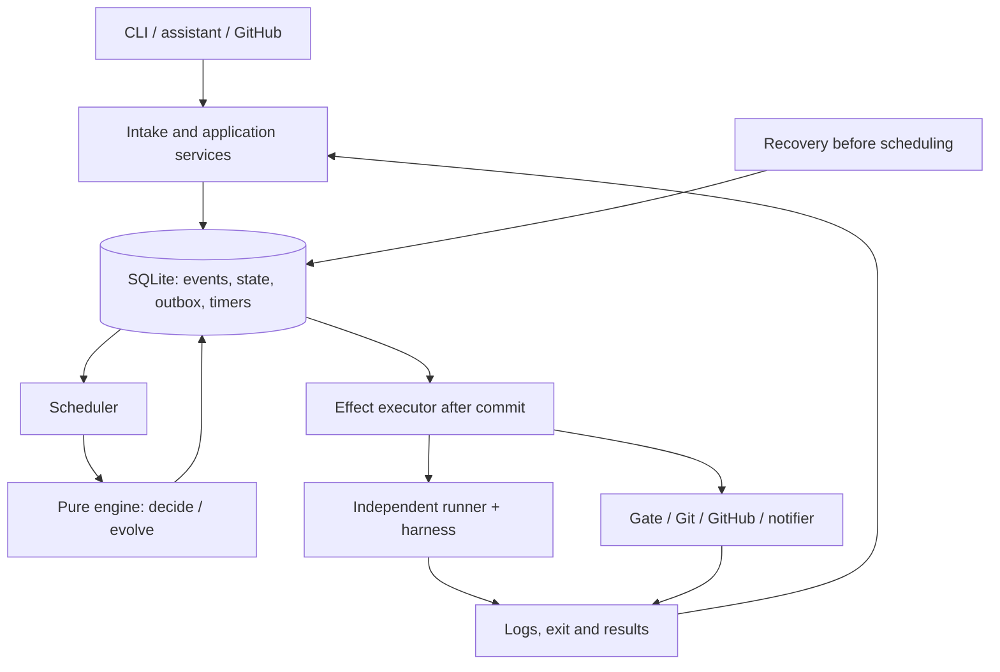

# Cuesura — Overview specification

**Version:** 0.2 · **Date:** 2026-10-29 · **Status:** Design specification, not yet implemented.

> Every call has a cue. Every pause has a purpose.
>
> Every call has a cue. Every pause has a reason.

This document defines the behavior, system boundaries, and acceptance criteria for all of Cuesura. It is the foundation for splitting out component specifications later; it is not a list of implementation tasks. [README](README.md) introduces the product; the [architecture review](docs/architecture.md) records the reasoning, the tool survey, and the alternatives considered. When two documents describe the implementation contract differently, this SPEC is authoritative and the related documents must be updated.

**MUST / MUST NOT** mark acceptance requirements. **SHOULD** marks a default that may be replaced by a recorded decision. **After v1** marks direction, not a v1 release condition. The CLI, JSON, and path examples below are the intended contract, not features that already exist.

Quick links: [Scope](#2-scope) · [Invariants](#4-system-invariants) · [Workflow](#7-software-development-workflow) · [Runner](#12-runner-contract-and-agent-results) · [Stack](#17-technical-baseline) · [Acceptance](#18-acceptance).

## 1. Product goal

Cuesura is a deterministic, event-driven workflow engine that orchestrates AI agents across multiple harnesses. Users set goals and limits; code chooses the next step, agents perform the specialist work, and users take part at the points where a decision is needed.

The name **Cuesura** combines **Cue** (a signal to start) and **Caesura** (a deliberate break in music or poetry). A wait is a stateful part of the workflow with a stated reason: the system keeps watching the required condition without keeping an agent running just to wait. The CLI uses the short name **`cusr`**.

The first use case is software development: receive task → code → gate → review → PR → CI → merge. The engine core holds no knowledge of programming languages, build tools, model providers, or task intake channels. The long-term goal is to support other workflows through adapters with clear contracts; each new workflow is a preset in code with tests for its graph, not a graph that users declare themselves.

Target outcomes:

- Complete tasks with few coordination steps and few wasted agent runs.
- Every decision can be explained: where the task is, why it stopped, which model was used, and which limits remain.
- Recover after a crash without losing committed state, running an agent twice, or repeating external operations that already succeeded.
- Users keep control of policy, cost, write permissions, and merging.
- Works across many repos and ecosystems without changing the engine.

Routine state transitions do not call an LLM. Tokens used by the coder, reviewer, scout, and refiner are still counted in full; the claim of “0 coordination tokens” applies only to the state machine and scheduler.

## 2. Scope

### 2.1 V1

V1 serves one user on a single Linux/Ubuntu or WSL2 machine and can manage multiple allowed repos. Worktrees and runtime data live on the local Linux filesystem. Initial parallelism targets 2–3 tasks, limited by resource pools.

| Area | V1 scope |
|---|---|
| Task sources | CLI, assistant via CLI, GitHub issues/comments via polling; normalized and deduplicated into one format |
| Workflow | Fixed `software_dev@1` graph in code, finite conditions, bounded loops; user config only tunes parameters (§8) |
| Agents | Claude Code and Codex CLI run headless; fake harness for testing |
| Policy | Role/model/profile, snapshots, budgets, bounded escalation ladder for effort/model/vendor |
| Execution | Independent runner, separate worktree, setup, gates, role-specific context, logs and artifacts |
| Coordination | Dependency DAG, priority, pools, quota cooldowns, durable timers |
| GitHub | Commit/push/PR/comment, waiting for CI, failure classification, CI fixes, SHA-bound and serialized merges |
| Users | Inbox, answer, approve, cancel; Telegram is the default channel for questions/approvals, GitHub for tasks from issues |
| Terminal UI | `cusr` opens an interactive interface to monitor, create tasks, confirm configuration, and handle pending items, through the same services and permissions as the CLI; details in [spec 004](specs/004-terminal-tui/spec.md) |
| Decisions | Made by the authorized person; recorded and explainable |
| Task groups | Manually created groups, dependencies, optional integration branch, integration task, and group-level acceptance |
| Operations | Recovery, backup/restore, migration, doctor, health, history, and usage reports |

### 2.2 After v1

- Pi/ACP adapter, MCP server, and form/HTTP interface.
- A planner that splits epics automatically; new task sources such as Telegram, Slack, email, and other trackers. Telegram in v1 does not accept new tasks.
- Full toolchain packs for Node, Python, Go, Rust, and JVM; automatic context addition as one escalation rung.
- Remote workers, emulator/browser lifecycle, screenshot comparison, web dashboard.
- Webhooks, cost-based routing, and multi-user support with its own authentication.

V1 has no continuously running Primary AI, no plugin marketplace, no workflows that modify themselves at runtime, and no mechanism for agents to grant themselves permissions. A durable-execution framework, message broker, and database server are not part of the v1 baseline.

## 3. Users and key journeys

| ID | Journey | Observable outcome |
|---|---|---|
| S01 | The user submits a task with acceptance criteria via CLI or GitHub | A single task is created; if eligible it runs and creates a PR; it completes once the merge is confirmed |
| S02 | An assistant creates a task, or the user submits a request missing information | The task waits for confirmation or added information; the coder is not called and no worktree is created |
| S03 | A gate, review, or CI finds a failure | Fixes run in a bounded loop; every run, result, and model escalation is traceable |
| S04 | An agent asks a question mid-run | The agent ends its run; the question appears in the inbox on the right channel; one answer lets the task continue |
| S05 | The daemon stops while an agent is running or a PR was just created | On restart it reclaims the agent, result, and PR; it does not create a second run or a second PR |
| S06 | A harness runs out of quota or infrastructure fails temporarily | The task waits with a reason and a scheduled recheck; the model is not escalated because of an infrastructure failure |
| S07 | Multiple tasks, independent or dependent | Independent tasks run within pool limits; dependent tasks wait for their prerequisite results; no shared worktrees |
| S08 | The base branch changes or the user turns off yolo before merge | The system rechecks; old CI/approval is not enough to merge; a revoked yolo permission takes effect for merge commands not yet sent |
| S09 | The user edits a request or reverses a decision | A new revision/audit entry is created; inputs are never silently changed, and external side effects are not pretended to be undone |
| S10 | The user asks for progress, restores a backup, or upgrades the version | Status and evidence are readable via the CLI; data can be restored; incompatible versions are rejected |

## 4. System invariants

| ID | Mandatory rule |
|---|---|
| I01 | For the same recorded state, workflow, policy, and input, `decide` produces the same events/commands. `evolve` only applies events; neither performs I/O, reads the clock, or generates random numbers. |
| I02 | One daemon holds write access to the state store at a time. The CLI, assistant, and runner never write directly to the database. |
| I03 | A trigger is accepted in one transaction: record dedup, append events, update projections, outbox, and timers. Effects run only after commit. |
| I04 | Each logical operation has a stable idempotency key. An unclear result after a timeout or crash must be reconciled before retrying. |
| I05 | An executing task has one worktree and its own branch. Within that worktree, all steps run sequentially; no two attempts run at the same time. |
| I06 | A successful exit code and an agent saying “done” are not enough to pass a step. The result must match the schema, belong to the right attempt, and pass all mandatory gates. |
| I07 | The engine honors declared limits; optional execution caps may be unlimited per §9.4. A waiting task always has a reason and a way to continue or end. |
| I08 | Workflow, policy, and original input are immutable per revision. Any change requires an event, an actor, a reason, and a new version. |
| I09 | Every agent call must satisfy the resolved role, binding, permissions, approval, pool, and budget. Agents may not change those limits themselves. |
| I10 | Event order comes from the committed sequence; it is not inferred from IDs or system time. A repeated trigger creates no additional logical effect. |
| I11 | A merge effect sent by Cuesura is performed only by code, after checking permissions, head/base, gates/CI, review for the mode, and merge approval. `full-review` requires reviewer approval, except for a base-integration run with scope certification per §14.2 and a minor-finding fix run that carries over approval (see task-execution-modes). A manual merge by the user on GitHub is an external action, reconciled through its own evidence; no review/approval is faked and no guard is invoked to send the merge. Agents do not decide merges. |
| I12 | Terminal states never reopen on their own. A retry after termination creates a new task linked to its source; the history of the old task is kept unchanged. |

## 5. Domain model and data

### 5.1 Entities

| Entity | Responsibility and key data |
|---|---|
| Project | Allowed repo, base/protected branches, paths, gate/setup configuration, and the current yolo permission |
| Task | Standard request, revision, state, dependencies, frozen workflow/policy/context, worktree/branch/PR |
| Group / Epic | Group-level goal and acceptance, child tasks, integration branch, and integration task; not an attempt by itself |
| Step | A node of the workflow; kind, role/action, resource pool, outcome, transitions, and limits |
| Attempt | One execution of a step; actual binding, harness version, session/process identity, timing, result, usage, and artifacts |
| DomainEvent | Immutable event with schema version, task/revision, sequence, actor, causation, and payload |
| Effect | Durable I/O intent in the outbox; ID, idempotency key, request, state, retry count, and result |
| Timer | Wake-up condition with ID, due time, and payload; can be cancelled or consumed within a transaction |
| Question / Decision / Approval | Question, answer, decision maker, evidence, scope of validity, and revocation/overturn status |
| SourceEvent / TaskLink / Message | Deduplicated raw inbox, links from tasks to sources, Q&A history, and sync |
| Artifact | Logs, diffs, gate/review results, document snapshots, and standard results; with provenance and hash when needed |

Tasks, attempts, and effects use UUIDv7. An ID is an identifier, not a duplicate-prevention key. `events.seq` increases per task; the event log has a global commit order for tracing. A short ID prefix may be shown if it is unambiguous; the CLI must reject a prefix that matches more than one record.

### 5.2 Standard task

A task has `schema_version`, `id`, `title`, `type`, `project`, `base_branch`, `description`, `requirements`, `acceptance`, `constraints`, `out_of_scope`, `attachments`, `group`, `parent`, `depends_on`, `priority`, `size`, `labels`, `profile`, `requested_by`, and `revision`.

- `acceptance` must contain at least one criterion before READY. Code checks structure and presence; whether a criterion matches the user's intent is confirmed by the requester or by a permitted refine step.
- GitHub or other channel-specific metadata lives in the source link. The context compiler gives the agent the request and relevant excerpts, but not tokens, control addresses, or the channel's administrative syntax.
- Dependencies must exist, must not reference themselves, and must not form cycles. A FAILED/CANCELLED dependency keeps the dependent task waiting with an explanation; it is not treated as complete.
- Tasks created by an assistant require confirmation at intake by default. Intake auto-confirmation and per-client task-creation quotas are configured by the user. Intake auto-confirmation is the key `intake.auto_confirm` (a list of `requested_by.id`, for example `assistant`) that exists only in user config; cusrd reads it at task creation, records `intake_auto_confirmed` in `TaskCreated`, and does not accept a flag declared by the caller. Per-client quotas do not exist yet. Intake confirmation decides whether to accept the task; it does not replace confirmation of the run configuration before spawn.
- A single interaction may confirm both intake and run configuration if both scopes are clearly shown; the user is not asked to confirm twice when the task set/configuration has already been fully approved.
- The agent that receives a task may read the `when to use` guidance to propose a harness/model/effort and the `direct-pr` or `full-review` mode; the daemon does not infer the mode from the task's content or size. Before the first spawn, the user or an assistant (with `operate` permission) must confirm the specific selection by digest, including the reviewer if there is one. Intake auto-confirmation does not replace run-configuration confirmation; see the mode contract.

### 5.3 Snapshot and revision

Workflow/profile/binding are checked as soon as the task is received. When execution starts, the project configuration is fixed at `base_sha` and the following are created together:

- **FrozenPolicy:** the expanded workflow, the confirmed execution mode, the binding and ladder for each step, permissions, actual gates, limits, decision mode, schema version, and configuration hashes. Confirmation is tied to the exact selection; if the effective configuration changes, confirmation must be requested again before spawn.
- **FrozenExecutionContext:** request content, acceptance, a snapshot of attachments, prompt/conventions, and `base_sha`.

If the configuration is no longer valid at start, the task stays PENDING and must be handled before a worktree is created. A frozen policy is never silently replaced. Output from earlier steps, the current diff, and Q&A are additional context with provenance; they do not replace the original request snapshot.

Source changes made before a run may update the task after validation. After a run starts, a change becomes `source_drift`: the user chooses to continue the old revision, apply the new revision at a safe boundary, or create a new task. A revision change must invalidate results/approvals that no longer fit; it does not automatically reset the budget, the runs already used, or the history.

A policy amendment requires admin permission, a reason, a diff, and a new policy version. V1 does not change the workflow graph of a running task; changing the workflow requires a new task. The current yolo permission is an explicit exception to the snapshot, per §14.2.

## 6. States and scheduling

### 6.1 Task state

| State | Meaning | `wait_reason` |
|---|---|---|
| PENDING | Main workflow not yet run; no task worktree yet | `confirmation`, `needs_info`, `dependency` |
| READY | Eligible; waiting for the scheduler to allocate resources | None |
| RUNNING | Executing or preparing the next step | None |
| WAITING | Started; waiting for an external condition | `human_input`, `approval`, `ci`, `rate_limit`, `policy`, `infra` |
| DONE | Met the workflow's successful completion condition | None |
| FAILED | Ended unsuccessfully per policy or an explicit decision | None; has a failure reason |
| CANCELLED | Cancel request processed and in-flight operations reconciled | None; has a cancel reason |

Valid transitions: PENDING → READY → RUNNING; RUNNING ⇄ WAITING; non-terminal states may move to FAILED/CANCELLED when justified. RUNNING or WAITING may move to DONE after the final result is confirmed, including after recovery. READY may return to PENDING if the pre-run conditions no longer hold. Receiving an answer while PENDING only reruns triage.

`approval_kind` distinguishes merge from escalation. `source_drift`, exhausted fix rounds, and unclassified errors are details of the wait reason, not new states. Review, retry, and CI fixes belong to steps/attempts and do not create additional task statuses.

A cancel does not become CANCELLED while a process or merge request is still of unknown outcome. Block new effects, stop the task's processes within limits, reconcile the effects already sent, then record a state that reflects reality. Cancelling does not undo a merge that already succeeded.

### 6.2 Scheduler

- Select eligible tasks by higher numeric priority first (default `0`), then by queue order; run only when every slot the step requires is available. For the feature 002 execution slot (tied to a task; at most `runtime.concurrency` tasks hold it at once), at the same priority a task already started that is re-requesting a slot goes ahead of READY tasks; within the same group, ordering uses the current slot request time, with ties broken by committed event order. A task waiting on an external condition holds its slot as a time-limited reservation, which lets a never-started task borrow it; when the waiting task comes back, it runs immediately.
- Keep the worktree lock and resource slot for as long as the attempt is actually still running, including across daemon restarts. Restore claims before granting new work.
- A pool is a name plus a capacity; the engine does not know what `build`, `browser`, `emulator`, or `test_db` do. Hotspot hints allow serializing file areas that are prone to conflicts.
- A rate limit locks the related pool/harness until `reset_at`, even if that is beyond the backoff cap `max_ms` (the cap only limits self-computed delay; the task deadline still applies). If the reset time is unknown, use a finite backoff and report it clearly. Never switch to a model outside the policy on its own.
- Waiting for a person, CI, or a cooldown does not keep an agent alive just to wait, and does not consume LLM calls.
- Timers must be durable and consumed exactly once logically; external polling has a timeout, and backoff and jitter that can be controlled in tests.

## 7. Software development workflow

| Step | Required behavior | When not met |
|---|---|---|
| Triage | Check permissions, task, acceptance, dependencies, and policy | PENDING with a clear reason |
| Prepare | Snapshot, create worktree/branch, run setup per configuration | Classify the error and wait/retry a finite number of times |
| Scout, if enabled | Gather missing context, read-only | At most one run by default; if critical context is missing, ask the user |
| Code | Coder edits in the worktree, prepares the commit message and PR title/description per the frozen template, returns a schema-conforming result | Ask the user, add context, or handle the error per policy |
| Gates | All mandatory gates pass together on the final code tree; if a formatter/gate modifies code, re-run the gate set within limits | The worker receives the errors and the latest state; if the final tree is not proven, block |
| Checkpoint | After gates, the orchestrator commits the reconciled code state using the worker-prepared message | Durable intent/OID; gate evidence matches the tree |
| Review, `full-review` only | Reuse valid evidence when all inputs are unchanged; otherwise a separate reviewer session (its changes are returned), checking acceptance, the pinned commit, and PR content | Findings → worker fixes → gates → commit if code changed → evaluate evidence; if there is no progress, keep the findings and apply the limits |
| Publish | Orchestrator pushes the exact verified SHA and creates or reclaims the PR using the worker-prepared content | Ref/tree/worktree drift blocks; probe before retry |
| CI | Wait for required checks on the exact head SHA | Infrastructure/flaky: finite rerun; autofix: gate; code failure: coder/fixer, then re-run the needed gates/review |
| Merge | Serialize by target branch; recheck all conditions | Update the base and re-run checks, or WAITING |
| Complete | Confirm the merge, save artifacts/usage, sync the source | Conditional cleanup; a notification error does not repeat the merge |

A task may continue on an already-open PR instead of creating a new one: `task add --pr <owner/repo#n>` keeps the task in `adopt_approval` until an admin runs `task approve --kind adopt --head-sha <sha>`. Then both modes below push to the PR's head branch, fast-forwarding only from the approved head; no new PR is opened, and the PR title and description are kept. Only open PRs in the same repo, with the correct base, and not belonging to any live task are accepted; if the head changes before start it must be approved again, and after start it stops at `head_changed`. The frozen base is the merge-base of the head and the base branch, so configuration is read from the base branch rather than from the PR. The task keeps its own local `cusr/` branch and does not need the head branch checked out on the machine.

Two modes are confirmed by the user before running: `direct-pr` does not call a reviewer; `full-review` requires review before publish. The mode is not chosen automatically by size XS, and it does not require a different vendor/model. The reviewer uses its own session; any changes it leaves in the worktree are returned by the daemon; approval is tied to a specific base SHA/commit SHA. Code changes after review must pass gates, produce a new commit, and be reviewed again, except for the base-integration exception with scope certification in §14.2 and a minor-finding fix that touches only the finding's file and its tests; publish does not add more code commits after approval.

If the task's remote branch changes to B while A is under review, a late result for A applies only to A and does not clear `head_changed` or B's certification. An approval that arrives before the drift is observed must still pass the remote expected-old guard before publish; a restart keeps the blocker and receipt. A change of only the base tip does not by itself invalidate the review of A. See H01–H06.

When quota runs out, wait or propose another option for the user to approve; never change the mode/binding outside the approved set on your own. Fix rounds within limits do not ask again; changing the mode alters the graph of a task that has already run, so across all of v1 it requires a new task per §5.3. `direct-pr` does not grant merge permission by itself: the daemon sends a merge only when the current yolo setting allows it and the §14.2 conditions are met. See the detailed contract and verification criteria.

Each time a fixing worker is resumed, it MUST receive a new packet recording the cause, the log/findings, the checkpoint/worktree/diff, the PR content, and the current Q&A. Within the same task/revision, review is re-invoked only when needed: if the approval/findings are still valid and all review inputs are unchanged, the evidence is reused; a no-op worker creates no new commit and does not ask the reviewer again. See the reuse conditions.

Setup, formatters, and gates are commands from trusted project configuration and may have side effects. Do not assume every shell command is “pure”; retry automatically only when the command's contract allows safe re-running.

## 8. Configuration and loader

- `~/.cusr/config.yaml`: harness, model alias, role, workflow, profile, shared pool, and repo administration configuration. A workflow only selects a built-in graph (`base: software_dev@1`, required) and tunes step parameters: `max_visits` (steps that already have a visit limit), `max_rung` (agent/review steps), `run`/`required` (gate steps), and `poll`/`timeout` (CI steps). Steps, `start`, `kind`, role, action, predicate, edges, or outcomes cannot be declared; old config that still contains these keys is rejected with `workflow_key_removed` along with the path of the key to remove ([upgrade guide](docs/config-upgrade.md)).
- `cusr.yaml` in the repo: setup, gates, autofix, log digest, failure signature, CI rules, its own pools, hotspots, and conventions.
- Toolchain packs are preset data. Application order: pack → project configuration; profile → overrides permitted when a task is created. An override may not widen permissions beyond the caller's own.
- Project configuration is read from the selected revision. An agent editing `cusr.yaml` within a task does not change the gates of that same task.
- Hashes are computed over the normalized effective configuration and stored with the snapshot and its source. A configuration change affects only new tasks, unless an approved amendment exists.

The loader uses eemeli's `yaml` package with the core schema and no custom tags; it keeps node positions so errors read like `cusr.yaml:14:7`. It rejects duplicate keys, unsupported tags, invalid references, and input exceeding the configured size/alias limits.

Checks before execution:

1. Every referenced role, model, pool, and gate exists; each adjusted step exists in `software_dev@1` and accepts that parameter; a `required` gate is listed in the step's `run`.
2. Graph in code: the start step and transition targets exist, outcomes per step kind form a finite set, and every outcome and every skip/exhausted case has a defined target. Because the graph is fixed, this is verified by code tests for `software_dev@1` and for each mode graph, plus a property test that every valid parameter set leaves `structure_hash` unchanged.
3. Every cycle in the graph passes through a limit with a counter that does not reset when the loop repeats; checked as in item 2. The total agent runs and task duration are optional caps; they are not required for a valid configuration.
4. The escalation ladder can be reached within the adjusted step's visit limit; a rung configuration that cannot be reached must be reported as an error.
5. Each step has a valid starting binding. A rule excluded by the allowlist is skipped to try the next rule; if no rules remain, the task must not become READY.
6. Predicates come only from a predefined set such as flag/size/label/type/attempt/branch; free-form conditions are never `eval`'d or interpreted by an LLM.

A project gate that is not declared may be skipped only under the optional rule and is recorded in the snapshot; a missing mandatory gate is an error. Having no gates at all is valid only when the profile allows `allow_no_gates`; even then, auto-merge is not eligible if mandatory checks are missing.

## 9. Roles, escalation and budget

### 9.1 Roles and permissions

The daemon creates branches/worktrees; coders/fixers may write code and commit on the task branch, but may not push or publish. A fixer is the fixing role of the worker that made the change: for gate/review/CI failures, it prioritizes resuming that worker's session per the resolved binding, rather than creating a new worker just because the step was renamed. Reviewers may edit and run checks, and the daemon restores the worktree after the review run; scouts are read-only; a reviewer always uses a session separate from the worker. A refiner may propose acceptance criteria at most once, when the profile allows it; the planner that splits epics comes after v1.

A binding consists of harness, model, effort, permissions, and the actual supported limits. Model names and CLI flags live in adapter configuration, not hard-coded in the engine. Resume is used only when the harness is the same, the session is still valid, and policy allows it; otherwise a new session is started with a bounded context packet.
### 9.2 Failure classification

| Class | Default handling | Counts toward quality escalation? |
|---|---|---|
| Rate limit | Cooldown and timer; does not increase the quality-failure count | No |
| Infra/transient | Retry at the same rung with backoff; no default cap on retries | No |
| Auth/config | Wait for a person to fix it; no blind retry | No |
| Timeout/stall | At most 1 retry; if it still fails, ask about scope/time | No |
| Invalid output | One short repair run, then at most one new session; if still wrong, consider the next rung | Yes, per the role's ladder |
| Refused | Record the reason and wait for a person; do not retry or escalate on its own to get past a refusal | No |
| Quality | Gate failure, review rejection, CI failure caused by code; the failure signature is computed | Yes |
| Unknown | Reconcile further or WAITING; dangerous effects are never replayed on a guess | No |

Every actual agent call, including repairs, resumes, and calls that hit a rate limit, is recorded as usage and counted toward `max_agent_runs`. “Retries due to rate limits are not counted” only means the quality-failure counter is not incremented. I/O retries still have a limit per request; the task-wide retry cap and the task-wide deadline apply only when declared.

### 9.3 Escalation ladder

- The FrozenPolicy holds each step's ladder and the state of each rung: `auto`, `needs_approval`, or `denied`. If a step is not permitted to use a model, an ordinary approval does not make that model valid; an amendment by an authorized person is required.
- Two consecutive failures with the same signature at the same rung trigger an escalation review. A changed signature allows more runs, up to `quality_tries_per_rung` quality attempts per rung (default 5, no hard cap). If effort is raised but the error is unchanged, a same-model rung may be skipped per the approved ladder.
- A check failure is attributed to the most recent agent step that edited code. A pass resets the consecutive-failure chain, but does not lower the rung or reset the total run count.
- `rung[task, step]` only increases or stays the same. Returning to an earlier step keeps its rung; a step that has not run yet starts at that step's own resolved floor.
- The task floor only increases. A profile may raise the floor when two steps have already required escalation (`hard`), or when it uses `scope: task`. The loader must map the floor onto each role's ladder; the same rung number in two roles does not mean the same model, and the floor must not exceed the role's last rung.
- An approval is tied to the task/revision, step, rung, and policy hash. Returning to the same step with an unchanged policy may reuse the approval; a different step or a changed policy requires rechecking permissions.
- Every escalation, including one caused by the task floor, must pass the escalation limit and the budget. When visits, `max_escalations`, or the budget run out, it waits for a decision; limits are never silently extended.
- When no usable rung remains, the task ends as `FAILED` with a reason instead of waiting for a person (issue 247): when the last rung is exceeded (`ladder_exhausted:<step>`), when the next rung is `denied` (`rung_denied:<step>:<rung>`), or after start when the needed rung has a binding outside the confirmed set of worker/fallback/reviewer/fallback reviewer (`run_config_unconfirmed:<step>:<binding>`, issues 245, 276), because it cannot be confirmed again after start. An already-open PR is kept as is (draft until approved). A task that has a run config but no PR yet first commits whatever the worktree holds to the task branch (it has not passed gates, so it is not a checkpoint), pushes, and opens a draft PR `[failed] <title>` with the reason in the body; the `FAILED` reason also appends `(draft PR <repo>#<n>)`. If there is nothing beyond the base, no empty PR is opened and the reason reads `(no draft PR: nothing to publish beyond the base)`; a push error is also recorded in the reason rather than leaving the task hanging. Salvage is a `publish` effect with the same guarantees as the normal flow: a fixed commit intent makes the commit (re-running after a crash reuses the intent), and an unclear push/PR-creation result is reconciled using the PR's marker so the PR is still attached to the task. If salvage has not run and the deadline has already passed, or the task failed after the deadline, it ends immediately with `(no draft PR: deadline passed)`; if salvage is running or being reconciled, it ends once the result is known; if reconciliation finds it has not run and the deadline has passed (or it was not requeued), it ends immediately. After each decision the engine rechecks: a task in salvage never moves on while any salvage effect is still pending, running, or being reconciled. Then the slot is released.
- An agent run that times out or runs out of turns is retried `timeout_retries` times at each rung; beyond that count, the rung's failure chain requests escalation as a repeated quality failure (not counted as one quality try), and when the ladder is exhausted the task is `FAILED` as above. Non-agent effects still ask a person.
- Visits lost to the harness (infrastructure, rate limit, sign-in) are refunded automatically when a step reaches `max_visits`, under the same rule as `recheck visits`; only visits that failed due to the work itself count toward `loop_exhausted`.
- When escalations or visits run out due to quality failures (`escalations_exhausted`, `loop_exhausted`; older tasks still waiting on `ladder_exhausted`/`rung_denied` count the same way), the owner may change the model for the waiting step with `cusr task amend-policy` (issue 105): preview first, then confirm the exact policy hash that was previewed. The new binding is inserted as a rung directly above the current rung when the step is requesting escalation, or replaces the current rung when the step has run out of visits; the rung state follows the profile's `allow_models`/`auto_up_to_tier`/`above` in the current user configuration (a model outside `allow_models` or with `above: deny` is rejected; above the automatic tier it still needs approval as usual; an amendment never gets approval waived the way rung 0 does). An amendment is a `PolicyAmended` event with a new policy version: it restores visits as `task continue` does, grants exactly one more escalation if `max_escalations` is exhausted, and for a task with a run config the new binding is treated as confirmed for that role. The task continues from the waiting step, keeping the worktree, evidence, and history; gates and review run again.
- The only exception to the try count: a review/fix loop that makes no progress (`review_repeated`, `fix_no_src_change`) is not sent to a person; the engine answers it itself (actor `engine:auto`, issue 247). The fixer runs again with a note naming the files it skipped, and is guaranteed at least one run at the current rung: a failure chain that has already requested escalation gets exactly one run, while one that has not requested escalation keeps its remaining tries. Each failure chain (step, rung) gets only one such run; if it repeats, the rung is escalated, and when the ladder is exhausted the task is `FAILED`. This run does not change the ladder, the floor, step entries, the budget, or the deadline. A person's answer to a `review_repeated` wait left over from an older version is handled as before.

### 9.4 Budget

A task has no budget object: the profile no longer has a `budgets` key, and old config that still contains it is rejected at load. A new policy freezes `max_agent_runs` and `max_wall_ms` as `null`; older tasks keep the caps they froze. Per decision issue 45, `max_escalations_per_task`, `infra_retries`, backoff `max_attempts`, the wall time of workers/commands, and the Claude pin's `max_turns` are optional and unlimited by default; omit the key or set `null` to apply no cap; an explicitly declared value still takes effect.

Limits on entries into a step, quality-failure handling, permissions, approval, pools, and I/O volume are still configured separately. An attempt does not start if it would exceed a declared cap or lacks approval. Slots and reservations are still recorded before spawn, and usage is still fully recorded when there is no cap.

An attempt's wall timeout is measured separately from the task-wide deadline. When declared, the task deadline starts when the workflow first runs and includes waiting time; when it expires it blocks new attempts and moves to waiting for the user's decision. This deadline now exists only in older frozen tasks; it is not extended automatically on restart or revision change.

Usage distinguishes `reported`, `estimated`, and `unavailable`; a 0 is never recorded in place of missing data. Subscription cost and API cost are not treated as the same. Cuesura has no cost cap. When there is no deadline, the engine and runner do not create a substitute deadline; configured cancellation and stall detection still work.

## 10. Questions and decisions

`needs_input` ends the attempt, creates a question, and moves the task to WAITING; if it has not run yet, it stays PENDING. The question is stored before any notification is sent. GitHub tasks receive comments on the issue; CLI/assistant tasks go to the default channel. All of them appear in `cusr inbox`.

Answers from Telegram, GitHub, or the CLI all map to the same question. Permissions and revision are checked, and answers are deduplicated by message/request; the first valid answer wins, and competing answers receive a conflict. Then the task resumes or a new attempt is created, the Q&A is added to the context, and the other channels are updated.

Every decision point waits for a person with permission to answer; no agent decides on anyone's behalf.

**Autonomous.** `autonomous: true` in user config replaces the person who answers a worker's questions with the `decider` role: a new session, read-only, its result recorded through the `decider_ran` trigger and the `DeciderRan` event, the answer carrying `by: agent:decider`, and `<data dir>/decisions.md` written from the event. There is no cap on the number of calls, no confidence threshold, and no review passes; approval and merge are outside this scope. After one decider answer, the next question at the same step and revision waits for a person, except for tasks labeled `grill`. The decider needs at least 2 agent runs left (one for itself, one for the resumed worker), does not run on a paused task, and if a person gets there first (answers, cancels, pauses), it stops and returns its run; the inbox marks the question the decider is holding with `decider: true`. Operational details are in [deploy](deploy/README.md#autonomous). In this mode, the decider cap and the overturn conditions that the sections above describe as reversible do not apply.

## 11. Execution architecture



The CLI sends requests to `cusrd` over a Unix domain socket with restricted access. Ordinary status reads also go through the daemon. Offline inspection tools open data read-only only; migration/restore requires exclusive maintenance mode. No CLI path writes additional commands directly into the database.

The engine receives the state, trigger, workflow/policy, and environment-dependent data captured beforehand. The scheduler/runner is injected with a `Clock`; the engine receives `now` as data. IDs, jitter, and I/O results are produced outside the engine and recorded when needed for replay. Adapters do not decide retries, escalation, or task state.

## 12. Runner contract and agent results

### 12.1 Process and files

The daemon uses `node:child_process.spawn` to start an independent runner, redirects stdio to files, and separates its lifetime from the daemon. Feature 002 calls `systemd-run --user` through `spawn`, placing the runner in its own transient service that is not tied to the daemon's lifecycle and does not restart agents on its own; the systemd user manager is a prerequisite even for a foreground daemon. The runner spawns the harness within a managed process group; the harness must not accidentally be detached from a group that needs to be cancelled. Doctor checks that the user manager is available and that systemd is really enabled on WSL2; the ability to survive a daemon service stop/restart must pass a spike before rollout. See [ADR-0002](docs/adr/0002-systemd-runner-lifetime.md); `detached` on its own is not evidence.

Each attempt has its own directory `~/.cusr/runs/<attempt_id>/`:

| File | Contract |
|---|---|
| `invocation.json` | Cwd, argv with sensitive information masked, harness/model/version, task/revision, policy/schema hash; contains no secrets |
| `pid.json` | PID, PGID, process start ticks, host boot identity, and attempt identity |
| `events.jsonl`, `stderr.log` | Raw output for re-ingestion; subject to size limits and a retention policy |
| `liveness`, `progress.json` | Runner still alive; progress signals of the harness and child processes |
| `exit.json` | Exit code/signal/end time written by the runner, even when the daemon is not running |
| `out/result.json` | Standard result artifact per role, validated and published atomically by the orchestrator |

Complete state files are written as tmp → fsync → rename → fsync of the directory. JSONL ingestion processes only complete lines and stores the offset in the same transaction as the data derived from them. Rotation must keep uningested content readable; unprocessed log segments must never be silently lost.

The runner sets `CUSR_ATTEMPT_ID` for the process tree; the marker helps find and reconcile processes and is not an authentication mechanism. Claiming the attempt and reconciling processes must prevent a retried spawn effect from creating a second runner in the window where the daemon dies before the PID is saved.

### 12.2 Liveness, progress and timeout

- Liveness indicates whether the runner/process is still alive; progress is based on output, CPU of the process tree, file changes, and child-process activity.
- Silence on stdout does not by itself prove a stall. A stall is concluded only after a period with no progress signal, per policy.
- Timeout, stall, or cancel sends SIGTERM to the attempt's group, waits a finite interval, then sends SIGKILL; leftover processes are checked, and shared processes not belonging to the task are not killed.
- A running timeout uses a monotonic clock. Durable timers use UTC timestamps; after sleep or reboot they must reconcile and must not reset the deadline or fire a duplicate trigger.

### 12.3 Schema and result sources

Zod 4 is the source of type definitions and validation; JSON Schema is exported with `z.toJSONSchema()`. Exchange schemas use the subset of JSON Schema that both harnesses accept: a root object, closed objects, required fields, and `null` or empty arrays for absent values. Business checks still run after structural validation.

Coders/fixers return a `status` of `done | needs_input | needs_context | blocked`. `questions` is a list of questions with content and options if any; `blocker` is a description or `null`. Example coder result:

```json
{
  "schema_version": 1,
  "status": "done",
  "summary": "Implemented the task criteria",
  "questions": [],
  "blocker": null
}
```

Coders/fixers also prepare a commit message, PR title, and description following the template from the frozen base, as artifacts outside the code; the orchestrator uses that content to publish. This is an additional contract that needs schema versioning and verification, and it is not yet in the current example schema.

A reviewer returns a verdict of `approve | request_changes`, a summary, and findings with severity/file/line/message; `request_changes` if and only if critical or major findings remain. Each role has a versioned schema; task/attempt metadata and provenance are attached by the orchestrator, and IDs that an agent declares about itself are not trusted.

The preferred source is the harness's structured final response. The adapter normalizes the response, and the orchestrator validates it and then stores `out/result.json`. A structured-output flag does not automatically validate arbitrary files that an agent creates. A fallback file is used only when the adapter explicitly declares it, has a per-attempt path of its own, and is checked for equivalence. An older `result.json` from a previous step must never be read by mistake.

The day-one spike must run every role schema supported in v1 with both Claude and Codex. It checks both that the schema is accepted and the actual output; fixtures are saved together with the harness/model versions. A schema error, refusal, missing or truncated output, or failed exit must never be turned into `done`. A read-only reviewer can still return its result through the harness output and does not need write access to the repo.

## 13. Persistence, outbox and recovery

### 13.1 Store

SQLite uses WAL, `synchronous=FULL`, foreign keys, and a finite busy timeout. `better-sqlite3` sits behind a thin store module that provides transactions and domain operations; no connection is exposed to the engine or adapters. `node:sqlite` is an alternative driver that may replace it after passing the same contract tests; it is not a backend running in parallel in v1.

Transactions perform only short work on local data; they never spawn processes, make network calls, or `await` inside. Events, projections, effects, and timers either all commit or all roll back. Unique constraints protect the event sequence, source deduplication, request IDs, and effect idempotency keys. Optimistic versioning blocks commands based on stale state.

### 13.2 Effect

Each effect has its own ID, and its `idem_key` is derived from the identity of the logical operation, namespaced by project/task/revision where appropriate. Transport or recovery retries keep the same key; a new business attempt gets a new identity.

| Effect | Reconcile before re-running |
|---|---|
| Start agent | Attempt claim, run directory, process identity, and exit artifact; reclaim a still-live attempt |
| Setup/gate/autofix | The command's re-run contract; recorded checkpoint and results; if the command is not safe, wait for a person |
| Commit | Trailer containing the effect key, and the expected content/checkpoint |
| Push | Remote ref and expected SHA; if the remote is at a different SHA, reconcile; never force-push blindly |
| Create PR | Repo, head/base branch, and the marker created by the orchestrator; reject the marker namespace in the worker's title/body; do not accept a PR matched only by worker content; distinguish open, closed, and merged PRs |
| Comment/sync/notify | Marker or dedup key on the channel side, if any; a channel that does not support probing needs its own policy |
| Merge | PR state, merge commit, expected head/base, and current permissions |
| Cleanup | Existence, ownership, commit/push state, and data that must be preserved |

Protocol: commit `started` → perform the I/O → commit the result and the next trigger. A crash after the external operation succeeds but before the result is committed must recover the success through a probe.

The delivery model is at-least-once. The goal of not repeating effects relies on unique keys, sequential execution, and probes, not on a distributed transaction. A probe that hits a network error or lacks enough evidence returns `unknown`, and must not be treated as “did not happen”. For channels without reliable idempotency/probing, a notification may be duplicated and must carry the same question/effect ID; a duplicate notification must never double a decision or a dangerous operation.

### 13.3 Restart

1. Hold the exclusive daemon lock; check schema compatibility, back up before migration, and check database integrity.
2. Reconcile open attempts with the run directory, process identity, and `exit.json`; ingest the remaining log content exactly once logically.
3. Reclaim live processes and transfer ownership to the new daemon instance; do not spawn a replacement until the old attempt is proven to have ended.
4. An attempt that died without an exit record is classified `lost`. Resume at most once if valid; before any reset or rerun, existing data and checkpoints must be preserved.
5. Probe in-flight effects: if unknown, wait; if successful, record it; if not performed, return it to the queue when it is safe.
6. Restore slots, worktree locks, timers, and orphaned steps. A regenerated command must keep the same idempotency key.
7. Write the recovery report before letting the scheduler grant new work. A mass loss of signals must trigger a circuit breaker and an alert.

A worktree must not be reset just because HEAD differs from the checkpoint: a commit made before the crash may have succeeded. When the state store cannot be written, stop emitting new effects and report an unhealthy status; do not claim WAITING was saved if the transaction actually failed.

## 14. Worktree, merge and task groups

### 14.1 Worktree

The orchestrator creates and owns the worktree at `~/.cusr/worktrees/<project>/<task_id>`, with a branch per task. It does not use the harness's own self-managed worktree mechanism. Setup runs when the environment is prepared and is re-run only per the project's retry contract.

Temporary context and output must be excluded from git. The cwd and writable paths are checked before running; scouts and deciders are read-only, and reviewer changes are returned. If a change outside the allowed area is detected, stop and reconcile; do not automatically attribute every user change in the original repo to agent behavior.

A checkpoint is taken before any step that may write; the orchestrator commits changes after a successful step. A lost worktree is restored from its branch/checkpoint when there is enough evidence. Cleanup happens only after completion and after the retention period; uncommitted changes or unpushed commits are preserved and not deleted.

### 14.2 Merge

By default, **squash merge** is used so that one task/PR corresponds to one commit on the target branch. A repo may change this with `merge.method` in `cusr.yaml`:

```yaml
merge:
  method: squash # squash | merge | rebase
```

The feature 002 loader and runtime snapshot already accept this key; the v1 merge effect does not exist yet. `merge` is a closed object with only the `method` key; if the whole object or the `method` key is omitted, the default is `squash`; a value outside the enum or of the wrong type must be reported as an invalid configuration. `merge` means creating a merge commit, and `rebase` means rebase-merging the PR; it does not mean automatically rebasing the task's worktree. The method is read from the frozen base and is frozen together with the policy/context when the task starts; a config change affects only tasks that start afterward. The method does not change the `direct-pr`/`full-review` graph, merge permissions, approval, or yolo permission. The new default applies only when a new task is resolved; an older snapshot without this field keeps its hash/content unchanged and records that no choice was stored, without back-assigning the default to history.

When Cuesura is allowed to send a merge effect in v1, it must use exactly the frozen method; if the repository does not allow that method or it cannot be verified, wait for a person and do not fall back automatically. For squash, use the current validated commit message artifact prepared by the worker; store the content/digest together with the merge intent so that recovery does not construct a different message for the same operation.

Feature 002 only observes manual merges: the method is a suggested choice that provides the same squash message to the user, and it does not call the merge endpoint or block a task just because the repo does not enable the suggested method. A user who merges with a different method is still recorded under a valid merge proof; if the actual method is evidenced, the difference is recorded for audit and is not used as a blocker or as a reason for `merged_head_unverified`. If the method cannot be verified, record `unknown`; do not guess from the commit graph, and do not treat it as a missing merge proof. Always store separately the verified head, the PR head at merge time, and the commit on the target branch; squash/rebase can change the commit SHA without making the head-at-merge differ from the verified head.

Protected branches include the default branch by default. The checks below apply only when **Cuesura sends a merge effect**; they do not apply to prevent or deny a manual merge that already happened on GitHub. Each target branch has one merge queue; immediately before the merge effect, the following must be checked:

1. The head SHA matches the gate/CI results, and there is valid approval for the merge operation; a reviewer approval on the same head is required for `full-review`, except for a base-integration run with scope certification below. `direct-pr` does not need reviewer approval, even with auto-merge.
2. The head includes the current base tip; if the base has changed, update the branch, re-run the necessary gates/review, and CI.
3. All required checks are present and successful; pending, cancelled, missing, or unknown is not a pass.
4. Auto-merge for `full-review` requires reviewer approval or the base-integration scope certification below; no unresolved serious findings remain.
5. Merge permission is still valid, existing GitHub rules are enforced by GitHub, and there is no cancellation request blocking an unsent effect; enabling branch protection is not required.

The local queue only serializes Cuesura's own merges. The daemon checks that the head contains the current base tip using a compare of `head...target_tip_sha` (`ahead_by === 0`), and sends the expected head `sha`. Branch protection is optional, and enabling it is recommended as an extra layer enforced by GitHub. Without protection, GitHub does not block a race where the target branch gets a new commit or a check changes result between the daemon's read and the merge; the expected head only blocks a PR head that has changed.

Users may merge both `direct-pr` and `full-review` PRs manually on GitHub, subject to permissions and branch protection. Cuesura reconciles repo/PR/target/head-at-merge and completes based on evidence; it does not fake internal review/approval or send another merge command. If the head has not been fully verified for the mode, record that the merge is not certified.

**Yolo in the daemon:** when `yolo: true` is set in user config, after each read of a PR for a task waiting to merge, the daemon re-reads the config and requires the PR to be open, targeting the right branch, with `mergeable_state` of `clean` or `unstable` on the same head that was verified, and a compare of `head...target_tip_sha` returning `ahead_by === 0`. The compare uses `per_page=1&page=2` to read only the total ahead/behind and skip the diff list on page 1, even when the PR has fallen behind the target. If it cannot be read or `ahead_by` is missing, keep waiting. `unstable` only reports that a check outside the required set is failing or pending, so it is accepted because the daemon itself checks that the required-check set is non-empty and all green before merging; `blocked` (e.g. a repo that requires a person's review) still blocks. Protection, `strict`, or `enforce_admins` are not required; if they are set, GitHub enforces those rules when it receives the merge command.

The set of checks that must be waited on in CI, observation, and yolo is the union of the frozen `policy.ci.required_checks` and the names of every required check currently in effect on GitHub, including checks outside the policy and app-pinned checks. `evaluateRequired` computes the union on each read, stores the names/apps in the evidence, does not modify the FrozenPolicy, and does not depend on the yolo flag (FR-042). A new `required_checks_mismatch` is not created just because of a check outside the policy or an app pin; older waits/events can still be replayed and are reconciled again at the next observation within the CI window.

Evidence of `unknown`, incomplete check data, missing permissions, or a name collision all count as not passing. Every check in the union must be `success`; `pending`, `skipped`, `neutral`, `cancelled`, `failure`, or `unknown` all fail. When sending a merge, the daemon also requires an app-pinned check to have a `success` result from exactly the right `app_id`; it does not rely on GitHub, because an admin token may bypass protection. If the union is empty, observation keeps its old behavior: the task moves to waiting to merge and ignores non-required checks; but yolo does not merge in that case, and logs once per task for the daemon's lifetime, with guidance to declare `ci.required_checks` in `cusr.yaml`. No fallback to every check visible on the head is used, because some jobs may not have appeared yet. The `clean` condition is still kept cautious: a failing non-required check may make GitHub return `unstable` and block yolo even when the required checks are all green. A read or validation error in user config is logged and treats yolo as off; it does not change evidence or the observed state.

**Base integration, independent of yolo:** after an observation, a task waiting to merge on a certified head is updated if the PR is still open, on the right head/target, in a `clean`, `behind`, or `dirty` state; the daemon reads the tip through `GET branches/{target}` and confirms `ahead_by > 0` with a compare of `head...target_tip_sha`. `pull.base.sha` is not used, because it may be an old snapshot of the PR. The tip SHA that was read is used consistently for the compare and for the Git fetch/merge; if the tip cannot be read, no update is made. The task re-requests an execution slot and uses the existing workflow, FrozenPolicy, and visit/deadline limits. The yolo flag only decides whether a merge is sent; it does not decide whether the base is updated or conflicts are fixed. If the head is not certified, the PR is closed, there is drift, or the task is cancelled, no update is made.

| Situation | Handling | New review |
|---|---|---|
| Behind the target, no conflict | Daemon integrates the base, runs gates, publishes, and waits for CI on the new head; does not call a fixer | No |
| Conflict on the first attempt | One fixer run; check the scope with Git on the host, run gates, publish, wait for CI | No, if only conflicting files were edited |
| Fixer edits files outside the conflict list | Goes through review before publish | Yes; if `direct-pr` has no frozen reviewer, wait for a decision maker |
| The fixer fails, is blocked, is unfinished, conflicts again, or its scope cannot be checked (including conflicts without markers) after that run | One more automatic conflict-fixer run (issue 247); if it still does not pass, wait up to 12 hours for a person to fix it by hand (timer `wait_timeout`); if that expires, the task becomes `FAILED` (`base_conflict_unresolved: <reason>`) | Only if the automatic run also fails |
| Gate fails after the fix run, or review rejects changes outside the conflicting files | Wait for a person; do not call another fixer automatically | Decision maker |

**Base integration within the review/fix loop (issue 239):** each checkpoint records `base_conflicts`, meaning the files that `git merge-tree` reports as conflicting when the base tip at `refs/remotes/origin/<base>`, fetched locally, is integrated; if that cannot be read, the value is unknown. When a `full-review` rejects a published checkpoint that has not drifted and conflicts with that tip, the daemon integrates exactly that tip before the review fixer run, using the same base update (`fix_step` records the review fixer step), the same handler, intent, and guard as above. If there is a conflict, the review fixer run is the only conflict-fixer run: it receives both the conflicting files and the review findings. A clean merge runs gates and certification, and only then calls the review fixer on the merged head. A gate failure after the fix run goes to the gate fixer as an ordinary fix round; the host rechecks the scope (markers, conflicting files) on the tree from that gate-fixer run, and if markers or conflicts come back, they are handled as in the table above. A new head is not exempt from review: a fix run that carries changes the reviewer has not seen must be reviewed.

A conflict-fixer run that fails, is unfinished, or conflicts again is handled as in the table above: one more automatic run (`auto_retried` on the base update), then a base-repair question with a 12-hour deadline. The timer is tied to the question: if it expires while the question is still open, the task becomes `FAILED`, even when a deadline or source drift is masking it; if it has been answered, the timer does nothing. A new base update for a checkpoint that already used a conflict-fixer run also gets one automatic run in the same way. The conflict-fixer packet requires lockfiles and generated files to be regenerated with the project's own tools rather than merged by hand. Each checkpoint has at most one base update; the number of runs is still limited by `max_visits` of the review/fix and gate steps.

The handler fetches exactly the base SHA and uses `merge-tree --write-tree --name-only -z`. With no conflict, a two-parent merge commit is created with a durable intent and a CAS from the old head. With a conflict, the tree and the list of conflicting files are stored in the intent; this tree is checked out for the fixer but the old HEAD is kept; a commit containing markers is never applied or pushed. The host compares the tree after the fixer and after the gate with the original conflict tree, using a diff that does not guess renames: automatic changes from the base are not counted as the fixer editing outside scope; new or renamed files outside the list are counted. Each conflicting file must differ from the original conflict tree; reporting `done` without changing a file (including modify/delete or binary files without markers) is not automatically certified. `git grep -I -q` is used only on the conflicting files to find opening/closing markers, and a Markdown line `=======` is not treated as a marker. The full diff/diagnostics are not exported to the port; an error, truncation, or timeout while reading the scope yields unmet evidence and is not thrown, so the effect does not get stuck in `started`. If markers remain or the tree has changed unexpectedly, stop. The final commit with two parents is applied only after the gate passes. A branch/worktree that was changed unexpectedly is kept for reconciliation.

`BaseUpdateRecorded` stores the head/base, revision, conflicts, fixer runs, scope, and the certification for the head/tree after the gate. This certification exempts a new review only for a clean base integration or one that only edits conflicting files; it does not fake reviewer approval or reuse the old head's approval for the new head. A different head/tree/revision makes the certification not apply. Out-of-scope edits in `full-review` use the frozen reviewer; if the review does not approve, wait for a person and do not open a second fixer run for this conflict.

**Continuing after waiting for a person:** a conflict-fix error, a gate failure, a repeated conflict, or an out-of-scope edit opens a question through the existing `answer` flow, instead of a `refused` wait that only waits for an amendment. The user may edit by hand in the worktree, and reply exactly `continue` to confirm the chosen versions and re-run gates/publish/CI; for a conflict without markers, the reply records the actor/time confirming the choice to keep the file as it is. Replying exactly `retry fixer` authorizes one more worker run; a timer/observation does not grant that run by itself. Both paths still go through the slot, visit, budget, deadline, and remote expected-old guard; limits are not reset. Edits outside the conflicting files still need review; `direct-pr` may revert that part and continue, or create a new task with a reviewer. A flaky gate after a clean local merge is retried from the same durable intent/OID, without creating an empty merge commit. If the user edits code after a clean merge, the scope is compared with the tree in the durable intent; additional edits outside the conflicting files must be reviewed as usual. Git still blocks creating a new merge if the requested base is already in the head. A `policy/refused` wait from an older version becomes a question when the user runs `task recheck`.

The push uses an expected-old guard and fast-forward; gates/CI must pass on the new head, and then the task waits to merge again. A compare before merge still reads the current tip, so if the target moves on, another update may be needed; if a later attempt conflicts, a second fixer is not called. The intent/event/effect/resume keep the head/base and the budget for one fixer run across slot waits, retries, replays, and restarts. The FrozenPolicy and base snapshot keep the policy and review unchanged.

The engine checks that the task has confirmed its mode, is not cancelled, and that the head is certified by Cuesura; it then records a `policy:yolo` approval with the digest of the publish content. The daemon then re-reads the config and the task state, and sends the merge with the `sha` of that head; for squash, it also sends the commit message of exactly that validated content. A task becomes DONE only when merge evidence is observed. If a condition is missing, nothing is sent and the task keeps waiting; a refusal from GitHub is handled as `refused`, and the user can still merge manually.

**A protected branch has two modes:** `human` approves each PR/head, or `auto` relies on the yolo permission the user granted in advance for the repo. Agents take part in neither mode.

Yolo can be enabled only by a user with admin rights, through a trusted confirmation channel or the user's configuration. It cannot be enabled through the repo's `cusr.yaml`. This is a current permission and is not frozen within the task: it is rechecked when the merge is dispatched. Turning yolo off blocks merges not yet sent, but it does not promise to revoke a remote request already received. Every permission change is audited.

An unprotected integration branch may auto-merge under the frozen policy, subject to the corresponding hard conditions. If CI on a protected branch turns red after a merge, it raises an alert and opens a revert PR when the change that needs to be compensated can be identified; it does not force-push or merge the revert PR itself to bypass the checks.
### 14.3 Group/epic

V1 lets users or an assistant propose child tasks and dependencies, but they are created and run only under intake permission. It does not call a planner to split epics automatically.

A child task may open a PR into the integration branch; a dependent task is ready only when its prerequisite has completed under the workflow. When the child tasks of a group's revision are complete, exactly one integration task is created, with its own worktree, group-level acceptance, the full set of gates, and a review of the entire diff.

A group is DONE only when the integration result is merged into the final target branch. All child tasks being DONE is not enough. Fix tasks arising within the group are also limited; changing the set of child tasks or the acceptance must invalidate the old integration result.

## 15. CLI, source channels and access

### 15.1 CLI interface

| Command group | Contract |
|---|---|
| `cusr` with no command, in an interactive terminal | Opens the interactive interface; outside a terminal it still reports a missing-command error as it does now |
| `cusr init`, `cusr doctor`, `cusr status`, `cusr dispatch` | Repo setup, environment check, health, and guidance for choosing run settings |
| `cusr task add/show/list/explain/history/logs/gates/gate-log` | Create and read tasks; `add` is the standard name for creation |
| `cusr task propose/confirm/recheck/continue/pause/resume/cancel/message`, `cusr queue pause/resume` | Operations with checks for permission, version, and dedup; `message` sends instructions to the task's agent and does not widen scope |
| `cusr task approve` | Escalation: `operate` permission (an assistant can do it); PR adoption: owner only; there is no merge approval |
| `cusr task amend-policy` | Change the model for a waiting step after the ladder/visits are exhausted (§9.3); without `--confirm` it only previews (read permission); `--confirm <policy_hash>` applies it, owner (admin) only |
| `cusr task retry`, `cusr yolo` | Not supported; returns `unsupported_feature` (exit 2) with a replacement command |
| `cusr project list`, `cusr task board/content/progress/options` | Read-only data for the terminal UI; `--json` output like every other command (feature 004 contract) |
| `cusr request show` | Look up a mutation's result by request ID; read-only |
| `cusr inbox`, `cusr answer`, `cusr assistant` | List and answer questions; the assistant lease and wait: `assistant wait` and a wake hook when a task needs a person or when a task ends (item codes `done`/`failed`/`cancelled`) |
| `cusr report` | Project report from a point in time (finished tasks, items waiting for a person, questions answered by the decider, usage) |

`cusr group status` and `cusr admin verify-projections/backup/restore` are not yet in the running version.

`--json` is a common option; the output includes `schema_version`. A finite command returns one JSON object to stdout, including handled errors. Logs/diagnostics go to stderr; no ANSI, spinners, or prompts are mixed into stdout. Streaming commands such as `logs -f --json` use JSONL: each line has `schema_version` and `type` (`record`, `diagnostic`, `state`, `end`), plus a cursor for resuming. A `state` line reports that a task has entered or left a wait; the final line is `end` (`task_finished`, `needs_user` with `wait_code`, `session_limit`, or `daemon_unreachable` with exit 3 after retrying for a few seconds). A cursor beyond the last record returns `invalid_arguments`.

```json
{
  "schema_version": 1,
  "ok": true,
  "data": { "task_id": "019a0000-0000-7000-8000-000000000001", "status": "PENDING" },
  "error": null
}
```

An error has `ok: false`, `data: null`, and an `error` containing a stable code, a message, and details. A mutation request has a `request_id`; resending the same ID with the same payload returns the old result, and an ID reused with a different payload is a conflict. A socket timeout after sending does not prove the command failed; the client looks it up or resends with the same ID. A request left unfinished because the daemon stopped or the handler failed (`internal`, still with `request_id`) is safe to re-run when the exact same command is resent with the same ID; resending while the first attempt is still running shares its result and returns `replayed: true`.

| Exit code | Meaning |
|---|---|
| 0 | The command was handled successfully; the task may still be PENDING/WAITING, or FAILED if this was a query command |
| 1 | Command execution failed or a health check did not pass; the daemon's reply exceeded the client's limit (`response_too_large`) |
| 2 | Invalid syntax, input, or configuration |
| 3 | Cannot connect to the daemon/service, or timed out; the request may need to be looked up again |
| 4 | Object not found |
| 5 | Insufficient permission |
| 6 | Conflict: stale version, question already answered, request ID reused with a different payload, invalid transition, or task already ended |

A mutation rejected by the engine goes through the same mapping for every command: if the task state does not allow it, exit 6 (`rejected`, or `conflict` for a task/PR that is already owned or a question that is already closed); invalid input (for example, depends on a task that does not exist, or an answer outside the options) exits 2; an untrusted channel exits 5. A mutation to a finished task returns `conflict` with `reason: "task_terminal"`, not `ok`; `cancel` is the exception and still returns `ok` with `ignored: "terminal"` because the task has already stopped as the command intended, and `recheck` still returns `ok` with `target: "terminal"` and `performed: false` (it only records the signal, FR-046.08). The detailed table is in the cli-daemon contract.

Signal exits follow the operating system convention. Exit codes describe the CLI command and do not replace `task.status`. Non-interactive mode returns structured errors or approval requests, and never grants permission on its own to avoid a prompt.

### 15.2 Connector and trust boundary

The connector receives → checks permissions → normalizes → deduplicates → triages. GitHub accepts only allowed actors/repos/labels; control comments must have their permissions rechecked. The cursor advances only once an event has been stored safely. State sync goes through the outbox; editing a running issue creates a source drift, and closing an issue is a cancel request reconciled against the current PR state.

The `read`, `operate`, and `admin` permissions are checked in the application service, not only in the CLI. Only processes with the same UID as the daemon can open the control socket (directory 0700, socket 0600). A caller declares its actor through `CUSR_ACTOR`: if none is declared it is the owner (`read`, `operate`, `admin`); `assistant` has only `read` and `operate`; a field in the request body cannot change the actor. A self-declared actor is a guardrail for callers that follow the convention, not evidence that the caller is a real person: a process with the same UID can always call as owner. Actions that require a person's approval (adopting an existing PR, enabling yolo) belong to the owner; approving an escalation requires only `operate`, because the rung is already in the ladder the user configured; to genuinely separate permissions, run the assistant under a different UID, which comes after v1.

Per the project owner's decision of 2026-11-01 ([ADR-0005](docs/adr/0005-native-harness-permissions.md)), Cuesura runs harnesses directly in their own worktrees, dropping the outer bwrap. By default, Claude workers use `auto` mode with the sandbox off, as Claude Code does; the owner can turn the sandbox on or off independently via `--sandbox on|off` or `settings.sandbox.enabled`. With the sandbox on, native proof is required; with auto and the sandbox off, the run records `permissions_only`/`not_tried` and still checks tool permissions. Codex uses `workspace-write` with automatic approval review. The owner may choose `permission_mode: full-access` in the pin; in that case the worker uses the harness's own full-access permissions. Deciders still use a read-only sandbox; reviewers run like fixers, and their changes are returned against a checkpoint the daemon durably records before the run. A command's environment secrets do not pass through the redacted `invocation.json`; they go through a separate 0600 file that the runner deletes before spawning. Changing the permission mode or sandbox requires a manifest that matches the pin; a failed sandbox must not automatically fall back to full access.

Setup/gate/autofix run on the host. The harness's home and auth remain separate, and the environment does not inherit orchestration tokens; but a worktree is not a security sandbox: there is no longer any commitment to hide the filesystem, secrets, or the host socket from processes with the same UID. Doctor checks the harness's actual dependencies and systemd, and does not require an outer proof. The harness's automatic review/approve does not change the review workflow, run confirmation, gate/CI, or merge permissions. A multi-user model and isolation from adversaries under the same OS user come after v1.

## 16. Operations and measurement

- `cusrd` runs in the foreground or under `systemd --user`; the restart policy and process ownership must be consistent with recovery. It has a singleton lock, a heartbeat, and a finite shutdown.
- Startup checks schema/event compatibility and database integrity. Online backups are consistent; a backup is taken before migration; restore/migration happens only in exclusive maintenance mode, with a tested rollback path.
- Logs include task/attempt/effect/request IDs, timestamps, and error family. Secrets are masked before storage or export; retention and size limits must be configurable.
- Disk full, SQLite busy, and network errors are classified. When there is no room to store state, stop granting work; do not delete a worktree holding unpreserved data to free space.
- `status --health` can detect a daemon that has lost its heartbeat, orphan steps, overdue timers, and attempts that are not progressing; a valid task waiting for a person is not in itself a health error.
- Usage/reports are built by code from recorded data; an LLM is not called to summarize routine status.

Metrics include tokens and agent runs per accepted task, wasted runs, time to green, time waiting for a person or a rate limit, first-pass rate, number of interventions, escalation/rescue rate, recovery success, and escaped defects. A task is “accepted” when its PR is merged and not reverted or reopened within 14 days; a cohort that has not yet reached 14 days must be marked as immature.

## 17. Technical baseline

### 17.1 Naming conventions

| Component | Standard name |
|---|---|
| Product | **Cuesura** |
| CLI | `cusr` |
| Daemon and service | `cusrd`, `cusrd.service`; lock `~/.cusr/cusrd.lock` |
| Runner | `cusr-runner` |
| Configuration | `cusr.yaml` in the repo; the user's `~/.cusr/config.yaml` |
| Runtime data | `~/.cusr/`; temporary context/output in the worktree uses `.cusr/` and is excluded from git |
| Internal environment variables | Prefix `CUSR_`, e.g. `CUSR_ATTEMPT_ID`, `CUSR_CRASH_AT` |
| Task branch | `cusr/<task_id>-<slug>` |
| GitHub | Intake label `cusr`, status label `cusr:<status>`, comment command `/cusr`; marker `<!-- cusr:<idem_key> -->` |

### 17.2 Stack

| Component | Decision |
|---|---|
| Runtime | Node 24 LTS; pin a verified patch version for dev/CI/runtime; upgrades are checked for compatibility |
| Language | TypeScript strict, `noUncheckedIndexedAccess`, `exactOptionalPropertyTypes`, `noFallthroughCasesInSwitch`, `noEmitOnError` |
| Exhaustiveness | Switches over domain unions end with `assertNever(value: never): never`; never cast to `never` to dodge an error |
| Build | `tsc` emits ESM JavaScript; the daemon/runner run the built artifact; a build with type errors must fail |
| Database | SQLite + `better-sqlite3`, versioned SQL/migrations, thin store module |
| Schema | Zod 4; JSON Schema generated from the same definitions and verified on real harnesses |
| CLI and IPC | Commander; Unix domain socket via the Node standard library |
| Terminal UI | A small renderer in the repo, `string-width` measures text width; no UI framework (R-01 feature 004) |
| Configuration | eemeli's `yaml`, core schema, diagnostics with line/column positions |
| Process | `node:child_process.spawn`; feature 002 calls `systemd-run --user` through spawn so the runner gets its own unit; gate/git/gh also go through a process port with a timeout; execa is added only when a proven need arises |
| ID | UUIDv7 via the `uuid` package; IDs and the clock are supplied from outside the engine |
| Testing | Vitest + fast-check; Clock injected at the I/O layer, fake ports/harnesses, fixtures, and crash injection; `node-pty` and `@xterm/headless` for terminal UI tests |
| Package manager | pnpm, version pinned in project metadata, lockfile committed, CI installs with a frozen lockfile |
| Lint/format | ESLint + typescript-eslint; formatting with Oxfmt; checks for unhandled Promises and misuse of Promises in the wrong context |
| GitHub | `gh` via a thin port with a timeout, error classification, and a fake for tests |

Typecheck, lint, test, and build are separate checks; a green Vitest run does not replace typecheck. Do not add a workflow framework, ORM, or DI container just to prepare for extensibility that is not yet needed.

**Baseline adjustment 2026-10-28:** feature 002 settles supervision with a systemd user service in [ADR-0002](docs/adr/0002-systemd-runner-lifetime.md), and adds prerequisites and probes in the [deployment runbook](deploy/README.md). GitHub stays behind the `gh` port; attempt files keep §12.1. This change does not amend the constitution or waive requirements for permissions, limits, single-writer, or idempotency.

## 18. Acceptance

### 18.1 Mandatory Reliability Gate for v1

| ID | Required evidence |
|---|---|
| R1 | At least 200 seeded, reproducible daemon kills; every committed state is recovered, and projection replay matches 100% |
| R2 | A crash matrix around the commit/push/PR/comment/merge phases: no successful effect is duplicated; the number of retried requests is distinguished from the number of observed effects |
| R3 | Every task ends or waits with a reason and a way to continue within the scenario limits; a watchdog detects stuck running states |
| R4 | At least 10.000 randomly generated trigger sequences: no violation of I01–I12, no exceeded visits, no use of a binding outside the policy, and no skipped approval; budgets are checked against what can be measured and the declared limits |
| R5 | Timeout, cancel, crash, and restart do not leave attempt processes alive unintentionally; processes deliberately kept for re-adoption must be reclaimed |
| R6 | Invalid or truncated output, torn JSONL, PID reuse, API errors/rate limits, disk full, SQLite busy, and clock jumps are all classified; no effect is emitted and no state is wrongly transitioned |
| R7 | Soak of 8–12 hours with at least 50 fake tasks and 20% random errors; no task gets stuck; resources are stable after cleanup rounds; no cumulative growth of FDs/processes/logs beyond limits |
| R8 | Both Claude and Codex run end-to-end on a sandbox repo with the daemon killed midway; every v1 role schema is accepted by both harnesses; gates run on at least two ecosystems |
| R9 | Backup/restore matches the data; migration on a copy and the rollback path work; doctor detects an environment/harness/permission that does not meet requirements |

Checks must be re-runnable with documented commands; the fake group runs automatically, and smoke tests with real harnesses are kept clearly separate because they consume usage. A gate that has not passed must be reported as not passed; it must not be replaced by a simulated check and then treated as equivalent.

### 18.2 Traceability from journeys to acceptance

| Journey | Key evidence |
|---|---|
| S01–S03 | End-to-end, schema contract, gate/review/CI loops, and policy limits: R4, R8 |
| S04 | Question/answer across multiple channels, dedup, and resume after restart: R1, R3, R6 |
| S05 | Spawn claim, effect probe, process identity, and projection: R1, R2, R5 |
| S06–S07 | Cooldown, pool/dependency, slot retention across restart, no mistaking a stall: R3–R7 |
| S08–S09 | Head/base changes, yolo revocation, old approval, source drift, and overturn after a side effect: R2, R4, R6 |
| S10 | CLI contract, health, report, backup/restore, and compatibility: R3, R9 |

### 18.3 Evaluation after real use

After 2–4 weeks of dogfooding, the targets are: at least 60% of tasks reach a green PR without the user hand-editing code; tokens per accepted task drop by at least 30% compared with a baseline on the same task set; the number of interventions does not increase; wasted runs are below 25%; adapter maintenance is under 2 hours per week. Not repeating dangerous side effects is a mandatory condition and must not be traded for scores on other metrics.

Expand only when the data shows it is needed. If maintenance cost exceeds the benefit, keep the domain/events/tests and re-evaluate the executor; do not default to continuing to build more features.

## 19. Delivery sequence and assumptions to verify

| Milestone | Output |
|---|---|
| Day-1 spike | Harness version/flags/auth/network verified; each role/schema accepted; fixtures for success/failure/rate limit/refusal/truncation; probes for permission-limiting ability and cost |
| Core | Domain schema, loader, decide/evolve, store/outbox/timer, policy, and property tests |
| End-to-end flow | Independent runner, fake + real harness, worktree/gate/GitHub; one task from start to green PR on a sandbox |
| Recovery and interaction | Crash matrix, dependencies/pools, task sources, inbox/Telegram/GitHub, CLI, and merge checks |
| v1 release | The full Reliability Gate, runbook/backup/restore, real smoke tests, and initial dogfooding figures |

The current estimate is about 4 focused weeks, with a checkpoint to review direction around day 10; this is a plan, not a guarantee. If scope must be cut, the reduced version must be stated clearly: one task at a time, fixed bindings, CLI/assistant sources, inbox, and the user merging manually. The reliability standard for the parts that remain must not be lowered.

Assumptions that still need real evidence: long-running headless operation with the chosen auth method; stability of JSON/schema; being able to read rate limits/reset and usage; network permissions for build tools; separating the orchestrator's credentials from the agent; the runner surviving a service restart; the ability to protect merges through GitHub configuration; the level of parallelism before conflicts cancel out the benefit. Each spike must record its version, results, and limits, and must not turn an assumption into an existing feature.

## 20. References

- [Cuesura architecture review](docs/architecture.md): the reasons for choosing to build in-house, the alternatives, and the initial detailed design.
- [Node.js release schedule](https://github.com/nodejs/Release#release-schedule): basis for choosing the runtime baseline.
- [TypeScript: noEmitOnError](https://www.typescriptlang.org/tsconfig/noEmitOnError.html): the build does not emit new artifacts while type errors remain.
- [Zod: JSON Schema](https://zod.dev/json-schema): converting schemas and types that have no equivalent representation.
- [OpenAI Structured Outputs](https://developers.openai.com/api/docs/guides/structured-outputs): the supported JSON Schema subset; must be verified on the pinned model/harness.
- [Codex non-interactive mode](https://learn.chatgpt.com/docs/non-interactive-mode): structured final response and output file; does not replace validation of arbitrary artifacts.
- [yaml](https://eemeli.org/yaml/), [better-sqlite3](https://github.com/WiseLibs/better-sqlite3), [UUID](https://github.com/uuidjs/uuid), [typescript-eslint](https://typescript-eslint.io/rules/no-floating-promises/): foundational library contracts.
