# Data Model: Deputy và goal

Daemon là bên duy nhất ghi. Bảng `deputy_turns` và `branch_conflicts` không sinh event và không làm đổi `version` của task
hay goal (FR-025). Goal là aggregate có event như task (R-21).

## Migration `NNN_deputy_goal.sql`

Lấy số kế tiếp còn trống trên `origin/main` lúc làm (hiện tới `007_slot_reservations.sql`).

### `events` (sửa)

| Cột | Thay đổi |
| --- | --- |
| `stream` | Mới, `TEXT NOT NULL DEFAULT 'task' CHECK (stream IN ('task','goal'))`. Event của goal có `task_id` = id của goal |

### `goals` (projection mới)

| Cột | Kiểu | Ghi chú |
| --- | --- | --- |
| `id` | TEXT PK | UUID |
| `project` | TEXT | |
| `status` | TEXT | `planning` \| `awaiting_confirm` \| `running` \| `amendment_pending` \| `replan` \| `done` \| `failed` \| `cancelled` |
| `implicit` | INTEGER | 1 cho goal ẩn của `task add` |
| `version` | INTEGER | Version của aggregate goal (expected version của lệnh goal) |
| `plan_version` | INTEGER | 0 khi chưa có kế hoạch |
| `plan_hash` | TEXT NULL | Hash của kế hoạch hiện hành |
| `confirmed_plan_version` | INTEGER NULL | Version đã được duyệt gần nhất |
| `branch` | TEXT NULL | Nhánh goal; NULL với goal một đơn vị |
| `final_task_id` | TEXT NULL | Task tổng |
| `state_json` | TEXT | `GoalState` đầy đủ |

### `goal_tasks` (chỉ mục mới)

| Cột | Kiểu | Ghi chú |
| --- | --- | --- |
| `goal_id` | TEXT | |
| `task_id` | TEXT | |
| `unit_key` | TEXT NULL | NULL với task tổng |
| `role` | TEXT | `unit` \| `final` |

PK `(goal_id, task_id)`. Một khóa đơn vị có thể có nhiều task (đơn vị FAILED được thay bằng task mới), nhưng tối đa một
task chưa kết thúc mỗi khóa (unique index một phần, điều kiện kiểm ở application vì trạng thái nằm ở `tasks`).

### `deputy_turns` (mới)

| Cột | Kiểu | Ghi chú |
| --- | --- | --- |
| `turn_id` | TEXT PK | UUID; cũng là `CUSR_DEPUTY_TURN` |
| `goal_id` | TEXT | |
| `task_id` | TEXT NULL | NULL với lượt `plan` |
| `kind` | TEXT | `incident` \| `question` \| `plan` |
| `incident` | TEXT NULL | Khóa `task:revision:code:enteredSeq` (FR-020); với `plan`: `goal:plan_version:reason` |
| `signature` | TEXT NULL | Chữ ký lỗi lúc mở lượt (R-18) |
| `harness` | TEXT | |
| `session_ref` | TEXT NULL | Phiên harness của lượt này; resume trong lượt (FR-011) |
| `attempt_id` | TEXT | Attempt của runner hiện tại |
| `mode` | TEXT | `interactive` \| `headless` |
| `state` | TEXT | `running` \| `retry_wait` \| `done` \| `handed_off` \| `aborted` \| `stopped` |
| `infra_failures` | INTEGER | Cho trần tùy chọn (FR-024c) |
| `retry_at` | INTEGER NULL | |
| `handoff_json` | TEXT NULL | `{ cause, decision, ruled_out[], next_look }` |
| `final_message` | TEXT NULL | Đã che secret |
| `handoff_reason` | TEXT NULL | `still_waiting`, `auth`, `refused`, `capability`, `no_harness`, `infra_cap`, `handover` |
| `context_bytes` | INTEGER | Kích thước vùng 2–5 lúc mở lượt (đo SC-010 trong smoke) |
| `started_at`, `ended_at` | INTEGER | |

Ràng buộc: tối đa một lượt `running`/`retry_wait` mỗi `task_id` (unique index một phần); tối đa một lượt `plan`
`running`/`retry_wait` mỗi `goal_id` (unique index một phần trên `goal_id` với `kind = 'plan'`).

### `deputy_turn_runs` (migration 009)

Mỗi lần chạy của một lượt: lần đầu và mỗi lần resume dưới attempt mới. `task_logs` (CLI `task logs`, màn Logs của TUI)
đọc spool của từng lần chạy ở `runs/<attempt_id>` và xếp nó vào log của task, dưới step `deputy`. `task_show` liệt kê
các lần chạy trong `deputy_runs`, mỗi lần kèm `after_attempt` (attempt đã launch cuối cùng trước nó; attempt chưa
từng launch không có vị trí trong log) và `mode`, để TUI chọn được từng lần (`t`, `←`/`→`). `task_logs` trả
`deputy_stamp`; TUI đọc lại `task_show` khi giá trị này đổi, vì lượt deputy bắt đầu hay kết thúc không đổi version của
task.

| Cột | Kiểu | Ghi chú |
| --- | --- | --- |
| `turn_id` | TEXT | |
| `attempt_id` | TEXT | Attempt của runner cho lần chạy này |
| `task_id` | TEXT NULL | NULL với lượt `plan` |
| `operation_id` | TEXT NULL | Operation của runner; NULL với dòng backfill |
| `mode` | TEXT NULL | `interactive` chỉ với lần chạy đầu; mọi lần resume là `headless`; NULL với dòng backfill |
| `after_seq` | INTEGER | Event cuối của task lúc ghi lần chạy |
| `records`, `digest` | INTEGER NULL, TEXT NULL | Số bản ghi và digest của spool, daemon ghi khi lần chạy kết thúc |
| `published` | INTEGER NULL | Số bản ghi `task_logs` đã cấp vị trí khi lần chạy chưa xác nhận; `records` không nhỏ hơn số này |

PK `(turn_id, attempt_id)`. Log của task chia thành từng đoạn giữa hai lần chạy, mỗi đoạn theo thứ tự ingest. Bản
ghi của một lần chạy đứng sau output của mọi operation đăng ký tới `after_seq`, kể cả phần ingest muộn, và trước
output của operation đăng ký sau đó. Cursor không bị xê dịch vì:

- lần chạy chỉ có vị trí khi các operation đăng ký trước nó đã xong (operation như `stop_attempt` dùng chung run
  directory của attempt nó dừng không bị tính, giống ingester). Chỉ khi run directory của operation đã kết thúc
  không còn (ingester báo `no_run_dir` và không thử lại; tombstone của retention để spool rỗng) thì phần đã commit của
  nó thành gap và lần chạy giữ nguyên vị trí. Spool của operation đã kết thúc có bản ghi hỏng (`corrupt_record`)
  cũng không chặn: ingester đọc lại cùng lô từ cùng cursor và luôn lỗi như nhau, nên không còn gì để commit. Phần đọc
  được giữa cursor đã commit và bản ghi hỏng được xếp ngay sau phần đã commit của operation. Sau đó là một thông báo
  0 bản ghi (`DEPUTY_SKIPS`), gắn `attempt_id` của lần chạy deputy, không đẩy cursor và không tính vào giới hạn trang,
  rồi tới output của lần chạy. Lỗi I/O, `cursor_not_found` và spool không còn segment nào mà không có tombstone
  (segment có thể được trả lại) vẫn làm lần chạy deputy chờ;
- bảng `operation_log_published` (migration 011) giữ số bản ghi của mỗi operation mà `task_logs` đã cấp vị trí, kể cả
  live tail chưa commit. Chỉ ghi số đã thật sự cấp, tức các vị trí tới `next_cursor` của trang, nên trang không cấp
  vị trí mới nào không ghi gì. Trước một lần chạy deputy, operation không còn được commit thêm (run directory mất,
  tombstone, spool hỏng) giữ phần đã cấp: phần còn đọc được, rồi gap đúng kích thước cho phần không đọc được. Khi
  operation đó là output cuối của nhóm, mọi bản ghi còn đọc được trước bản ghi hỏng cũng được xếp vào;
- khi trang cấp một vị trí sau operation mà log đã đi qua không chờ, cột `sealed` cố định số chỗ của nó. Nếu spool
  được sửa hay trả lại và operation commit thêm vượt số đó, phần vượt được xếp theo seq của event `OutputIngested`
  so với `after_seq` của các lần chạy, như output của một operation đăng ký lúc đó, nên không chen vào các vị trí
  đã cấp và không dời chỗ khi có thêm lượt deputy;
- trong một lần chạy, bản ghi đứng theo `seq` bền của spool chứ không theo thứ tự đọc được: mất một segment để lại
  gap đúng chỗ đó, các bản ghi sau giữ vị trí;
- output phía sau một lần chạy còn đang chạy phải chờ;
- lần chạy đã kết thúc giữ đúng số `records` đã xác nhận: spool mất thì thành gap cùng kích thước, lần chạy không ghi
  gì chiếm 0 vị trí;
- số đã công bố (`published`) là mức sàn: spool mất trước khi lượt kết thúc vẫn để lại gap đúng số vị trí đã cấp.
  `task_logs` chỉ ghi số này sau khi trang đã hợp lệ; không ghi được thì từ chối trang với `log_position_unsaved`.

Task chỉ `complete` khi không còn lượt `running`/`retry_wait`. Bảng không sinh event (FR-025).

Giới hạn với dữ liệu ghi trước migration 009:

- Mỗi lượt chỉ còn lần chạy cuối (attempt trong `deputy_turns`); các lần chạy trước một retry không hiện trong log.
- Lần chạy đó được đặt sau event cuối của task lúc migrate, tức ở cuối log khi đó, không đúng thời điểm nó chạy.
- `records` để NULL: số bản ghi đọc từ spool, nên spool mất thì lần chạy không còn vị trí.
- `mode` để NULL: lượt bắt đầu native có thể đã resume headless, nên `task_show` báo mode chưa biết và TUI chỉ nói
  deputy đang làm việc, không chỉ sang terminal native.
- Lượt `plan` không có task nên không thuộc log của task nào.

Lượt `interactive` chạy phiên native với stdio của terminal: output của phiên không vào spool, nên log chỉ có những gì
runner tự ghi. Trong lúc lần chạy native đó chạy mà chưa có bản ghi, màn Logs của TUI báo rằng deputy đang làm việc
ở terminal riêng; mở thẳng lần chạy đó (`t`) cũng nói output nằm ở đâu. Sau khi lượt chuyển sang headless, TUI báo
output sẽ hiện trong log.

### `branch_conflicts` (mới)

| Cột | Kiểu | Ghi chú |
| --- | --- | --- |
| `task_id` | TEXT | Task vừa checkpoint |
| `other_task_id` | TEXT | |
| `head`, `other_head` | TEXT | Hai head đã so |
| `files_json` | TEXT | File xung đột theo `git merge-tree` |
| `checked_at` | INTEGER | |

PK `(task_id, other_task_id)`; dòng được thay ở mỗi checkpoint, xóa khi một trong hai task kết thúc.

### `command_ledger` (sửa)

Thêm `reason TEXT NULL`, `turn_id TEXT NULL`, `trial_json TEXT NULL` (`{ hypothesis, expect, action_kind, params_hash,
signature, goal_id, unit_key }`, chỉ có với lệnh gia hạn của deputy; `task fail` của deputy lúc mọi hành động đã cạn giữ `{ exhausted_signature }`; bảng thử khóa theo `(goal_id, unit_key, signature)`), `lease TEXT NULL` (lease đã kiểm cho lệnh goal của trợ lý).

## Thay đổi domain

| Kiểu | Thay đổi |
| --- | --- |
| `CallerActor` | thêm `deputy` (`read`, `operate`) |
| `RequesterKind` | thêm `deputy` |
| `TaskInput` | thêm `goal: { id, unit_key \| null, role: 'unit' \| 'final', depends_on_units: string[] } \| null` (đóng băng ở intake; phụ thuộc theo khóa, R-29) |
| `DetailCode` | thêm `plan_amendment` (tới owner); bỏ `needs_draft` của bản trước |
| `FailureDetail` | `effect_failed` có `failure?: 'boundary_violation'` |
| `ReviewEvidence.findings[]` | thêm `key: string` (R-18) |
| `HarnessOutcome` | thêm `kind: 'turn_ended'` với `final_message`, `session_ref`, `usage` |
| `Role` | thêm `deputy`; `decider` chỉ còn cho replay |
| `CommandKind` | thêm `task_fail`, `task_waive`, `goal_add`, `goal_revise`, `goal_note`, `goal_propose`, `goal_amend`, `goal_confirm`, `goal_cancel`, `deputy_handoff`; `task_amend_policy` payload có `agent_runs_delta?`, `deadline?` |
| Event của task | thêm `Waived` (phạm vi: khóa finding và chữ ký review; chữ ký gate; hay head SHA, tên và nguồn của check), `ReviewWaived`; `GateResult` có `waived?: true` |
| Effect | thêm `git.create_goal_branch`, `github.update_pr_body` (sau `Waived` khi đã có PR) |
| Event của goal | `GoalAdded`, `GoalRevised`, `GoalNoted`, `PlanProposed`, `PlanConfirmed`, `PlanAmended` (thực thi), `PlanAmendmentProposed` (phạm vi), `GoalBranchCreated`, `GoalReplanNeeded`, `GoalCompleted`, `GoalFailed`, `GoalCancelled` |
| Approval | `by: 'policy:goal'` cho merge vào nhánh goal |
| Workflow | `goal_final` (R-24) |
| User config | `roles.deputy { binding, limits: { infra_retries?, wall_ms?, stall_ms?, context_bytes? } }`; `roles.decider` đọc như alias |

`GoalState`: `request` (nguyên văn, đã che secret), `hints`, `plan` (hiện hành) và `plans` (mọi version: hash, actor, lý
do), `pending_amendment`, `notes` (actor, loại suy ra, văn bản), `branch`, `units` (khóa → task id hiện tại và các task cũ),
`final_task_id`, `replan_reason`.

## Vòng đời lượt

```mermaid
stateDiagram-v2
    [*] --> running: sự cố hay plan tới deputy; ghi baseline + bản ghi lượt
    running --> done: hết lượt, sự cố đã rời wait (hoặc plan đã gửi)
    running --> handed_off: hết lượt, task vẫn ở sự cố; hoặc auth / refused / capability / no harness / handover
    running --> aborted: hết lượt không có bàn giao (kết hợp với done hay handed_off ở trường handoff_reason)
    running --> retry_wait: rate limit hoặc lỗi hạ tầng
    retry_wait --> running: tới retry_at, resume cùng session_ref
    retry_wait --> handed_off: chạm infra_retries đã khai
    running --> stopped: task hay goal kết thúc
    done --> [*]
    handed_off --> [*]
    aborted --> [*]
    stopped --> [*]
```

`aborted` ghi khi lượt không có bàn giao; nếu sự cố vẫn mở thì sự cố vẫn được chuyển cho người như `handed_off`
(`handoff_reason = still_waiting`). Mọi chuyển sang trạng thái cuối đều trả worktree về baseline trước (R-08). Sau trạng
thái cuối, daemon chạy loop guard (R-19).

## Vòng đời goal

```mermaid
stateDiagram-v2
    [*] --> planning: goal add
    [*] --> running: task add (goal ẩn)
    planning --> awaiting_confirm: goal propose hợp lệ
    awaiting_confirm --> planning: goal revise
    awaiting_confirm --> awaiting_confirm: goal propose mới (version + 1)
    awaiting_confirm --> running: goal confirm đúng hash
    running --> running: goal amend loại thực thi
    running --> amendment_pending: goal amend loại phạm vi
    amendment_pending --> running: goal confirm bản sửa
    running --> replan: đơn vị FAILED; goal revise
    replan --> running: sửa thực thi
    replan --> amendment_pending: sửa phạm vi
    running --> done: task tổng (hay đơn vị duy nhất) DONE
    running --> failed: task tổng FAILED; task của goal ẩn FAILED
    replan --> cancelled: goal cancel (sau handover)
    running --> cancelled: goal cancel
    planning --> cancelled: goal cancel
    done --> [*]
    failed --> [*]
    cancelled --> [*]
```

