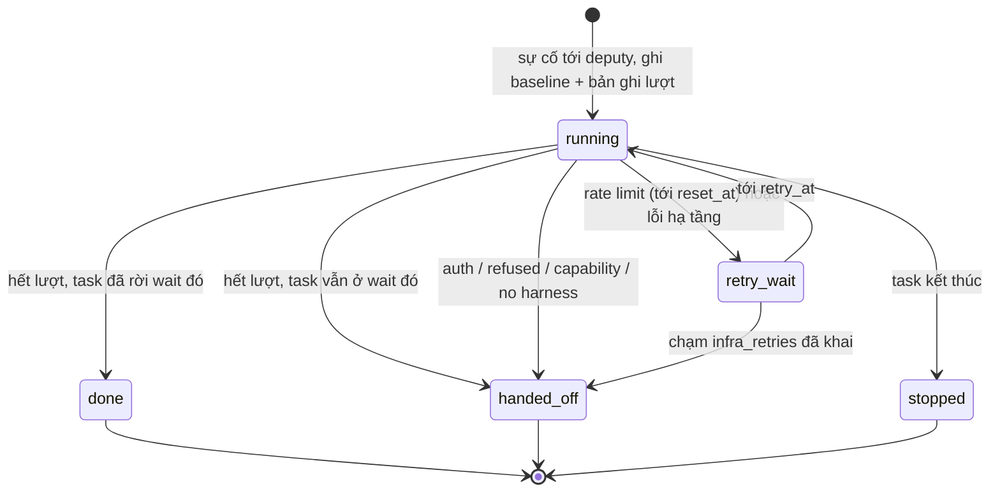

# Data Model: Deputy

## Bảng mới (migration `008_deputy.sql`)

Daemon là bên duy nhất ghi. Không bảng nào ở đây sinh event của task hay làm đổi `version` (FR-022).

### `deputy_sessions`

| Cột | Kiểu | Ghi chú |
| --- | --- | --- |
| `task_id` | TEXT PK | Một phiên mỗi task (FR-010) |
| `harness` | TEXT | Harness của lượt gần nhất |
| `session_ref` | TEXT NULL | Tham chiếu phiên của harness; NULL trước lượt đầu |
| `created_at` | INTEGER | |
| `closed_at` | INTEGER NULL | Đặt khi task kết thúc (FR-019) |

Đổi harness hoặc phiên mất: cập nhật `harness`, `session_ref` mới, và lượt đó có `seeded = 1` (FR-016).

### `deputy_turns`

| Cột | Kiểu | Ghi chú |
| --- | --- | --- |
| `turn_id` | TEXT PK | UUID; cũng là `CUSR_DEPUTY_TURN` và `turn_id` của lệnh |
| `task_id` | TEXT | FK `deputy_sessions` |
| `incident` | TEXT | Khóa `task:revision:code:enteredSeq` (FR-020) |
| `wait_code` | TEXT | |
| `attempt_id` | TEXT | ID attempt của runner cho lượt này |
| `mode` | TEXT | `interactive` \| `headless` |
| `seeded` | INTEGER | 1 khi mở phiên mới từ bản tóm tắt |
| `state` | TEXT | `running` \| `retry_wait` \| `done` \| `handed_off` \| `stopped` |
| `infra_failures` | INTEGER | Đếm cho trần tùy chọn (FR-024c) |
| `retry_at` | INTEGER NULL | Mốc chạy lại khi `retry_wait` |
| `final_message` | TEXT NULL | Đã che secret; đưa vào ghi chú chuyển cho người (FR-021) |
| `handoff_reason` | TEXT NULL | `still_waiting`, `auth`, `refused`, `capability`, `no_harness`, `infra_cap` |
| `started_at`, `ended_at` | INTEGER | |

Ràng buộc: tối đa một lượt `running` hoặc `retry_wait` mỗi task (FR-018), bằng unique index một phần.

## Bảng sửa

- `command_ledger`: thêm `reason TEXT NULL`, `turn_id TEXT NULL` (R-07).
- Không đổi `events`. `AuthzContext` trong envelope mang thêm `reason?`, `turn_id?`, nên event của lệnh lưu chúng trong
  payload JSON hiện có.

## Thay đổi domain

| Kiểu | Thay đổi |
| --- | --- |
| `CallerActor` | thêm `deputy` (`read`, `operate`) |
| `RequesterKind` | thêm `deputy` |
| `DetailCode` | thêm `needs_draft` (PENDING) |
| `FailureDetail` | `effect_failed` có `failure?: 'boundary_violation'` có cấu trúc (FR-002) |
| `HarnessOutcome` | thêm `kind: 'turn_ended'` với `final_message: string \| null`, `session_ref` |
| `Role` | thêm `deputy`; bỏ `decider` khỏi role mới (giữ trong replay) |
| `CommandKind` | thêm `task_revise`, `task_fail` (`{ reason }`); `task_add` payload có `draft?: true`; `task_amend_policy` payload có `agent_runs_delta?`, `deadline?` |
| User config | `roles.deputy { binding, limits: { infra_retries?, wall_ms?, stall_ms? } }`; `roles.decider` đọc như alias |

## Vòng đời lượt

Mọi chuyển sang `done`, `handed_off`, `stopped` đều trả worktree về baseline trước (R-08).
