# Data Model: Deputy và goal

Daemon là bên duy nhất ghi. Bảng `deputy_turns` và `branch_conflicts` không sinh event và không làm đổi `version` của task
hay goal (FR-025). Goal là aggregate có event như task (R-21).

## Migration `NNN_deputy_goal.sql`

Lấy số kế tiếp còn trống trên `origin/main` lúc làm (hiện tới `007_slot_reservations.sql`).

### `events` (sửa)

| Cột | Thay đổi |
| --- | --- |
| `stream` | Mới, `TEXT NOT NULL DEFAULT 'task' CHECK (stream IN ('task','goal'))`. Event của goal có `task_id` = id của goal |

### `goals` (projection mới)

| Cột | Kiểu | Ghi chú |
| --- | --- | --- |
| `id` | TEXT PK | UUID |
| `project` | TEXT | |
| `status` | TEXT | `planning` \| `awaiting_confirm` \| `running` \| `amendment_pending` \| `replan` \| `done` \| `failed` \| `cancelled` |
| `implicit` | INTEGER | 1 cho goal ẩn của `task add` |
| `version` | INTEGER | Version của aggregate goal (expected version của lệnh goal) |
| `plan_version` | INTEGER | 0 khi chưa có kế hoạch |
| `plan_hash` | TEXT NULL | Hash của kế hoạch hiện hành |
| `confirmed_plan_version` | INTEGER NULL | Version đã được duyệt gần nhất |
| `branch` | TEXT NULL | Nhánh goal; NULL với goal một đơn vị |
| `final_task_id` | TEXT NULL | Task tổng |
| `state_json` | TEXT | `GoalState` đầy đủ |

### `goal_tasks` (chỉ mục mới)

| Cột | Kiểu | Ghi chú |
| --- | --- | --- |
| `goal_id` | TEXT | |
| `task_id` | TEXT | |
| `unit_key` | TEXT NULL | NULL với task tổng |
| `role` | TEXT | `unit` \| `final` |

PK `(goal_id, task_id)`. Một khóa đơn vị có thể có nhiều task (đơn vị FAILED được thay bằng task mới), nhưng tối đa một
task chưa kết thúc mỗi khóa (unique index một phần, điều kiện kiểm ở application vì trạng thái nằm ở `tasks`).

### `deputy_turns` (mới)

| Cột | Kiểu | Ghi chú |
| --- | --- | --- |
| `turn_id` | TEXT PK | UUID; cũng là `CUSR_DEPUTY_TURN` |
| `goal_id` | TEXT | |
| `task_id` | TEXT NULL | NULL với lượt `plan` |
| `kind` | TEXT | `incident` \| `question` \| `plan` |
| `incident` | TEXT NULL | Khóa `task:revision:code:enteredSeq` (FR-020); với `plan`: `goal:plan_version:reason` |
| `signature` | TEXT NULL | Chữ ký lỗi lúc mở lượt (R-18) |
| `harness` | TEXT | |
| `session_ref` | TEXT NULL | Phiên harness của lượt này; resume trong lượt (FR-011) |
| `attempt_id` | TEXT | Attempt của runner hiện tại |
| `mode` | TEXT | `interactive` \| `headless` |
| `state` | TEXT | `running` \| `retry_wait` \| `done` \| `handed_off` \| `aborted` \| `stopped` |
| `infra_failures` | INTEGER | Cho trần tùy chọn (FR-024c) |
| `retry_at` | INTEGER NULL | |
| `handoff_json` | TEXT NULL | `{ cause, decision, ruled_out[], next_look }` |
| `final_message` | TEXT NULL | Đã che secret |
| `handoff_reason` | TEXT NULL | `still_waiting`, `auth`, `refused`, `capability`, `no_harness`, `infra_cap`, `handover` |
| `context_bytes` | INTEGER | Kích thước vùng 2–5 lúc mở lượt (đo SC-010 trong smoke) |
| `started_at`, `ended_at` | INTEGER | |

Ràng buộc: tối đa một lượt `running`/`retry_wait` mỗi `task_id` (unique index một phần); tối đa một lượt `plan`
`running`/`retry_wait` mỗi `goal_id` (unique index một phần trên `goal_id` với `kind = 'plan'`).

### `branch_conflicts` (mới)

| Cột | Kiểu | Ghi chú |
| --- | --- | --- |
| `task_id` | TEXT | Task vừa checkpoint |
| `other_task_id` | TEXT | |
| `head`, `other_head` | TEXT | Hai head đã so |
| `files_json` | TEXT | File xung đột theo `git merge-tree` |
| `checked_at` | INTEGER | |

PK `(task_id, other_task_id)`; dòng được thay ở mỗi checkpoint, xóa khi một trong hai task kết thúc.

### `command_ledger` (sửa)

Thêm `reason TEXT NULL`, `turn_id TEXT NULL`, `trial_json TEXT NULL` (`{ hypothesis, expect, action_kind, params_hash,
signature, goal_id, unit_key }`, chỉ có với lệnh gia hạn của deputy; `task fail` của deputy lúc mọi hành động đã cạn giữ `{ exhausted_signature }`; bảng thử khóa theo `(goal_id, unit_key, signature)`), `lease TEXT NULL` (lease đã kiểm cho lệnh goal của trợ lý).

## Thay đổi domain

| Kiểu | Thay đổi |
| --- | --- |
| `CallerActor` | thêm `deputy` (`read`, `operate`) |
| `RequesterKind` | thêm `deputy` |
| `TaskInput` | thêm `goal: { id, unit_key \| null, role: 'unit' \| 'final', depends_on_units: string[] } \| null` (đóng băng ở intake; phụ thuộc theo khóa, R-29) |
| `DetailCode` | thêm `plan_amendment` (tới owner); bỏ `needs_draft` của bản trước |
| `FailureDetail` | `effect_failed` có `failure?: 'boundary_violation'` |
| `ReviewEvidence.findings[]` | thêm `key: string` (R-18) |
| `HarnessOutcome` | thêm `kind: 'turn_ended'` với `final_message`, `session_ref`, `usage` |
| `Role` | thêm `deputy`; `decider` chỉ còn cho replay |
| `CommandKind` | thêm `task_fail`, `task_waive`, `goal_add`, `goal_revise`, `goal_note`, `goal_propose`, `goal_amend`, `goal_confirm`, `goal_cancel`, `deputy_handoff`; `task_amend_policy` payload có `agent_runs_delta?`, `deadline?` |
| Event của task | thêm `Waived` (phạm vi: khóa finding và chữ ký review; chữ ký gate; hay head SHA, tên và nguồn của check), `ReviewWaived`; `GateResult` có `waived?: true` |
| Effect | thêm `git.create_goal_branch`, `github.update_pr_body` (sau `Waived` khi đã có PR) |
| Event của goal | `GoalAdded`, `GoalRevised`, `GoalNoted`, `PlanProposed`, `PlanConfirmed`, `PlanAmended` (thực thi), `PlanAmendmentProposed` (phạm vi), `GoalBranchCreated`, `GoalReplanNeeded`, `GoalCompleted`, `GoalFailed`, `GoalCancelled` |
| Approval | `by: 'policy:goal'` cho merge vào nhánh goal |
| Workflow | `goal_final` (R-24) |
| User config | `roles.deputy { binding, limits: { infra_retries?, wall_ms?, stall_ms?, context_bytes? } }`; `roles.decider` đọc như alias |

`GoalState`: `request` (nguyên văn, đã che secret), `hints`, `plan` (hiện hành) và `plans` (mọi version: hash, actor, lý
do), `pending_amendment`, `notes` (actor, loại suy ra, văn bản), `branch`, `units` (khóa → task id hiện tại và các task cũ),
`final_task_id`, `replan_reason`.

## Vòng đời lượt

```mermaid
stateDiagram-v2
    [*] --> running: sự cố hay plan tới deputy; ghi baseline + bản ghi lượt
    running --> done: hết lượt, sự cố đã rời wait (hoặc plan đã gửi)
    running --> handed_off: hết lượt, task vẫn ở sự cố; hoặc auth / refused / capability / no harness / handover
    running --> aborted: hết lượt không có bàn giao (kết hợp với done hay handed_off ở trường handoff_reason)
    running --> retry_wait: rate limit hoặc lỗi hạ tầng
    retry_wait --> running: tới retry_at, resume cùng session_ref
    retry_wait --> handed_off: chạm infra_retries đã khai
    running --> stopped: task hay goal kết thúc
    done --> [*]
    handed_off --> [*]
    aborted --> [*]
    stopped --> [*]
```

`aborted` ghi khi lượt không có bàn giao; nếu sự cố vẫn mở thì sự cố vẫn được chuyển cho người như `handed_off`
(`handoff_reason = still_waiting`). Mọi chuyển sang trạng thái cuối đều trả worktree về baseline trước (R-08). Sau trạng
thái cuối, daemon chạy loop guard (R-19).

## Vòng đời goal

```mermaid
stateDiagram-v2
    [*] --> planning: goal add
    [*] --> running: task add (goal ẩn)
    planning --> awaiting_confirm: goal propose hợp lệ
    awaiting_confirm --> planning: goal revise
    awaiting_confirm --> awaiting_confirm: goal propose mới (version + 1)
    awaiting_confirm --> running: goal confirm đúng hash
    running --> running: goal amend loại thực thi
    running --> amendment_pending: goal amend loại phạm vi
    amendment_pending --> running: goal confirm bản sửa
    running --> replan: đơn vị FAILED; goal revise
    replan --> running: sửa thực thi
    replan --> amendment_pending: sửa phạm vi
    running --> done: task tổng (hay đơn vị duy nhất) DONE
    running --> failed: task tổng FAILED; task của goal ẩn FAILED
    replan --> cancelled: goal cancel (sau handover)
    running --> cancelled: goal cancel
    planning --> cancelled: goal cancel
    done --> [*]
    failed --> [*]
    cancelled --> [*]
```

