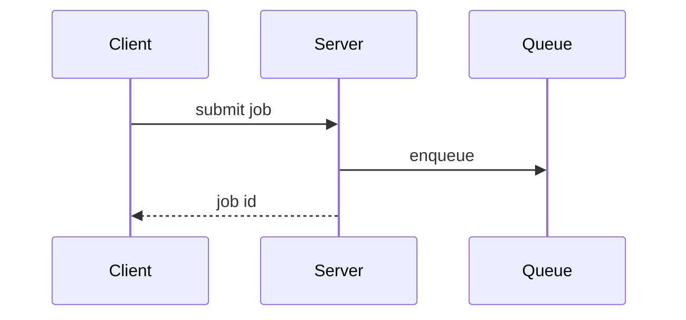
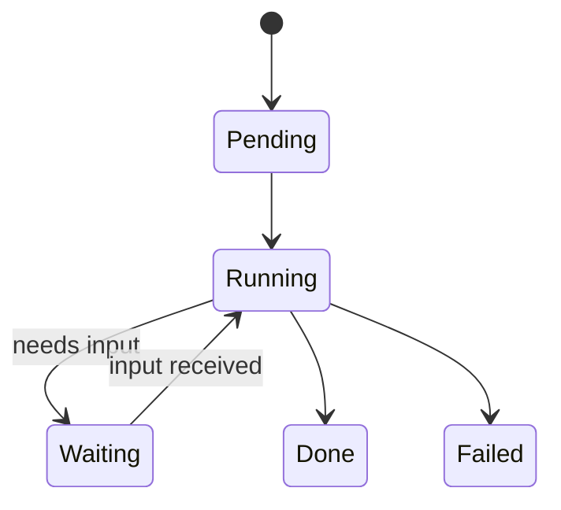

# Writing a PR description

Use the PR template the caller provides. A cusr worker gets the template frozen with its task in its
prompt: use that one as given, even when the task changes a template in the working tree. Look for
the repository's template only when no caller provides one: the file `pr_template` names in
`cusr.yaml`, else the repo's `pull_request_template.md`. This skill covers how to fill the template in
well, not which headings it has.

## Principles

- **Write a specific title.** Name the problem solved or the outcome, not the activity: "Keep the
  cursor visible after a signal", not "Update select code". Follow the repo's title conventions, such
  as a commit-type prefix.
- **Lead with why.** State the problem or need in one to three sentences before describing the change.
- **Describe behaviour, not files.** Say what a user or the system now does differently. The diff
  already lists the files.
- **Show evidence.** Give a concrete before and after: a test that failed and now passes, command
  output, a screenshot. Do not restate the gates and CI checks; they are recorded elsewhere. Say what
  was not verified.
- **State the merge risk.** Ask what a revert would not undo once the change has run: data already
  written in a new format, clients or scripts that already depend on new behaviour, messages already
  sent, data deleted. Nothing means a two-way door. Anything means a one-way door: say exactly where
  rollback stops, and how to go through safely. A changed schema or CLI is not one-way by itself; it
  is when something has come to rely on it. Name the blast radius in a short phrase: what breaks if
  the PR is wrong.
- **Be brief.** Skip preambles. Use the project's own vocabulary, including its glossary if it has one.
- **Keep it accurate.** When later commits change the scope, update the title and description too.

## Sketching structural changes

A diff is ordered by file. It does not show execution order or where new code sits in a flow. A
sketch of a few lines gives the reviewer that picture before they read the diff.

Add a sketch only when the PR changes structure: control flow, call order, state transitions, module
layout, or how components communicate. Skip it for wording, styling, configuration values, or a
small local fix.

### Choosing a form

Use the smallest form that makes the point. One is usually enough; more than two is rarely needed.
Place the sketch next to the sentence it supports, and keep only the functions, files, states, and
boundaries that point needs. Use the names from the code.

| To show | Use |
| --- | --- |
| Logic, conditions, an algorithm | Pseudocode |
| Call order at runtime | Call tree |
| What each directory or module owns | File tree |
| How components exchange messages | Mermaid `sequenceDiagram` |
| States and transitions | Mermaid `stateDiagram-v2` |
| What changes, when the shape already exists | A `diff` of one of the above |

### Pseudocode

```text
on save
  if content is unchanged
    return cached result
  write new content
  return fresh result
```

### Call tree

```text
handleRequest
  authenticate
  loadOrder
    readCache
    readDatabase       # on cache miss
  renderResponse
```

### File tree

```text
src/
├── cli/        # parses commands
├── service/    # owns business rules
└── storage/    # reads and writes records
```

### Mermaid





### Diff of a sketch

Use a diff when the shape already exists and the point is what changes. Match the diff to the form.

```diff
 handleRequest
   authenticate
+  checkRateLimit
   loadOrder
   renderResponse
+    recordMetrics
```

```diff
 src/
 ├── cli/
 ├── service/
-└── storage.ts
+└── storage/
+    ├── reader.ts
+    └── writer.ts
```

```diff
 on save
-  write content
+  if content is unchanged
+    return cached result
+  write new content
```

### Showing code in full

Show the full block instead of a sketch when most of it is new, when trimming it would hide ordering
or ownership, or when the reviewer needs the exact shape, such as a new type, schema, or public
signature.

## Credits

Installed by `cusr init`. Adapted from Matt Pocock's `pr` skill, whose catalogue of sketches comes
from Dex Horthy's `show-me` skill (HumanLayer).
